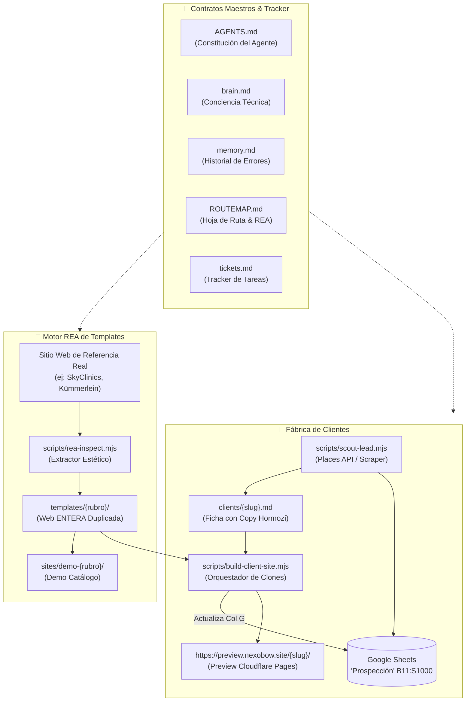
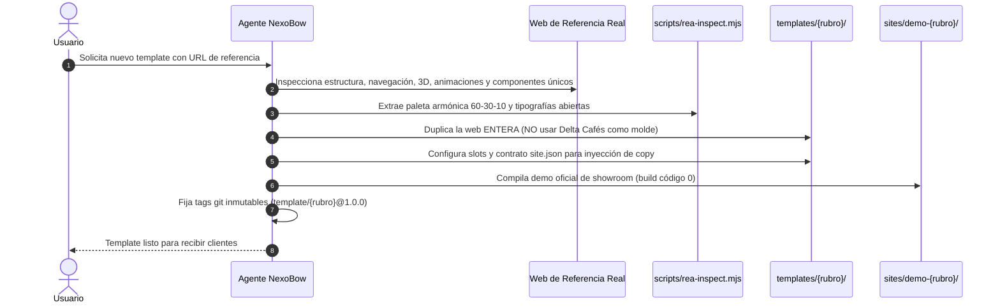

# ⚡ NexoBow — System Constitution (AGENTS.md)

## 📌 Misión y Arquitectura Core
Repositorio central de **NexoBow**: fábrica automatizada de embudos de venta y agendamiento para profesionales de servicios (nutricionistas, psicólogos, abogados, clínicas). Transformamos tráfico de WhatsApp, Instagram y Maps en consultorías agendadas mediante landings estáticas de carga instantánea (`<0.8s`).
- **Stack:** Astro + Tailwind CSS (`web/` mantiene SSG estricto con 0 JS ejecutable en cliente como benchmark de agencia; `/templates/` y `/sites/` son webs de alta gama **SIN límite artificial de JavaScript**: animaciones fluidas, micro-interacciones, componentes dinámicos y librerías 3D están 100% permitidos, rigiendo únicamente las restricciones de infraestructura de Cloudflare Pages [25 MB por activo]).
- **Arquetipos Visuales Desacoplados:** Los layouts no se atan al rubro sino a arquetipos de marca (`editorial-classic`, `obsidian-authority`, `minimalist-pure`, `kinetic-cards`) con retrocompatibilidad transparente (`rubro` → `arquetipo`).
- **Theme Switcher Anti-Rebote:** Previews con píldora flotante para alternar paletas en tiempo real, persistencia en `localStorage` y botón de WhatsApp precargado para pedir la versión favorita.
- **Integraciones:** Calendly / Google Calendar, Google Sheets (`'Prospección NexoBow'!B11:S1000`, Col B = ID, Col G = `Web Demo URL` vía `LeadStore`), Alianza Audiovisual con [**AfterBow**](https://www.afterbow.com).
- **Contratos del Sistema:** Leé `/brain.md` (conciencia técnica), `/memory.md` (estado del proyecto y errores documentados) y `/spec.md` (contrato maestro) **antes** de planificar o tocar código. Para términos de negocio, consultá `/GLOSSARY.md`. **IMPORTANTE:** `web/` = página de NexoBow (paleta **Soft-Obsidian**: `#040607`, `#0B0D12`, `#5B2A62`, `#4928C2`, `#BF40FA`, `#E3D9FC`), `/templates/` + `/sites/` = landings de prestadores (+10 direcciones estéticas exclusivas por REA). Identidades visuales TOTALMENTE distintas (ver `memory.md` → `ERROR-001`).

## 💻 Comandos de Ejecución y Verificación
- **Suite de Tests Completa:** `npm test` (`node --test tests/*.test.mjs`)
- **Build & Typecheck (`web/` o `/sites/{slug}`):** `npm run build` (Obligatorio ejecutar al finalizar cambios para verificar 0 errores de compilación y 0 `<script>` en `web/`).
- **Ciclo de Vida 7 Días & Mejora Continua:** `npm run lead-lifecycle` y `npm run continuous-improvement`.
- **GitHub:** Utilizar git y pushear todo a producción (menos cuando se indique lo contrario).

## 📐 Convenciones e Idioma
- **Código y Arquitectura:** Nombres de archivos, componentes, variables y commits en **inglés**.
- **Templates vs Demos vs Previews (Definición Core):**
  - **Template (`/templates/{id}/`):** Es una **web ENTERA** duplicada mediante REA a partir de un sitio de referencia real (estilo, estructura visual, navegación, animaciones, componentes únicos, objetos gráficos y 3D). Cada template tiene su propia arquitectura de componentes y diseño espacial; NO comparte la estructura de Delta Cafés ni de ningún otro template.
  - **Copywriting:** Es el texto estratégico (dolores Hormozi, bio, oferta, garantía, testimonios) redactado por la IA / skill para el cliente final, inyectado en los slots del template.
  - **Demo (`/sites/demo-{id}/`):** Compilación de muestra de un template para showroom/catálogo.
  - **Preview (`https://preview.nexobow.site/{slug}/`):** Landing compilada personalizada para un prospecto específico a partir de su ficha en `/clients/`.
  - **Delta Cafés:** Es única y exclusivamente la web de referencia de `templates/nutricionista/`. Prohibido usarla como molde o referencia para otros templates.
- **Copywriting y UI:** Todo texto visible para el usuario final en **español argentino** (voseo profesional).
- **Moneda y Precios Psicológicos:** Todo valor monetario debe expresarse en Pesos Argentinos con formato explícito (ej: `$189.999 ARS` Setup / `$12.259 ARS finales/mes`).
- **Correlatividad Google Sheets ↔ Fichas:** El ID de cada prospecto comienza en la **Columna B** (`B11:S1000`) de Google Sheets y mapea 1 a 1 al archivo `/clients/{id}-{nombre}-{apellido}-{rubro}.md` (ej: `22-alejandra-martinez-nutri.md`).
- **Política de Servidor Activo (TTL 7 Días):** Las demos de prospectos tienen una vigencia de 7 días desde su última actividad (`last_activity_at`). Si avanzan de estado en Google Sheets se renuevan por +7 días; en días 5–6 disparan alerta de seguimiento con urgencia; a los `>=7` días o estado `"Descartado"` se purgan automáticamente (protegiendo siempre `_ficha-template.md` y `demo-*`).

---

## 🗺️ Mapa de Correlación de Archivos para la IA

Este mapa describe la relación exacta de cada directorio y archivo para que ningún agente se desoriente al navegar el repositorio:



### Tabla de Responsabilidades por Directorio
| Ruta / Archivo | Rol en el Sistema | ¿Quién lo edita? |
| :--- | :--- | :--- |
| `AGENTS.md` | Constitución operativa y reglas de comportamiento del agente. | Agente / Usuario |
| `brain.md` | Arquitectura técnica, decisiones de diseño e integraciones. | Agente |
| `memory.md` | Registro persistente de errores (`ERROR-001` a `005`) y estado actual. | Agente |
| `ROUTEMAP.md` | Estrategia de negocio, catálogo de +13 templates REA y agentes futuros. | Agente / Usuario |
| `tickets.md` | Índice navegable de tickets de implementación. | Agente / Usuario |
| `scripts/*.mjs` | Motores ejecutables del pipeline (scout, fiche, build, sync, lifecycle). | Agente |
| `clients/*.md` | **Fuente de verdad** del cliente (metadatos + copy personalizado). | Agente / Skills |
| `templates/{rubro}/` | Proyectos Astro maestros (webs completas duplicadas vía REA). | Agente (vía REA) |
| `sites/{slug}/` | Clones compilables efímeros para clientes o demos de catálogo. | Generado por script |
| `tests/*.test.mjs` | Suites de pruebas unitarias y de integración end-to-end. | Agente |
| `web/` | Web flagship institucional de NexoBow (0 JS estricto, Soft-Obsidian). | Agente / Usuario |

---

## 🔄 Diagramas de Flujo Operativo

### Diagrama 1: Creación de un Nuevo Template mediante REA


### Diagrama 2: Árbol de Decisión del Agente (Anti-Confusión Guardrail)
```mermaid
flowchart TD
    Inicio([Inicio de Solicitud]) --> PreguntaTipo{¿Qué tarea se solicitó?}

    PreguntaTipo -->|Crear o adaptar un Template| EsTemplate[Misión: Duplicar Web ENTERA]
    EsTemplate --> CheckDelta{¿Es el template nutricionista?}
    CheckDelta -->|Sí| UsaDelta[Usa deltacafes.com como referente]
    CheckDelta -->|No| NoDelta[OLVIDARSE de Delta Cafés.<br/>Duplicar el referente específico del ticket]
    NoDelta --> ConstruyeTemplate[Crear componentes y layout únicos de la web real]

    PreguntaTipo -->|Crear sitio para un Cliente| EsCliente[Misión: Copywriting + Inyección]
    EsCliente --> RedactaCopy[Escribir dolores Hormozi y bio en clients/{slug}.md]
    RedactaCopy --> ClonaTemplate[build-client-site clona el template correspondiente]
    ClonaTemplate --> InyectaJson[Inyecta copy en site.json sin tocar componentes]

    PreguntaTipo -->|Demo de Catálogo| EsDemo[Compilar sites/demo-{rubro}/ como muestra]
    PreguntaTipo -->|Preview de Prospecto| EsPreview[Servir landing real en preview.nexobow.site]
```

---

## 🛡️ Reglas Operativas del Agente (System Rules)
1. **Spec-Driven (No Vibe Coding):** Prohibido inventar dependencias, asumir datos faltantes o escribir código sin contexto. Respetá estrictamente la arquitectura propia de cada template REA.
2. **Gate de Planificación (Ask-First):** Si la ficha en `/clients/` tiene datos ambiguos o incompletos, **frená y preguntale al usuario** antes de generar o modificar un sitio.
3. **Conservación de Tokens y Edición:** Para cambios grandes en un archivo, usá una única operación de escritura completa en vez de múltiples ediciones secuenciales. No leas carpetas de `/sites/` ajenas al cliente actual.
4. **Orquestación y Sub-agentes:** Si una tarea requiere analizar +3 archivos o hacer auditoría de calidad, delegá en un sub-agente con ventana de contexto limpia.
5. **Sin Límite Artificial de JS en Templates:** En `/templates/` y `/sites/` no existe restricción de 35 KB. Solo aplican las restricciones de infraestructura de Cloudflare Pages (25 MB por archivo) o de APIs externas.

## 📂 Mapa de Directorios y Límites (Boundaries)
- `/brain.md` -> **[LECTURA/ESCRITURA]** Cerebro de ejecución. Leelo al iniciar sesión; actualizalo al cerrar una tarea.
- `/memory.md` -> **[LECTURA/ESCRITURA]** Estado del proyecto + errores documentados (`ERROR-001` a `ERROR-005`). Leelo al iniciar sesión; actualizalo al cerrar una tarea.
- `/web/` -> **[SOLO LECTURA POR DEFECTO]** Página propia de la agencia NexoBow (Estándar Soft-Obsidian, 12 secciones). No copiar componentes a `/templates/` sin rediseño.
- `/clients/{id}-{nombre}-{apellido}-{rubro}.md` -> **[FUENTE DE VERDAD]** Ficha correlativa del prestador (YAML frontmatter con `sheet_id`, `lead_status`, `created_at`, `last_activity_at`, `expires_at` + Markdown). Plantilla base en `/clients/_ficha-template.md`.
- `/templates/{rubro}/` -> **[SOLO LECTURA POR DEFECTO]** Proyectos Astro maestros independientes por referencia REA (cada uno con sus propios componentes, estructura, animaciones y diseño). **Prohibido editar** salvo instrucción explícita.
- `/sites/{id}-{nombre}-{apellido}-{rubro}/` -> **[GENERADO / EFÍMERO]** Clon compilable del cliente. **Nunca se edita a mano**: se edita la ficha en `/clients/` y se regenera mediante skill (`edit-client-site` / `build-client-site`).
- `/assets/{id}-{nombre}-{apellido}-{rubro}/` -> **[LECTURA]** Recursos gráficos optimizados del prestador.
- `/.agents/skills/` -> **[PULL CONTEXT]** SOPs modulares ejecutables bajo demanda.

## 🛠️ Enrutamiento de Skills (Pull Workflows)
*No cargues estas instrucciones en memoria hasta que el usuario solicite la tarea. Cuando ocurra, leé el `SKILL.md` correspondiente en `/.agents/skills/`:*
- **`standard`**: **[GATE OBLIGATORIO DE CALIDAD VISUAL & 3D]** Define el estándar **Soft-Obsidian** (`#040607`, `#5B2A62`, `#4928C2`, `#BF40FA`, `#E3D9FC`) para `web/`: logo Outfit Bold (`Nexo` en `#F8F6FF` y `Bow` en `#BF40FA`), escena 3D CSS del embudo, interactividad 0-JS y respeto a `prefers-reduced-motion`.
- **`scout-lead`**: Prospección in-conversation con Google Maps Platform / Serper Dev, filtrado de profesionales sin sitio web propio, deduplicación contra Google Sheets (`'Prospección NexoBow'!B11:S1000`) e inserción desde Columna B con slug correlativo `{id}-{nombre}-{apellido}-{rubro}`.
- **`generate-client-fiche`**: Genera `/clients/{slug}.md` con copywriting en voseo argentino, dolores Hormozi, metadatos TTL de 7 días (`sheet_id`, `expires_at`), fallback a WhatsApp y cumplimiento Ley 25.326.
- **`build-client-site`**: Clona `/templates/{rubro}/` hacia `/sites/` verificando tag git `template/{rubro}@x.y.z`, inyecta assets locales y el contenido/tema de `/clients/{slug}.md`, verifica el build y registra `https://preview.nexobow.site/{slug}/` en Columna G vía `LeadStore`.
- **`edit-client-site`** (`/editar-web-cliente`): Modifica en 1 comando la ficha de un cliente en `/clients/`, recompila con `build-client-site` y audita con `audit-code`.
- **`lead-lifecycle`** (`/seguimiento-leads`): Sincroniza estados con Google Sheets, renueva leads activos (+7d), genera alertas de urgencia en días 5–6 (<48hs) y purga demos vencidas (`>=7d` o `"Descartado"`), además de correr el motor de Mejora Continua (`continuous-improvement.mjs`).
- **`flow-advisor`** (`/next-step` / `/ask-matt`): Unifica el flujo SDD de Matt Pocock (`prompts_structure.md`), `audit-code` y las métricas de Google Sheets para recomendar el siguiente paso exacto.
- **`audit-code`**: Ejecutar **siempre en un sub-agente con sesión limpia** tras construir o actualizar un sitio. Audita performance en Astro, accesibilidad, contraste de CTAs y 0 JS estricto en `web/`.
- **`deploy-cloudflare`**: Publica el sitio en Cloudflare Pages usando Wrangler CLI bajo el dominio unificado `https://preview.nexobow.site/{slug}/`.
- **`lead-to-live`**: Orquestador maestro end-to-end: ejecuta `scout-lead` → `generate-client-fiche` → `build-client-site` → `audit-code` → `deploy-cloudflare`.
- **`rea-template`**: Motor de Ingeniería Inversa de Templates (REA): toma una URL de referencia y un rubro, extrae la identidad visual (paleta 60-30-10, fuentes, layout), andamia el nuevo template Astro inmutable en `/templates/{rubro}/` con contrato `site.json` desacoplado, compila la demo en `/sites/demo-{rubro}/` y genera el tag git `template/{rubro}@1.0.0`.

## 🔄 Ciclo de Desarrollo Agéntico & Tracking de Estado (Main Flow)
Para cualquier tarea de diseño, refactor o feature en el repo, el agente debe seguir obligatoriamente las fases definidas en [`/prompts_structure.md`](file:///home/juanmamerodio/Desktop/NexoBow/prompts_structure.md) e identificar explícitamente en qué etapa se encuentra:
1. **Fase 1: `/grill-me` (Alineación)** — Ronda estructurada de preguntas con opciones recomendadas. Prohibido saltar a código.
2. **Fase 2: `/to-spec` (Especificación)** — Colapsar respuestas en criterios de aceptación y arquitectura de componentes.
3. **Fase 3: `/to-tickets` (Descomposición)** — Dividir el spec en tajadas verticales atómicas con dependencias claras.
4. **Fase 4: `/implement` (TDD & Build)** — Construcción componente por componente con verificación `npm run build`.
5. **Fase 5: `/code-review` o `/audit-code` (Auditoría)** — Revisión de estándares (0 JS en `web/`, a11y, identidad) y fidelidad al spec.
*El agente debe declarar en su respuesta la fase activa actual (ej: `[FASE ACTUAL: 4. IMPLEMENT]`) y guiar al usuario hacia el siguiente prompt de forma automática.*

## 🧠 Aprendizaje Aplicado (Self-Evolving Log)
- NexoBow ≠ prestador: `web/` (Soft-Obsidian) y `templates/` (estilos por rubro REA) tienen identidades visuales independientes (`ERROR-001`).
- No asumir el estilo de un template sin dirección estética previa del usuario (gate Ask-First de diseño).
- Identificar siempre la fase activa del Main Flow según `/prompts_structure.md` antes de actuar.
- En Google Sheets (`Prospección NexoBow`), el ID (`Nº`) comienza en la **Columna B** (`B11:S1000`), nunca en la Columna A.
- Mantener correlatividad 1:1 entre Google Sheets y fichas locales: `{id}-{nombre}-{apellido}-{rubro}.md` con expiración automática a los 7 días de inactividad.
- **Template ≠ Demo ≠ Preview ≠ Copywriting**: El template es la web entera del referente internacional; el copy es lo que la IA redacta para el cliente (`ERROR-005`).
