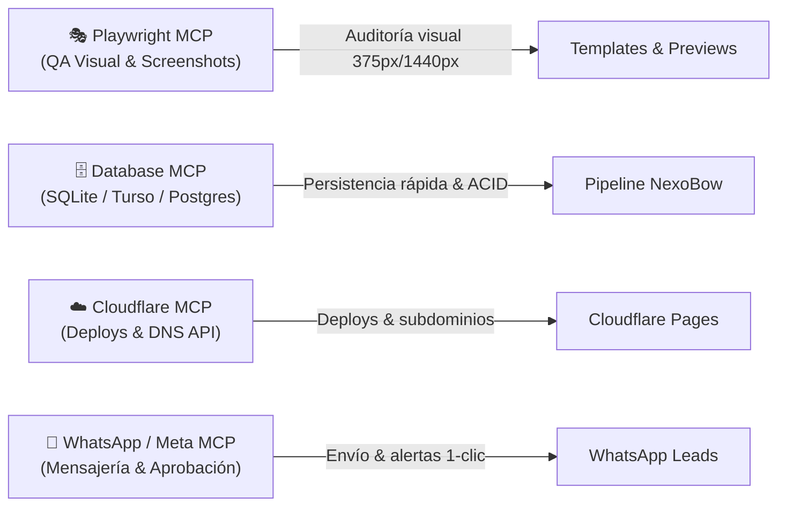
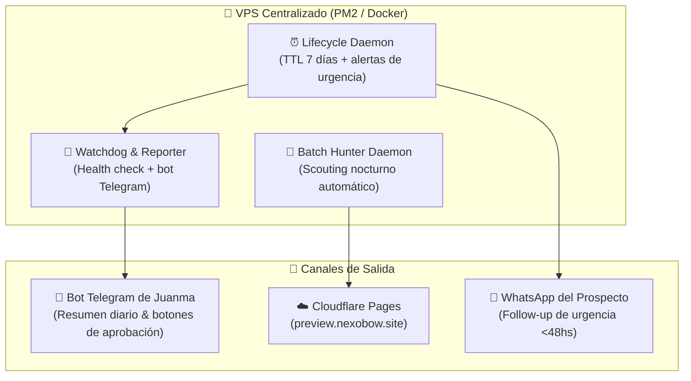

# 🗺️ NexoBow System — Master RouteMap & Roadmap Estratégico

> **Misión Core**: Transformar tráfico y prospectos fríos de servicios profesionales (nutricionistas, psicólogos, abogados, médicos, clínicas) en consultorías agendadas de alta conversión mediante sistemas "Bow" (landings estáticas ultra-rápidas `<0.8s`, copywriting de alivio Hormozi, agendamiento fluido) y automatizar el 100% del ciclo operativo, legal y comercial con agentes de software autónomos ejecutados a costo marginal cero.
>
> **Visión**: Convertir a NexoBow en una fábrica autónoma B2B 24/7 centralizada en un VPS, capaz de prospectar, crear demos personalizadas en vivo, permitir customización en tiempo real al lead, redactar contratos, perseguir cobranzas, optimizar pauta y auditar sistemas con intervención humana únicamente en la toma de decisiones estratégicas.

---

## 🎯 Caso de Uso Principal (The Golden Flow)

**El escenario operativo diario:**
1. **Entrada de voz o texto del usuario:** *"Che, quiero que me busques 5 nutricionistas en la zona de Belgrano/Palermo"*.
2. **Scouting & Filtrado:** El sistema consulta Google Maps / Serper Dev, extrae datos reales (nombre, rating, reseñas, fotos, teléfono, WhatsApp) y descarta automáticamente a quienes ya tienen web corporativa.
3. **Correlatividad e Inserción:** Comprueba duplicados contra Google Sheets (`'Prospección NexoBow'!B11:S1000`). Asigna el siguiente ID correlativo atómico en **Columna B**.
4. **Ficha & Copywriting Hormozi:** Genera `/clients/{id}-{nombre}-{apellido}-{rubro}.md` con dolores específicos del rubro, fallback a WhatsApp y cumplimiento Ley 25.326.
5. **Preselección Inteligente de Arquetipo Visual:** La IA no ata el template al rubro. Analiza el tono, formalidad y arquetipo de marca para asignar el mejor motor de layout (`editorial-classic`, `obsidian-authority`, `architectural-prestige`, `kinetic-cards`) junto con una paleta contextual 60-30-10 y tipografías.
6. **Compilación con Theme Switcher Interactivo:** Compila un clon Astro SSG a `dist-previews/{slug}/` (servido en `https://preview.nexobow.site/{slug}/`) incluyendo una píldora flotante para que el prospecto pruebe 3-4 paletas en vivo y confirme su preferida por WhatsApp.
7. **Publicación y Cierre en Google Sheets:** Actualiza la **Columna G (`Web Demo URL`)** y calcula el mensaje de WhatsApp de prospección listo para enviar.
8. **Motor TTL 7 Días:** Si el prospecto avanza, se renueva +7 días; si llega a días 5–6 se envía alerta de urgencia; a los 7 días o si es descartado, se purga el clon automáticamente protegiendo el almacenamiento.

---

## 🏗️ Catálogo de Templates REA: Duplicación Completa por Referente Internacional

> **Principio Innegociable de Templates:**
> - **Template (`/templates/{id}/`):** Es una **web ENTERA** duplicada e inspirada en un sitio de referencia real mediante REA (estilo, geometría espacial, navegación, animaciones, componentes únicos, objetos y 3D). Cada template es un desarrollo autónomo con su propia estructura; **NO comparte los componentes ni el layout de Delta Cafés**.
> - **Regla Mandatoria de Tipografía (Misma Fuente o Fallback Similar):** Las fuentes tipográficas deben ser **las mismas que utiliza la web a copiar** (extraídas e incorporadas desde los assets originales/webfonts del referente). Solo si una fuente original no pudiera utilizarse directamente (licencia comercial cerrada o inaccesible), se debe buscar y utilizar una **fuente similar / equivalente de máxima proximidad visual y anatómica**.
> - **Copywriting:** El texto (dolores Hormozi, bio, servicios, testimonios, FAQs) es lo que la IA/skill redacta para el cliente y se inyecta en el template. El template provee la infraestructura visual y espacial completa.
> - **Demo (`/sites/demo-{id}/`):** Compilación de exhibición para el catálogo.
> - **Preview (`https://preview.nexobow.site/{slug}/`):** Landing generada y personalizada para un prospecto real.
> - **Delta Cafés:** Es única y exclusivamente la web de referencia de `templates/nutricionista/`. No es el estándar ni la base estructural de los demás templates.

**Estado Actual del Catálogo:**
- ✅ **`templates/nutricionista/`** (`editorial-classic`, v1.0.0): Referente **Delta Cafés** (`deltacafes.com`). Estética editorial cálida, Fraunces + Archivo, números ordinales y ritmo pausado.
- ✅ **`templates/abogado/`** (`obsidian-authority`, Ticket 20): Referente **Kümmerlein Rechtsanwälte** (`https://www.kuemmerlein.de/`). Estilo ejecutivo brutalista, recortes SVG, ABC Monument Grotesk + Rhymes Display (fallback Space Grotesk + Instrument Serif), botón rectangular con dot expansivo.
- ✅ **`templates/clinica/`** (`architectural-prestige`, Ticket 21): Referente **SkyClinics** (`https://skyclinics.al/`). Prestigio médico quirúrgico, composición asimétrica mineral piedra (`#e8e7e5`), Deep Forest Teal (`#003934`), Menta quirúrgico (`#1a9e8f`), Plus Jakarta Sans + Inter, tarjetas clínicas y micro-interacciones.
- ⏳ **`templates/corporativo/`** (`high-ticket-consulting`, Ticket 22): Referente **Vetter Consulting** (`https://vetter-consulting-en.webflow.io/`). Cuadrícula táctica estilo ajedrez, Onyx + Tactical Orange, Neue Montreal.
- ⏳ **`templates/tech/`** (`tech-editorial-system`, Ticket 23): Referente **Think Company** (`https://www.thinkcompany.com/`). Editorial tech moderno, Canvas Vanilla + Think Red, Bagoss + ABC Diatype + Space Mono.
- ⏳ **`templates/deportes/`** (`kinetic-performance`, Ticket 24): Referente **The Performance Lab** (`https://theperformancelab.ca/`). Carbon Dark + Kinetic Emerald.
- ⏳ **`templates/dermatologia/`** (`clinical-pure`, Ticket 25): Referente **Lipedema Guru** (`https://lipedemaguru.com/`). Espacio negativo clínico y acentos cian/turquesa.
- ⏳ **`templates/propiedades/`** (`architectural-spaces`, Ticket 26): Referente **Lufte** (`https://www.lufte.us/`). Outfit + Manrope, bronce oak y galerías arquitectónicas.
- ⏳ **`templates/producto/`** (`minimalist-hardware`, Ticket 27): Referente **Heavn One** (`https://heavn-lights.com/`). Deep Matte Black, precisión óptica e ingeniería de producto.
- ⏳ **`templates/construccion/`** (`industrial-authority`, Ticket 28): Referente **Reliable Paving** (`https://reliablepaving.com/`). Asphalt Dark + Safety Amber, métricas de obra pesada.
- ⏳ **`templates/farmaceutica/`** (`biotech-clarity`, Ticket 29): Referente **Roveia** (`https://roveia.com/`). Pure White + Deep Molecule Navy y formulaciones científicas.
- ⏳ **`templates/profesional/`** (`island-creative-pure`, Ticket 30): Referente **Tahiti Numérique** (`https://tahitinumerique.com/`). Instrument Sans + Serif, Pacific Cyan + Lagoon Dark.
- ⏳ **`templates/turismo/`** (`oceanic-luxury`, Ticket 31): Referente **Bluemore Yachting** (`https://bluemoreyachting.com/`). Midnight Navy + Azure Wave y tipografía de alta costura.
- ⏳ **`templates/musica/`** (`harmonic-academy`, Ticket 32): Referente **Ethos Music Academy** (`https://ethosmusicacademy.com/`). Acoustic Stage Dark + Vibrant Tone Crimson.

---

## 🎨 Theme Switcher en Previews (Retención Anti-Rebote) [COMPLETADO / ACTIVO]

Para evitar que un lead descarte la propuesta porque *"no le gustaron los colores"*, todas las previews en `https://preview.nexobow.site/{slug}/` incluyen el componente `ThemeSwitcher.astro`:
1. **Píldora Flotante Discreta (Bottom-Right)**: Permite alternar con un clic entre 4 paletas precalibradas (*Original/Principal*, *Obsidian Gold*, *Clinical Cyan*, *Warm Terracotta*).
2. **Reactividad Instantánea vía CSS Custom Properties**: Modifica `--color-primary`, `--color-accent`, `--color-paper`, `--color-ink` en el `:root` sin recargar la página (< 2 KB, JS nativo vanilla).
3. **Persistencia en LocalStorage**: Si el cliente vuelve a entrar al enlace días después, recuerda la paleta elegida bajo la clave `nexobow_theme`.
4. **Captura y Cierre por WhatsApp**: Incluye el botón *"Pedir esta versión"* que abre un chat directo con el mensaje precargado.

---

## 🔬 Diagnóstico de Arquitectura e Ingeniería de Sistemas (Evaluación Externa Senior)

### 1. Diagnóstico Realista
Hoy NexoBow es un **CLI local asistido por LLM de altísima calidad técnica**, pero aún no es una plataforma autónoma distribuida.
- **Calidad de Frontend y Rendimiento (10/10):** Astro SSG + Cloudflare Pages + 0 JS en `web/` supera por varios órdenes de magnitud a agencias WordPress/Elementor (<0.8s vs 4.5s).
- **Desacoplamiento Arquitectónico (9/10):** Separar templates inmutables, fichas en markdown y scripts de inyección aísla las alucinaciones de la IA.
- **Pruebas Automatizadas (9/10):** +39 tests unitarios y de integración con `node:test` garantizan estabilidad en scripts de CLI.

### 2. Cuellos de Botella y Puntos Críticos a Resolver
1. **Google Sheets como Base de Datos Transaccional:**
   * La Columna B (`B11:S1000`) se usa como clave primaria autoincremental (`max(Col B) + 1`). 
   * *Riesgos:* No hay ACID, latencia de red (hasta 2s por escritura), rate limits de Google Sheets API (60 req/min) y riesgo de race conditions en concurrencia.
2. **Dependencia del Filesystem Local:**
   * El sistema vive en la máquina local de desarrollo. Si la laptop se apaga, no hay prospección, no se computa el TTL de 7 días ni se purgan demos vencidas.
3. **Ceguera de Telemetría (Falta de Observabilidad):**
   * No existe tracking pasivo de eventos: no se sabe si el prospecto abrió la preview, si interactuó con el Theme Switcher o si abandonó.
4. **Fricción en el Cierre (Embudo Humano Desconectado):**
   * El software llega hasta la generación del texto de WhatsApp; el envío, seguimiento y cobro siguen siendo manuales.

---

## 🔌 Estrategia de Herramientas y MCPs (Model Context Protocol)

### 🧹 Higiene de Contexto Inmediata (Protocolo Anti-Bloat)
> **Principio de `brain.md` (Antipatrón del MCP Global Inflado):**
> Nunca cargar herramientas no relacionadas con el dominio del proyecto. 
- **Acción:** Desactivar o desinstalar del workspace los plugins globales irrelevantes (Bioinformática: `alphafold`, `chembl`, `pdb`; `flutter`; `bigquery`/`composer`). 
- **Beneficio:** Recuperación inmediata de **15.000 a 30.000 tokens de contexto por mensaje**, manteniendo el modelo en la **Smart Zone (<100k tokens)** con máxima lucidez para programar.

### 🛠️ Los 4 MCPs Estratégicos para NexoBow



1. **🎭 Playwright / Puppeteer MCP (Prioridad Inmediata):**
   * *Función:* Inspección y QA visual automatizado.
   * *Caso de Uso:* Toma screenshots de la web de referencia antes de clonarla por REA; levanta un servidor efímero de la preview generada y saca capturas en móvil (`375px`) y desktop (`1440px`) para validar que no haya textos desbordados ni bugs antes de publicar.
2. **🗄️ SQLite / Turso / PostgreSQL MCP:**
   * *Función:* Persistencia relacional de alta velocidad y consistencia ACID.
   * *Caso de Uso:* Almacenar prospectos, métricas y estados en una base de datos real (<5ms de latencia). Google Sheets pasa a ser un visor o dashboard secundario sincronizado.
3. **☁️ Cloudflare MCP (o Workers/Pages API):**
   * *Función:* Gestión de infraestructura sin depender de comandos de bash con Wrangler CLI.
   * *Caso de Uso:* Consultar estado de builds en vivo, purgar caché instantáneamente y aprovisionar subdominios o dominios personalizados de clientes.
4. **📲 WhatsApp / Messaging MCP (vía Evolution API o Meta Cloud API):**
   * *Función:* Cierre del pipeline comercial.
   * *Caso de Uso:* El agente prepara el mensaje y envía una notificación con botón de aprobación al WhatsApp del operador: *"¿Aprobar envío a Dra. Gómez? [Sí / Editar]"*.

---

## 🚀 Plan Pragmático de Maduración: "Primero Funcional para 2-3 Clientes, Luego Escala"

Para no caer en parálisis por análisis ni sobre-ingeniería antes de facturar, el roadmap se divide en 3 fases de evolución orgánica:

```
[ FASE 1: Primeros 2-3 Clientes ] ──► [ FASE 2: Golden Flow & Robustez ] ──► [ FASE 3: Fábrica 24/7 en VPS ]
   (Usar lo que funciona hoy)            (DB Real + Playwright + Webhooks)          (Daemons, Telegram, Multi-agente)
```

### 🟢 FASE 1: Motor Operativo Inmediato (Cerrar los primeros 2-3 clientes YA)
*Objetivo: Utilizar la base existente (que ya tiene 39 tests en verde) para prospectar, generar valor tangible y cobrar.*

- [x] Web flagship NexoBow lista con 12 secciones y estándar 0 JS (`web/`).
- [x] Motor de Scouting con Google Maps y Serper Dev (`scout-lead.mjs`).
- [x] Motor de Fichas con dolores Hormozi y rotación determinista (`generate-client-fiche.mjs`).
- [x] Templates de alta gama activos: Nutricionista (`editorial-classic`), Abogado (`obsidian-authority`), Clínica (`architectural-prestige`).
- [x] Theme Switcher anti-rebote activo en todas las previews (`preview.nexobow.site/{slug}`).
- [x] TTL de 7 días y sincronización con Google Sheets (`LeadStore`).
- [ ] **Acción Inmediata 1:** Limpieza de plugins irrelevantes para reducir quema de tokens.
- [ ] **Acción Inmediata 2:** Ejecutar tandas reales de prospección (`prospect-in-conversation` / `prospect-batch`) en Belgrano/Palermo/Recoleta para Nutricionistas, Abogados y Clínicas.
- [ ] **Acción Inmediata 3:** Probar el flujo de cierre por WhatsApp asistido con respuestas de alivio y captar los primeros 2-3 clientes pagos.

### 🟡 FASE 2: Robustecimiento & Golden Flow Automatizado (Post-primeros clientes)
*Objetivo: Eliminar los cuellos de botella manuales y blindar la persistencia una vez validada la oferta comercial.*

- [ ] **Spec & Tickets de Persistencia Real (SQLite / Turso):**
  - Implementar adaptador `SqliteLeadStore` en `scripts/sheets-sync.mjs`.
  - SQLite/Turso como fuente primaria transaccional (ACID, IDs autoincrementales sin colisiones).
  - Sync asíncrono hacia Google Sheets `'Prospección NexoBow'!B11:S1000` (Sheets queda solo como visualizador para el humano).
- [ ] **Integración de Playwright MCP para QA Visual:**
  - Skill `screenshot-qa` que valida automáticamente la preview en 375px y 1440px antes de sincronizar a `dist-previews/`.
- [ ] **Telemetría Pasiva en Previews:**
  - Script ultraliviano (1 KB) en las previews que envía un ping anónimo cuando el lead abre la web o cambia de paleta en el Theme Switcher.
- [ ] **Skill `objection-handler` (WhatsApp):**
  - Matriz de respuestas en voseo argentino para rebatir objeciones de precio, tiempo o manejo de redes sociales.
- [ ] **Skill `domain-provisioner` (Handoff Post-Venta):**
  - Automatización del paso de `preview.nexobow.site/{slug}` a dominio propio del cliente (`.com.ar`) en Cloudflare.

### 🟣 FASE 3: Fábrica Autónoma 24/7 en VPS (Escala y Cero Intervención)
*Objetivo: Migrar el sistema a un servidor virtual privado (VPS Linux) con ejecución continua y supervisión ejecutiva.*



- [ ] **Infraestructura VPS (Hetzner / DigitalOcean $4-6 USD/mes):**
  - Migración del repositorio y entorno Node.js a un contenedor Docker / PM2.
- [ ] **Agente "Batch Hunter" Nocturno:**
  - Corre a las 02:00 AM, busca 10 profesionales según backlog de nichos, compila previews y deja los mensajes listos en una bandeja.
- [ ] **Agente "Watchdog & Alerter" (Telegram Bot):**
  - Notificación matutina con el estado del sistema, alertas de demos por vencer y métricas de clics.
- [ ] **Agentes Especializados Avanzados:**
  - `Business-Bow` (CFO: costos de infraestructura, CPL, LTV, retornos de pauta).
  - `Legal-Bow` (Contratos de prestación según Ley 25.326 y términos de servicio).
  - `Automation-Bow` (Integración directa con WhatsApp Cloud API / Evolution API).

---

## 📋 Matriz de Roles y Agentes del Sistema

| Agente / Skill | Tipo | Estado | Rol Principal |
| :--- | :---: | :---: | :--- |
| `scout-lead` | Skill | ✅ Activo | Búsqueda y filtrado de profesionales sin web vía Google Maps. |
| `generate-client-fiche` | Skill | ✅ Activo | Redacción de dolores Hormozi y metadata TTL en Markdown. |
| `build-client-site` | Skill | ✅ Activo | Compilación Astro SSG con inyección de contenido y bloqueo de versión. |
| `audit-code` | Skill | ✅ Activo | Verificación de 0-JS en `web/` y presupuesto de JS en templates. |
| `impeccable` | Skill | ✅ Activo | Filtro anti-mediocridad visual y triage rápido de diseño (`detect`, `bolder`, `polish`). |
| `lead-lifecycle` | Skill | ✅ Activo | Evaluación de 7 días, alertas de urgencia (<48hs) y purga de demos. |
| `flow-advisor` | Skill | ✅ Activo | Asesor de siguientes pasos según ciclo SDD y métricas. |
| `screenshot-qa` | Skill | ⏳ Fase 2 | Auditoría visual headless (móvil y desktop) con Playwright. |
| `objection-handler` | Skill | ⏳ Fase 2 | Manejo de objeciones comerciales por WhatsApp en voseo argentino. |
| `domain-provisioner` | Skill | ⏳ Fase 2 | Aprovisionamiento de DNS y SSL para dominios propios de clientes. |
| `Batch Hunter` | Agente Daemon | ⏳ Fase 3 | Scouting nocturno autónomo sin intervención humana. |
| `Watchdog & Alerter` | Agente Daemon | ⏳ Fase 3 | Monitoreo 24/7 y reporte diario al Telegram de Juanma. |
| `Business-Bow` | Agente | ⏳ Fase 3 | Estrategia de crecimiento, finanzas, márgenes y rentabilidad. |
| `Legal-Bow` | Agente | ⏳ Fase 3 | Contratos de adhesión, cumplimiento Ley 25.326 y términos legales. |
