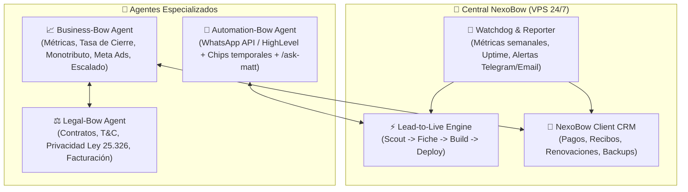

# 🗺️ NexoBow System — Master RouteMap & Roadmap Estratégico

> **Misión Core**: Transformar tráfico y prospectos fríos de servicios profesionales (nutricionistas, psicólogos, abogados, médicos, clínicas) en consultorías agendadas de alta conversión mediante sistemas "Bow" (landings estáticas ultra-rápidas `<0.8s`, copywriting de alivio Hormozi, agendamiento fluido) y automatizar el 100% del ciclo operativo, legal y comercial con agentes de software autónomos ejecutados a costo marginal cero.
>
> **Visión**: Convertir a NexoBow en una fábrica autónoma B2B 24/7 centralizada en un VPS, capaz de prospectar, crear demos personalizadas en vivo, redactar contratos, perseguir cobranzas, optimizar pauta y auditar sistemas con intervención humana únicamente en la toma de decisiones estratégicas.

---

## 🎯 Caso de Uso Principal (The Golden Flow)

**El escenario operativo diario:**
1. **Entrada de voz o texto del usuario:** *"Che, quiero que me busques 5 nutricionistas en la zona de Belgrano/Palermo"*.
2. **Scouting & Filtrado:** El sistema consulta Google Maps / Serper Dev, extrae datos reales (nombre, rating, reseñas, fotos, teléfono, WhatsApp) y descarta automáticamente a quienes ya tienen web corporativa.
3. **Correlatividad e Inserción:** Comprueba duplicados contra Google Sheets (`'Prospección NexoBow'!B11:S1000`). Asigna el siguiente ID correlativo atómico en **Columna B**.
4. **Ficha & Copywriting Hormozi:** Genera `/clients/{id}-{nombre}-{apellido}-{rubro}.md` con dolores específicos del rubro, fallback a WhatsApp y cumplimiento Ley 25.326.
5. **Preselección de Template e Inyección:** Selecciona el mejor template del rubro (ej. `#01 Editorial Delta` para nutricionistas), inyecta los datos y compila un clon Astro SSG.
6. **Publicación y Cierre en Google Sheets:** Compila a `dist-previews/{slug}/` (servido en `https://preview.nexobow.site/{slug}/`), actualiza la **Columna G (`Web Demo URL`)** y calcula el mensaje de WhatsApp de prospección listo para enviar.
7. **Motor TTL 7 Días:** Si el prospecto avanza, se renueva +7 días; si llega a días 5–6 se envía alerta de urgencia; a los 7 días o si es descartado, se purga el clon automáticamente protegiendo el almacenamiento.

---

## 📊 Estado Actual de la Implementación (Octubre 2026)

| Componente | Estado | Detalle Técnico |
|---|:---:|---|
| **Página de Agencia (`web/`)** | ✅ **COMPLETA (100%)** | 12 secciones Soft-Obsidian (`#040607`, `#BF40FA`, `#4928C2`), 3D CSS, 0 JS en cliente, calculadora ROI y catálogo. |
| **Templates Base (`templates/`)** | 🟡 **PARCIAL (1/10)** | `#01 Editorial Delta` (Nutricionista) 100% listo y versionado (`template/nutricionista@1.0.0`). Faltan 9 templates REA (abogados, psicólogos, clínicas, etc.) esperando URLs de referencia. |
| **Pipeline Lead-to-Live** | ✅ **COMPLETO (100%)** | `scout-lead` -> `generate-client-fiche` -> `build-client-site` -> `audit-code` -> `deploy-cloudflare`. 32 tests pasando al 100%. |
| **Google Sheets (`LeadStore`)** | ✅ **COMPLETO (100%)** | Rango `'Prospección NexoBow'!B11:S1000`. ID correlativo en Col B, escritura de demo en Col G sin tocar Col L. |
| **Ciclo de Vida 7 Días & Mejora** | ✅ **COMPLETO (100%)** | `scripts/lead-lifecycle.mjs` y `scripts/continuous-improvement.mjs`. |
| **Motor REA (Ingeniería Inversa)**| ✅ **COMPLETO (100%)** | `scripts/rea-inspect.mjs` extrae paleta 60-30-10, fuentes Google y genera bloque `tema` para `site.json`. |

---

## 🔮 Arquitectura de Nuevos Agentes & Fases Futuras

### 1. 📈 Agente Business-Bow (CFO & Growth Strategist)
- **Función**: Administrar números duros, costo por lead (CPL), valor del tiempo de vida (LTV), tasa de conversión de cada template por rubro y proyecciones de inversión (Meta Ads, dominios `.com.ar`, infraestructura).
- **Decisiones Ejecutivas**: Evaluador de régimen fiscal (análisis costo-beneficio de Monotributo vs cobro simplificado, pasarelas de pago automáticas, retenciones vs formalidad y confianza de marca).
- **Salida**: Genera propuestas estratégicas concretas listas para que Juanma decida con un clic o feedback.

### 2. ⚖️ Agente Legal-Bow (Compliance & Legal Operations)
- **Función**: Respaldo legal total y mitigación de riesgos.
- **Entregables**: Redacción automática de Contratos de Servicios de Agendamiento, Políticas de Privacidad y Términos y Condiciones adaptados a la Ley Argentina 25.326 (Protección de Datos Personales).
- **Conexión**: Se enlaza con Business-Bow para validar términos contractuales según el plan de pago acordado y gestionar el envío digital para firma.

### 3. 📲 Agente Automation-Bow (Outreach & Messaging Engine)
- **Función**: Conectar el pipeline de prospección con la mensajería fría y seguimiento.
- **Estrategia de Conexión**: Integración con API de WhatsApp Cloud o GoHighLevel con rotación de números/chips temporales anti-bloqueo.
- **Workflow SDD**: Utilizar el loop de `/ask-matt` para calibrar el tono, objeciones y disparar mensajes en el timing psicológico óptimo (<48hs antes del vencimiento del demo).

### 4. 📂 NexoBow Client CRM (Post-Venta & Retención)
- **Función**: Panel central para clientes que compraron un sistema Bow.
- **Módulos**: Emisión de recibos de pago / facturas, alertas de renovación mensual (`$12.259 ARS`), changelog de actualizaciones del sitio y canal de reclamaciones/soporte rápido.

### 5. 📡 Weekly Reporter & System Watchdog (Health & KPIs)
- **Función**: Monitoreo 24/7 y resumen semanal consolidado.
- **Canal de Entrega**: Mensaje ejecutivo vía Bot de Telegram o Email (HTML limpio).
- **Contenido**:
  - Estado del Uptime de `preview.nexobow.site` y sitios en Cloudflare Pages.
  - Alerta inmediata si un número de WhatsApp o chip se cae o recibe reporte de spam.
  - Métricas de negocio: Leads prospectados, webs generadas, contactos realizados, clientes en mora.

### 6. 🖥️ Infraestructura 24/7 (VPS Centralizado)
- **Objetivo**: Migrar el repositorio y los daemons programados desde el entorno local de desarrollo a un servidor virtual privado (VPS Linux) con Docker/PM2.
- **Autonomía**: Monitoreo continuo vía cron jobs de `lead-lifecycle.mjs`, prospección agendada y reporte automático sin necesidad de tener la PC encendida.
