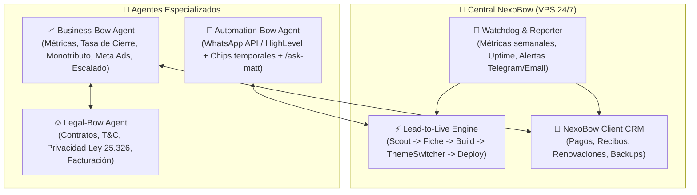

# 🗺️ NexoBow System — Master RouteMap & Roadmap Estratégico

> **Misión Core**: Transformar tráfico y prospectos fríos de servicios profesionales (nutricionistas, psicólogos, abogados, médicos, clínicas) en consultorías agendadas de alta conversión mediante sistemas "Bow" (landings estáticas ultra-rápidas `<0.8s`, copywriting de alivio Hormozi, agendamiento fluido) y automatizar el 100% del ciclo operativo, legal y comercial con agentes de software autónomos ejecutados a costo marginal cero.
>
> **Visión**: Convertir a NexoBow en una fábrica autónoma B2B 24/7 centralizada en un VPS, capaz de prospectar, crear demos personalizadas en vivo, permitir customización en tiempo real al lead, redactar contratos, perseguir cobranzas, optimizar pauta y auditar sistemas con intervención humana únicamente en la toma de decisiones estratégicas.

---

## 🎯 Caso de Uso Principal (The Golden Flow)

**El escenario operativo diario:**
1. **Entrada de voz o texto del usuario:** *"Che, quiero que me busques 5 nutricionistas en la zona de Belgrano/Palermo"*.
2. **Scouting & Filtrado:** El sistema consulta Google Maps / Serper Dev, extrae datos reales (nombre, rating, reseñas, fotos, teléfono, WhatsApp) y descarta automáticamente a quienes ya tienen web corporativa.
3. **Correlatividad e Inserción:** Comprueba duplicados contra Google Sheets (`'Prospección NexoBow'!B11:S1000`). Asigna el siguiente ID correlativo atómico en **Columna B**.
4. **Ficha & Copywriting Hormozi:** Genera `/clients/{id}-{nombre}-{apellido}-{rubro}.md` con dolores específicos del rubro, fallback a WhatsApp y cumplimiento Ley 25.326.
5. **Preselección Inteligente de Arquetipo Visual:** La IA no ata el template al rubro. Analiza el tono, formalidad y arquetipo de marca para asignar el mejor motor de layout (`editorial-classic`, `obsidian-authority`, `minimalist-pure`, `kinetic-cards`) junto con una paleta contextual 60-30-10 y tipografías.
6. **Compilación con Theme Switcher Interactivo:** Compila un clon Astro SSG a `dist-previews/{slug}/` (servido en `https://preview.nexobow.site/{slug}/`) incluyendo una píldora flotante para que el prospecto pruebe 3-4 paletas en vivo y confirme su preferida por WhatsApp.
7. **Publicación y Cierre en Google Sheets:** Actualiza la **Columna G (`Web Demo URL`)** y calcula el mensaje de WhatsApp de prospección listo para enviar.
8. **Motor TTL 7 Días:** Si el prospecto avanza, se renueva +7 días; si llega a días 5–6 se envía alerta de urgencia; a los 7 días o si es descartado, se purga el clon automáticamente protegiendo el almacenamiento.

---

## 🏗️ Nueva Arquitectura de Templates: Duplicación Completa REA por Referente Internacional

> **Principio Innegociable de Templates:**
> - **Template (`/templates/{id}/`):** Es una **web ENTERA** duplicada e inspirada en un sitio de referencia real mediante REA (estilo, geometría espacial, navegación, animaciones, componentes únicos, objetos y 3D). Cada template es un desarrollo autónomo con su propia estructura; **NO comparte los componentes ni el layout de Delta Cafés**.
> - **Copywriting:** El texto (dolores Hormozi, bio, servicios, testimonios, FAQs) es lo que la IA/skill redacta para el cliente y se inyecta en el template. El template provee la infraestructura visual y espacial completa.
> - **Demo (`/sites/demo-{id}/`):** Compilación de exhibición para el catálogo.
> - **Preview (`https://preview.nexobow.site/{slug}/`):** Landing generada y personalizada para un prospecto real.
> - **Delta Cafés:** Es única y exclusivamente la web de referencia de `templates/nutricionista/`. No es el estándar ni la base estructural de los demás templates.

**Catálogo de Templates REA (Webs Enteras Duplicadas por Referente):**
- **`templates/nutricionista/`** (`editorial-classic`, v1.0.0): Web duplicada de **Delta Cafés** (`deltacafes.com`). Estética editorial cálida, Fraunces + Archivo, números ordinales y ritmo pausado.
- **`templates/abogado/`** (`obsidian-authority`, Ticket 20): Web duplicada de **Kümmerlein Rechtsanwälte** (`https://www.kuemmerlein.de/`). Estilo ejecutivo brutalista, recortes SVG, Space Grotesk + Inter, botón rectangular con dot expansivo.
- **`templates/clinica/`** (`architectural-prestige`, Ticket 21): Web duplicada de **SkyClinics** (`https://skyclinics.al/`). Prestigio médico quirúrgico, composición asimétrica mineral piedra (`#e8e7e5`), Deep Forest Teal (`#003934`), Menta quirúrgico (`#1a9e8f`), tarjetas clínicas, animaciones suaves y elementos 3D/gráficos médicos.
- **`templates/corporativo/`** (`high-ticket-consulting`, Ticket 22): Web duplicada de **Vetter Consulting** (`https://vetter-consulting-en.webflow.io/`). Cuadrícula táctica estilo ajedrez, Onyx + Tactical Orange, bloques modulares de impacto financiero.
- **`templates/tech/`** (`tech-editorial-system`, Ticket 23): Web duplicada de **Think Company** (`https://www.thinkcompany.com/`). Editorial tech moderno, Canvas Vanilla + Think Red, resolución de sistemas complejos.
- **`templates/deportes/`** (`kinetic-performance`, Ticket 24): Web duplicada de **The Performance Lab**. Tipografía atlética masiva, Carbon Dark + Kinetic Emerald.
- **`templates/dermatologia/`** (`clinical-pure`, Ticket 25): Web duplicada de **Lipedema Guru**. Espacio negativo clínico, acentos cian/turquesa y enfoque empático.
- **`templates/propiedades/`** (`architectural-spaces`, Ticket 26): Web duplicada de **Lufte**. Tipografía editorial refinada, bronce oak y galerías arquitectónicas.
- **`templates/producto/`** (`minimalist-hardware`, Ticket 27): Web duplicada de **Heavn One**. Deep Matte Black, precisión óptica e ingeniería de producto.
- **`templates/construccion/`** (`industrial-authority`, Ticket 28): Web duplicada de **Reliable Paving**. Asphalt Dark + Safety Amber, métricas de obra pesada.
- **`templates/farmaceutica/`** (`biotech-clarity`, Ticket 29): Web duplicada de **Roveia**. Pure White + Deep Molecule Navy y formulaciones científicas.
- **`templates/profesional/`** (`island-creative-pure`, Ticket 30): Web duplicada de **Tahiti Numérique**. Pacific Cyan + Lagoon Dark para marca personal ágil.
- **`templates/turismo/`** (`oceanic-luxury`, Ticket 31): Web duplicada de **Bluemore Yachting**. Midnight Navy + Azure Wave y tipografía de alta costura.
- **`templates/musica/`** (`harmonic-academy`, Ticket 32): Web duplicada de **Ethos Music Academy**. Acoustic Stage Dark + Vibrant Tone Crimson.

---

## 🎨 Theme Switcher en Previews (Retención Anti-Rebote) [COMPLETADO / ACTIVO]

Para evitar que un lead descarte la propuesta porque *"no le gustaron los colores"*, todas las previews en `https://preview.nexobow.site/{slug}/` incluyen el componente `ThemeSwitcher.astro`:
1. **Píldora Flotante Discreta (Bottom-Right)**: Permite alternar con un clic entre 4 paletas precalibradas (*Original/Principal*, *Obsidian Gold*, *Clinical Cyan*, *Warm Terracotta*).
2. **Reactividad Instantánea vía CSS Custom Properties**: Modifica `--color-primary`, `--color-accent`, `--color-paper`, `--color-ink` en el `:root` sin recargar la página (< 2 KB, JS nativo vanilla).
3. **Persistencia en LocalStorage**: Si el cliente vuelve a entrar al enlace días después, recuerda la paleta elegida bajo la clave `nexobow_theme`.
4. **Captura y Cierre por WhatsApp**: Incluye el botón *"Pedir esta versión"* que abre un chat directo con el mensaje:
   > *"Hola Juanma! Estuve viendo la web demo y me encantó la combinación [Nombre de Paleta]. ¿Cómo seguimos para activarla?"*

---

## 🔮 Roadmap de Nuevos Agentes & Fases Futuras

### 1. 📈 Agente Business-Bow (CFO & Growth Strategist)
- **Función**: Administrar números duros, costo por lead (CPL), valor de vida del cliente (LTV), tasa de conversión de cada arquetipo visual por nicho e inversiones (Meta Ads, dominios `.com.ar`, infraestructura).
- **Decisiones Ejecutivas**: Evaluador de régimen fiscal (análisis costo-beneficio de Monotributo vs cobro simplificado, pasarelas de pago automáticas, retenciones vs formalidad y confianza de marca).
- **Salida**: Genera propuestas estratégicas concretas listas para que Juanma decida con un clic o feedback.

### 2. ⚖️ Agente Legal-Bow (Compliance & Legal Operations)
- **Función**: Respaldo legal total y mitigación de riesgos.
- **Entregables**: Redacción automática de Contratos de Servicios de Agendamiento, Políticas de Privacidad y Términos y Condiciones adaptados a la Ley Argentina 25.326 (Protección de Datos Personales).
- **Conexión**: Se enlaza con Business-Bow para validar términos contractuales según el plan de pago acordado y gestionar el envío digital para firma.

### 3. 📲 Agente Automation-Bow (Outreach & Messaging Engine)
- **Función**: Conectar el pipeline de prospección con la mensajería fría y seguimiento.
- **Estrategia de Conexión**: Integración con API de WhatsApp Cloud o GoHighLevel con rotación de números/chips temporales anti-bloqueo.
- **Workflow SDD**: Utilizar el loop de `/ask-matt` para calibrar el tono, objeciones y disparar mensajes en el timing psicológico óptimo (<48hs antes del vencimiento del demo).

### 4. 📂 NexoBow Client CRM (Post-Venta & Retención)
- **Función**: Panel central para clientes que compraron un sistema Bow.
- **Módulos**: Emisión de recibos de pago / facturas, alertas de renovación mensual (`$12.259 ARS`), changelog de actualizaciones del sitio y canal de reclamaciones/soporte rápido.

### 5. 📡 Weekly Reporter & System Watchdog (Health & KPIs)
- **Función**: Monitoreo 24/7 y resumen semanal consolidado.
- **Canal de Entrega**: Mensaje ejecutivo vía Bot de Telegram o Email (HTML limpio).
- **Contenido**:
  - Estado del Uptime de `preview.nexobow.site` y sitios en Cloudflare Pages.
  - Alerta inmediata si un número de WhatsApp o chip se cae o recibe reporte de spam.
  - Métricas de negocio: Leads prospectados, webs generadas, contactos realizados, clientes en mora.

### 6. 🖥️ Infraestructura 24/7 (VPS Centralizado)
- **Objetivo**: Migrar el repositorio y los daemons programados desde el entorno local de desarrollo a un servidor virtual privado (VPS Linux) con Docker/PM2.
- **Autonomía**: Monitoreo continuo vía cron jobs de `lead-lifecycle.mjs`, prospección agendada y reporte automático sin necesidad de tener la PC encendida.
