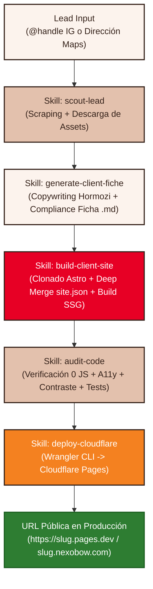

# Plan de Arquitectura de Skills: Pipeline Automatizado Lead-to-Live

Este documento define la arquitectura técnica y el plan de implementación para automatizar el ciclo completo de creación y despliegue de embudos de venta para prestadores de servicios en **NexoBow**.

---

## 1. Objetivo General

Permitir que un usuario o un agente ejecute una sola instrucción (por ejemplo: *"che, en base al template nutricionista crea una web para @karinutricion"* o *"NutriAr, Belgrano 1221, Campana, Buenos Aires"*), y el sistema realice de manera 100% autónoma y determinista:
1. **Extracción y Enriquecimiento de Datos (`scout-lead`):** Detección de nombre, rubro, bio, servicios, reseñas públicas de Google Maps, teléfono/WhatsApp, localidad y descarga local de imágenes/avatar a `/assets/{slug}/`.
2. **Generación de Ficha y Copywriting (`generate-client-fiche`):** Creación de `/clients/{slug}.md` con voseo argentino, enfoque en dolores reales (Hormozi), fallback inteligente de agendamiento (a WhatsApp si no posee Calendly público) y cumplimiento legal estricto de salud (Ley 25.326: `consentimiento_testimonios: false`).
3. **Clonado e Inyección (`build-client-site`):** Ejecución de `build-client-site` adaptando el template (estilo Delta Cafés para nutricionistas) con 0 JS en cliente.
4. **Auditoría Automatizada de Calidad (`audit-code`):** Validación de 0 scripts en cliente, contraste de color, accesibilidad (a11y) y tests de temas/orden (`audit-site.mjs`).
5. **Despliegue Instantáneo en Cloudflare Pages (`deploy-cloudflare`):** Creación y subida a Cloudflare Pages mediante Wrangler CLI, entregando la URL pública `https://{slug}.pages.dev` y mapeo a subdominio `*.nexobow.com`.

---

## 2. Acuerdos de Diseño del Grill

1. **Orquestador Maestro (`lead-to-live`):** Un solo comando encadena todas las fases y reporta la URL final lista.
2. **Fallback Inteligente de Agendamiento:** Si el lead no tiene Calendly público, el embudo configura automáticamente el CTA hacia su WhatsApp con mensaje predeterminado de reserva (`wa.me/{telefono}?text=...`), dejando la web 100% operativa desde el primer segundo.
3. **Persistencia Local de Assets:** Descarga de imágenes y avatar a `/assets/{slug}/` para evitar enlaces caídos por expiración de URLs de Instagram/Google CDN.
4. **Compliance y Salud:** Reseñas atribuidas a Google Maps y `consentimiento_testimonios: false` por defecto para respetar la Ley 25.326.
5. **Despliegue Autónomo a Cloudflare Pages:** Mediante Wrangler CLI con variables de entorno (`CLOUDFLARE_API_TOKEN` / `CLOUDFLARE_ACCOUNT_ID`) para publicación instantánea en `*.pages.dev` y subdominio `*.nexobow.com`.

---

## 3. Componentes y Archivos a Implementar

### Componente 1: Extracción & Enriquecimiento (`scout-lead`)
- `scripts/scout-lead.mjs`
- `.agents/skills/scout-lead/SKILL.md`

### Componente 2: Redacción & Ficha (`generate-client-fiche`)
- `scripts/generate-client-fiche.mjs`
- `.agents/skills/generate-client-fiche/SKILL.md`

### Componente 3: Actualización de Build con Assets (`build-client-site`)
- `scripts/build-client-site.mjs` (copia de `/assets/{slug}/` a `sites/{slug}/public/assets/` e inyección de rutas).

### Componente 4: Auditoría Automatizada (`audit-code`)
- `scripts/audit-site.mjs`
- `.agents/skills/audit-code/SKILL.md`

### Componente 5: Despliegue en Cloudflare Pages (`deploy-cloudflare`)
- `scripts/deploy-cloudflare.mjs`
- `.agents/skills/deploy-cloudflare/SKILL.md`

### Componente 6: Orquestador Maestro (`lead-to-live`)
- `scripts/lead-to-live.mjs`
- `.agents/skills/lead-to-live/SKILL.md`
- `package.json` (scripts añadidos: `lead-to-live`, `scout-lead`, `generate-fiche`, `audit-site`, `deploy-cf`).

---

## 4. Plan de Verificación

1. **Unit Test Ficha & Fallbacks:** Generar ficha de prueba mock y verificar parsing de WhatsApp y atribución de reseñas.
2. **Build Test:** Correr `build-client-site` en el clon, pasando los 16 tests de `templates/nutricionista`.
3. **Audit Test:** Correr `audit-site` verificando 0 scripts en `dist/index.html` y contraste accesible.
4. **E2E / Dry Run:** Ejecutar `lead-to-live` de punta a punta en modo prueba y validar el reporte final.
