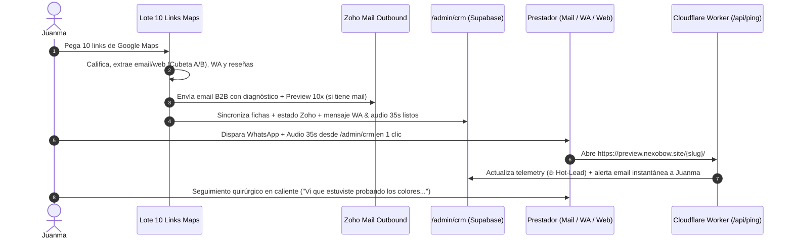
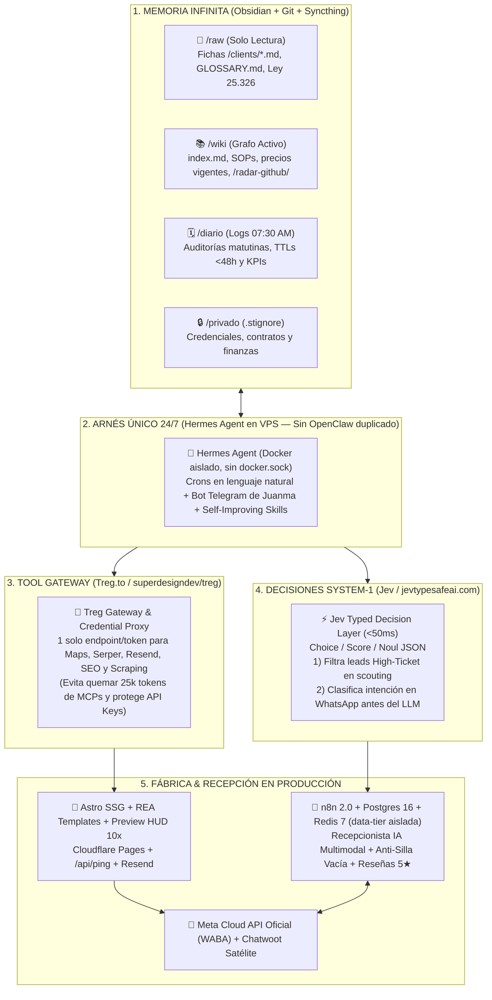

# 🗺️ NexoBow System — Master RouteMap v3.0 & Estrategia de Escala ($0 a +$100,000 USD/mes)

> **Misión Core**: Devolverle al **prestador** de salud y servicios profesionales **+10 horas libres por semana** y erradicar el **ausentismo ("silla vacía")**, transformando el tráfico disperso de Google Maps, Instagram y WhatsApp en **consultorías agendadas y concretadas** mediante **embudos** "Bow" (su **landing** estática ultra-rápida `<0.8s`, posicionamiento AEO en ChatGPT/Maps y **turno automatizado** 24/7 con confirmación anti-ausentismo).
>
> **Visión**: Convertir a **NexoBow Systems** en una fábrica autónoma B2B operando sobre un sistema operativo agéntico de 5 capas (**Obsidian** + **Hermes Agent** + **Treg.to** + **Jev** + **n8n 2.0**) activado estrictamente por **Gates de Facturación** (cero gasto fijo antes de validar caja real), para escalar de **$0 a +$100,000 USD/mes** combinando volumen Low/Mid-Ticket, retención High-Ticket en clínicas e infoproductos digitales.

---

## 🎯 El Factor Diferencial Real: Por Qué Nos Eligen ("Salvarles la Vida")

Ningún odontólogo, médico estético, nutricionista o abogado se despierta deseando comprar *"una landing en Astro SSG"*. Su verdadero infierno diario tiene tres caras concretas que destruyen su rentabilidad y su paz mental:

| Infierno Actual del Prestador | Pérdida Real Hoy | Mecanismo NexoBow (**"Anti-Silla Vacía & Cero-Secretaria"**) | Resultado Cuantificable |
| :--- | :--- | :--- | :--- |
| **1. Esclavitud del WhatsApp a las 22 hs** | Responde manualmente 40 mensajes/audios por día tipo *"hola, precio"* y pierde pacientes frente al que contesta en <2 min. | **Landing Filtro `<0.8s` + Recepcionista IA Multimodal (n8n + Redis + Postgres)** que transcribe audios de pacientes, responde dudas frecuentes y agenda en el acto 24/7. | **+10 horas libres por semana** y respuesta inmediata en <15 segundos. |
| **2. El Lucro Cesante de la "Silla Vacía"** | Entre un **20% y 35%** de los pacientes que reservan faltan sin avisar, dejando un hueco imposible de llenar (`$100.000 – $300.000 ARS/semana` perdidos). | **Protocolo Anti-Ausentismo Activo**: recordatorios interactivos 24h y 2h antes (`[Confirmar / Reprogramar]`). Si cancela, el sistema ofrece el hueco automáticamente a la lista de espera. | **Reducción drástica del ausentismo** y agenda cubierta sin secretarias extra. |
| **3. Invisibilidad frente a la Competencia en Maps e IA** | Tiene 0 web o una web lenta de WordPress que ni Google ni ChatGPT saben leer; depende 100% del boca en boca o del algoritmo de Instagram. | **Motor de Reseñas 5★ en Maps + Posicionamiento AEO** (`/llms.txt` + JSON-LD médico/legal) para que ChatGPT, Perplexity y Gemini lo recomienden primero en su zona. | Flujo predecible de **consultorías concretadas** de alto valor sin depender de subir Reels todos los días. |

> **Tesis Central de Posicionamiento:** NexoBow no vende "diseño web". Vende **tiempo de vida recuperado y facturación salvada**. Con evitar apenas 2 sillas vacías al mes, el sistema se paga solo varias veces.

---

## 📖 Ontología y Reglas del Lenguaje Oficial (`GLOSSARY.md`)

Toda comunicación humana, prompt de agente, **ficha de cliente** y script del repositorio respeta estrictamente el vocabulario oficial de NexoBow:

| Término Oficial | Definición Operativa en NexoBow | Términos Prohibidos (_Avoid_) |
| :--- | :--- | :--- |
| **Prestador** | Profesional de la salud o servicios que contrata NexoBow (nutricionista, odontólogo, médico estético, abogado, clínica). | Cliente (ambiguo con paciente), usuario |
| **Paciente** | Persona que consulta al **prestador** y reserva un turno. | Cliente, lead (salvo antes de reservar) |
| **Turno automatizado** | Reserva de una **consultoría** que el **paciente** concreta por WhatsApp/agenda sin intervención manual del **prestador**. | Cita, reserva manual |
| **Consultoría** | Llamada o entrevista inicial del **prestador** con un **paciente** (puede configurarse como `gratuita`, `arancelada` o `consultar` según `tipo_consulta` en la ficha). | Demo, reunión |
| **Upsell del prestador** | Paso de la **consultoría** inicial al tratamiento o servicio completo pago (resuelto por el **prestador**, no por NexoBow). | Conversión (ambiguo) |
| **Setup** | Cobro único por implementar el **embudo** completo a un **prestador**. | Instalación, pago único |
| **Abono** | Cobro mensual recurrente por mantener y operar el sistema de **turno automatizado** IA (Tier 2 / Tier 3). | Mensualidad, fee, suscripción |
| **Caso de éxito** | Resultado comprobable de un **prestador**, publicado en la web de NexoBow o en su **landing**. | Testimonio |
| **Embudo** | Recorrido completo que lleva al **paciente** desde Google Maps, WhatsApp o Instagram hasta una **consultoría agendada**. Es lo que vende NexoBow. | Sistema de turnos, bot, Calendly |
| **Landing** | Página propia del **prestador**, núcleo del **embudo**, con sus **casos de éxito**, reseñas e información de confianza. | Sitio web, embed |
| **Consultoría agendada / concretada** | Métrica reina del **embudo**: **consultorías** reservadas por mes y cuántas de ellas se realizaron efectivamente (control de silla vacía). | Lead, conversión |
| **Ficha de cliente** | Archivo Markdown (`{id}-{nombre}-{apellido}-{rubro}.md`) con datos, branding, contenido y estado de un **prestador**. Única fuente de verdad para generar su **landing**. | `client.json`, perfil |
| **Template** | Proyecto Astro base por rubro/arquetipo duplicado vía REA que se clona para cada **prestador**. | Plantilla, theme |
| **Clon** | Copia del **template** adaptada automáticamente con la **ficha de cliente** de un **prestador**. Se genera, no se edita a mano. | Fork, sitio |

---

## 💰 Tesis Económica & Escalera de Valor (Alineada a `web/src/config.ts`)

### 1. Retrospectiva Crítica de Falencias Ya Corregidas
1. **Erradicación del Abono Parásito de $10 USD/mes:** Un abono micro de $10/mes genera comisiones altas de pasarela y exactamente el mismo soporte por WhatsApp que un cliente de $250/mes. **Solución vigente:** Tier 1 cobra un **Setup único (`$189.999 ARS` / `$189–$249 USD`) con `$0 ARS/mes` por 1 año de hosting en Cloudflare Pages** (costo marginal $0). El **abono** mensual nace recién en **Tier 2** cuando opera la Recepcionista IA y la infraestructura VPS.
2. **Prohibición de WhatsApp No Oficial en Producción:** Baileys / Evolution API en producción clínica arriesga el baneo del número del consultorio. En Fase 1 se contacta de forma semi-asistida (humana desde `/admin/crm`) y en Tier 2/3 productivo se opera exclusivamente sobre **Meta Cloud API Oficial (WABA + Embedded Signup)**.
3. **Desacople de RAM en VPS:** Chatwoot (Rails + Sidekiq) consume 2–3 GB de RAM; se mantiene desacoplado (Chatwoot Cloud o instancia satélite) para blindar el VPS de n8n + Postgres + Redis + Hermes.
4. **Prioridad de Nichos de Alto Margen:** Priorizar **Odontología Implantológica, Medicina Estética/Dermatología, Cirugía, Kinesiología y Estudios Jurídicos** junto con nutrición de alto ticket. Un solo tratamiento recupera el año completo del sistema.
5. **Gobernanza & Sandboxing Zero-Trust:** Hermes corre sin root ni acceso a `/var/run/docker.sock` (`cap_drop: [ALL]`, `read_only: true`), detrás de **Tailscale Mesh VPN + Cloudflare Tunnels + CrowdSec**.

### 2. La Escalera de Valor Oficial NexoBow (Value Ladder)

| Nivel de Oferta | Nombre del Sistema | Qué Incluye el Embudo Entregado | Setup (Único) | Abono (Mensual) | Rol en la Escala a $100k/mes |
| :--- | :--- | :--- | :---: | :---: | :--- |
| **Tier 0 (Gancho Gratuito)** | **Preview Studio 10x + Auditoría Maps/AEO** | **Clon** vivo 7 días (`preview.nexobow.site/{slug}/`) con **Preview Studio HUD** (selector de 4 paletas, comparador *20% vs. 10x*, simulador de Turno IA) + diagnóstico Maps/AEO. | **$0** | **$0** | Rompehielos de altísima respuesta: muestra el trabajo funcionando antes de pedir un peso. |
| **Tier 1 (Liquidez & Entrada)** | **NexoBow Starter (Landing de Prestigio)** | **Clon** Astro SSG `<0.8s` en dominio propio + Copy Hormozi + WhatsApp/Agenda + Hosting Cloudflare (1 año incluido) + **30 días de prueba del Turno IA**. | **$189.999 ARS** *(o $189–$249 USD)* | **$0 ARS/mes** *(Año 1 incluido)* | **Caja rápida ($0 → $5k/mes)** sin soporte parásito. Valida la oferta y financia el VPS. |
| **Tier 2 (Core Recurrente)** | **NexoBow Autonomous (Anti-Silla Vacía IA)** | Todo Tier 1 + **Recepcionista IA 24/7 en WhatsApp** (audios + texto, Meta Cloud API + n8n + Redis + Postgres) + Confirmaciones anti-ausentismo + Reseñas 5★ en Maps. | **$549.999 ARS** *(o $500–$950 USD)* | **$229.999 ARS/mes** *(o $197–$297 USD/m)* | **Motor principal de MRR.** Evitar 2 sillas vacías al mes paga todo el abono. |
| **Tier 3 (High-Ticket Clínicas)** | **NexoBow Growth Partner (+ AfterBow)** | Todo Tier 2 multi-profesional + Posicionamiento AEO completo (`llms.txt`, JSON-LD) + **Producción Audiovisual (AfterBow)** + Reactivación de pacientes inactivos. | **$1,500 – $3,000 USD** *(o plan a medida)* | **$500 – $1,000 USD/mes** | Escala en centros médicos, clínicas privadas y arbitraje internacional (ES/USA/MX/CL). |
| **Tier 4 (Escala 1-a-Muchos)** | **NexoBow Digital Assets / Kit Self-Serve** | Infoproducto auto-entregable (*"Kit Agenda Llena & Anti-Silla Vacía"*) + plantillas de WhatsApp para el **upsell del prestador**, escalado con Meta Ads. | **$47 – $97 USD** | **$29 USD/mes** *(Comunidad)* | Monetización pasiva de profesionales que no califican para High-Ticket (Fase 4). |

### 3. Ecuación Matemática hacia +$100,000 USD/mes (Mix Objetivo en Fase 4)

| Línea de Ingreso | Volumen Objetivo | Ticket Promedio | Facturación Mensual (USD) | Margen Neto Estimado |
| :--- | :--- | :--- | :---: | :---: |
| **1. Setups Tier 1 (Starter)** | 25 nuevos **setups**/mes (flujo continuo de entrada) | $200 Setup único | **$5,000 USD** | ~98% |
| **2. Motor Recurrente Tier 2 (Autonomous)** | 200 **prestadores** en **abono** + 20 nuevos **setups**/mes | $250 Abono / $650 Setup | **$63,000 USD** | ~92% |
| **3. Clínicas Tier 3 (Growth Partner)** | 35 clínicas en **abono** + 6 nuevos **setups**/mes | $700 Abono / $2,000 Setup | **$36,500 USD** | ~88% |
| **4. Activos Digitales Tier 4 (Kit IA)** | 180 ventas/mes (Meta Ads automatizados) | $67 USD promedio | **$12,060 USD** | ~65% (post-Ads) |
| **TOTAL CONSOLIDADO NEXOBOW** | **235 Prestadores en Abono + Setups + Digital** | **Mix Híbrido B2B** | **$116,560 USD / mes** | **~88% (~$102k netos)** |

---

## ✨ Arquitectura de Conversión de Previews: "Efecto 10x" (`NexoBow Preview Studio HUD`)

### Diagnóstico del Problema Actual
Cuando hoy un **prestador** abre `https://preview.nexobow.site/{slug}/`, corre dos riesgos mortales de conversión:
1. **Cree que la preview es la web final:** Si ve fotos ilustrativas del rubro, copy generado automáticamente o secciones genéricas sin sus datos internos, asume *"eso es todo lo que entregan"* y no percibe el salto de calidad de contratar el sistema completo.
2. **Bug Crítico Detectado en Código (2026-11-17):** En los 10 `templates/*/src/components/ThemeSwitcher.astro` sigue hardcodeado el teléfono placeholder `"5491100000000"` dentro de `JUANMA_PHONE` (y en 5 templates también en `juanmaWaPhone`), en lugar del número oficial de Juanma (`5493489536088` de `web/src/config.ts`). **Debe corregirse antes de enviar las 29 previews.**

### Solución: Evolución a `NexoBow Preview Studio HUD`
Reemplazar la píldora pasiva de `ThemeSwitcher.astro` por un **HUD interactivo de prototipo** que encapsule el marco psicológico correcto (*"Estás viendo solo un boceto del 20% armado en minutos con tus datos públicos; mirá cómo queda tu Sistema Final 10x"*):

1. **Barra/Dock Superior Discreta + Badge de Estado (`PROTOTIPO CONCEPTUAL · 20%`)**:
   - Indica al **prestador** que la demo está reservada por **7 días** (TTL real), que las fotos y secciones son referenciales y que se personaliza con su material real tras la activación.
2. **Badges en Imágenes de Referencia**:
   - Etiqueta sutil en fotos del **template**: `"📸 Foto ilustrativa de prototipo — Se reemplaza por fotos reales de tu consultorio y equipo"`.
3. **Modal / Drawer Comparativo `"✨ Preview (20%) vs. Tu Sistema Final (10x)"`**:
   - Comparación visual lado a lado de lo que cambia cuando contrata:
     - **Hoy (Preview 20%):** Subdominio temporal `preview.nexobow.site`, datos públicos de Maps, fotos ilustrativas, botón de agenda demo.
     - **Web Final (Sistema 10x):** Dominio propio (`.com.ar` / `.com`) + SSL, sesión/curaduría de fotos reales del consultorio, copy afinado tras llamada de 15 min, **Recepcionista IA 24/7 en WhatsApp** (transcribe audios y agenda sola), **confirmación anti-silla vacía** y **posicionamiento AEO en ChatGPT & Google Maps**.
4. **Mini-Simulador Interactivo de Turno IA en Vivo**:
   - Botón dentro del HUD (`"🤖 Probar cómo atiende tu Recepcionista IA"`) que abre una micro-simulación de chat donde el profesional ve en 10 segundos cómo un paciente manda un audio preguntando por obra social/arancel y el sistema le responde en voseo humano y cierra el horario en la agenda.
5. **Selector de 4 Paletas en Vivo + CTA Real a `5493489536088`**:
   - Conserva las 4 paletas instantáneas con `localStorage`, pero corrige de raíz el teléfono hacia `5493489536088` y dispara el evento `theme-switched` hacia `preview-telemetry` para alertar a Juanma en tiempo real.

---

## 📲 Estrategia Omnicanal de Adquisición y Alertas: WhatsApp + Zoho Mail + Sensor `/api/ping` ($0)

No elegimos "WhatsApp o Email" como dogma excluyente: cada canal cumple la función matemática donde es imbatible en Argentina/LATAM sobre lotes de **10 links de Google Maps**.

| Dimensión | WhatsApp (Canal #1 de Venta y Cierre) | Zoho Mail (Email Outbound B2B) | Sensor `/api/ping` + Resend ($0) |
| :--- | :--- | :--- | :--- |
| **Rol Estratégico** | **Primer contacto y cierre humano.** Apertura >80% en profesionales locales. | **Respaldo ejecutivo B2B al prestador** cuando tiene email público en su web o perfil. | **Sensor Hot-Lead en Tiempo Real** (< 1 KB, 0 cookies, Ley 25.326). |
| **¿Se automatiza en frío desde el Día 1?** | **NO (Prohibido).** Enviar links masivos desde WhatsApp no oficial garantiza baneo del chip. | **SÍ (Controlado por lote).** Correo personalizado desde Zoho (`ZOHO_SMTP_*`) con diagnóstico de Maps y preview 10x. | **SÍ (Pasivo en el clon).** Registra aperturas y cambios de paleta en Supabase y alerta a Juanma. |
| **Cómo opera en Fase 1 (Gate 0)** | Tras procesar un lote de **10 links de Maps**, queda listo en consola y `/admin/crm` el mensaje en voseo + guion de audio 35s para enviar manualmente en 1 clic. | Si el scraper extrae email válido de la web/bio, Zoho Mail envía un correo ejecutivo con el link `preview.nexobow.site/{slug}/` y la ecuación Anti-Silla Vacía. | Conectado a `preview-telemetry.mjs` (`/api/ping` en Cloudflare Worker): al abrir la preview o probar una paleta, actualiza el CRM con `🔥 Hot-Lead` y alerta al instante. |
| **Uso Secundario con Clientes** | En **Fase 2 (Gate 1)** pasa a **Meta Cloud API Oficial (WABA)** para atender pacientes 24/7 con 0% riesgo de baneo. | Respuestas ejecutivas a estudios jurídicos/clínicas y coordinación formal de propuestas. | Avisos TTL (<48hs) y trazabilidad de interés real antes del seguimiento humano. |



---

## 🧠 Arquitectura del Sistema Operativo Agéntico (5 Capas) & Radar GitHub

El ecosistema NexoBow evoluciona de scripts locales hacia una fábrica modular ejecutada 24/7 en VPS Linux ($6–$12 USD/mes en Hetzner), **activando cada capa únicamente cuando el Gate de Facturación lo justifica**:



### ¿Para Qué Sirve Cada Herramienta y Cómo Encajan Sin Estorbarse?

1. **Obsidian (Segundo Cerebro en Markdown):** Resuelve la amnesia de los agentes. `/raw/` guarda las **fichas de cliente** inmutables (solo lectura para la IA); `/wiki/` conecta precios vigentes, objeciones reales, templates y análisis del Radar GitHub con `[[wikilinks]]`; `/diario/` registra el parte diario de las 07:30 AM. Sincronizado entre tu PC y el VPS con Syncthing.
2. **Hermes Agent vs. OpenClaw (Regla Anti-Duplicación):** **Hermes Agent** y **OpenClaw** cumplen exactamente el mismo rol arquitectónico: son arneses/gateways de agentes 24/7 conectados a chat (Telegram/WhatsApp), crons y skills. Correr ambos en el mismo VPS duplicaría consumo de RAM, rompería la fuente única de verdad en Obsidian y generaría conflictos de estado. **Decisión:** **Hermes Agent** es el único arnés oficial 24/7 en el VPS (por su arquitectura de memoria/skills y confinamiento Docker), mientras que `openclaw/openclaw` queda en el **Radar GitHub** como fuente de patrones de skills e integraciones para importar selectivamente vía REA.
3. **Treg.to (`superdesigndev/treg` — Tool Gateway & Credential Proxy):** Es el *"OpenRouter para herramientas de agentes"*. En lugar de enchufar 15 servidores MCP dentro del prompt (que queman 20.000+ tokens por turno antes de pensar) o guardar API keys en texto plano dentro del VPS, Treg expone herramientas bajo un solo endpoint y hace inyección de credenciales del lado del servidor.
4. **Jev (`jevtypesafeai.com` — Modelo de Decisión System-1):** A diferencia de un LLM que redacta párrafos lentos y caros, Jev recibe un JSON y responde decisiones tipadas (`Choice`, `Score`, `Noul`/sí-no) con probabilidades calibradas en milisegundos. En NexoBow resuelve dos cuellos de botella:
   - *En Scouting:* Decide al instante si un consultorio de Google Maps es High-Ticket o spam/MLM y qué ángulo de dolor Hormozi asignarle.
   - *En Recepción IA (n8n):* Clasifica el mensaje del **paciente** (`turno_nuevo`, `reprogramar`, `duda_obra_social`, `urgencia_medica`, `handoff_humano`) antes de invocar al modelo grande, bajando latencia y costo de API en ~70%.
5. **n8n 2.0 + Redis 7 + PostgreSQL 16 (Motor Determinista de Turnos):** La IA sola alucina horarios y responde 3 veces seguidas si el paciente manda 3 mensajes cortos (*"Hola"* / *"Atienden OSDE?"* / *"Quiero turno"*). Redis aplica un **debounce de 8–12 segundos**, Postgres guarda memoria persistente + calendario/confirmaciones booleanas (para no mandar recordatorios duplicados) y n8n ejecuta la secuencia **Anti-Silla Vacía** sin fallas.
6. **Topología de Seguridad VPS (Zero-Trust):** Red interna `data-tier` sin acceso a internet para Postgres y Redis; Hermes confinado (`cap_drop: [ALL]`, `read_only: true`, sin `docker.sock`); cero puertos SSH/n8n públicos (acceso solo vía **Tailscale Mesh VPN**); webhooks filtrados por **Cloudflare Zero Trust Tunnels** + **CrowdSec** + **UFW**.

### 🔭 Radar Táctico de Repos de GitHub (El Filtro de 3 Preguntas de ROI)

Estudiar repositorios con miles de estrellas en GitHub es una ventaja injusta **solo si evita el síndrome del objeto brillante**. Ningún repo entra al stack de NexoBow sin aprobar este filtro de 3 preguntas:

1. **Impacto Directo en Caja:** ¿Aumenta cierres de ventas, reduce sillas vacías del prestador o baja costo/latencia de tokens? *(Si es "solo por curiosidad técnica", queda archivado).*
2. **Regla de No-Duplicación:** ¿Cubre una capa vacía o duplica algo que ya hacen Astro, Supabase, n8n o Hermes?
3. **Alineación al Gate Actual:** ¿Pertenece al Gate de facturación donde estamos hoy, o se documenta en Obsidian `/wiki/radar-github/` para el Gate siguiente?

| Repositorio / Herramienta | Rol Real en el Mercado | Veredicto del Filtro ROI | Gate de Adopción |
| :--- | :--- | :--- | :---: |
| **`superdesigndev/treg`** | Gateway unificado de herramientas e inyección segura de API keys. | ✅ **APROBADO:** Elimina bloat de MCPs y protege credenciales en VPS. | **Gate 2** *(Fase 3)* |
| **`jevtypesafeai.com` (`Jev`)** | Clasificador/decisor System-1 en JSON en milisegundos. | ✅ **APROBADO:** Abarata y acelera el routing de WhatsApp en n8n y el filtro de scouting. | **Gate 1–2** *(Fase 2–3)* |
| **`openclaw/openclaw`** | Arnés personal de agente multi-canal con amplio ecosistema de skills. | ⚠️ **SOLO PATRONES:** Duplica a Hermes Agent. Se inspeccionan sus skills/patrones en Radar, no se instala en paralelo. | **Radar Continuo** |
| **`unclecode/crawl4ai`** | Scraper web LLM-ready ultra rápido para extraer contexto de clínicas con web vieja. | ✅ **APROBADO (Cubeta B):** En Fase 2/3 audita automáticamente sitios viejos para generar comparativas *Antes vs. Después*. | **Gate 1–2** *(Fase 2–3)* |
| **`calcom/cal.com`** | Infraestructura de agendamiento open-source multi-profesional. | ⏳ **CONDICIONAL:** En Tier 1/2 basta Google Calendar + n8n; evaluar self-host/API recién en **Tier 3 (Clínicas multi-sede)**. | **Gate 2–3** *(Fase 3)* |
| **`chatwoot/chatwoot`** | CRM omnicanal oficial con Embedded Signup de WhatsApp WABA + handoff humano. | ✅ **APROBADO DESACOPLADO:** Usar Chatwoot Cloud ($19/mes) o satélite separado para no saturar RAM del VPS central. | **Gate 1** *(Fase 2)* |

---

## 🤝 Protocolo Operativo Co-Founder (Manera de Trabajar Juntos para Automatizar)

Para que entiendas el 100% de cada decisión y podamos automatizar sin cajas negras frágiles, operamos bajo **4 reglas inquebrantables**:

1. **Explicación Pedagógica del *Porqué* Primero:** Antes de construir un módulo o activar una herramienta nueva, definimos en lenguaje claro qué problema de negocio resuelve, qué alternativas descartamos y por qué elegimos esa arquitectura.
2. **Validación Manual Asistida Antes de Automatizar en Piloto Automático:** Nunca automatizamos en ciego algo que no convirtió primero manualmente. Primero validamos el pitch, la preview y el cierre con vos al volante (sobre los 29 prospectos actuales); lo que funciona se automatiza.
3. **Cristalización Progresiva en `Agent Skills`:** Todo flujo repetitivo que ya probó resultados se encapsula en `/.agents/skills/{nombre}/SKILL.md` + scripts deterministas con pruebas `node --test` (`npm test`). Así, cuando Hermes Agent corra 24/7 en el VPS en Gate 2, heredará procesos probados en batalla, no improvisaciones.
4. **Ciclo SDD Estricto (`prompts_structure.md`):** `/grill-me` (alinear decisiones) ➔ `/to-spec` (contrato `spec.md`) ➔ `/to-tickets` (tajadas verticales) ➔ `/implement` (TDD Red-Green-Refactor) ➔ `/audit-code` + `impeccable detect` (calidad visual y 0 regresiones).

---

## 🏗️ Catálogo de Templates REA (Estado Real Verificado)

> **Regla Innegociable de Producto:** Cada **template** (`/templates/{id}/`) es una arquitectura visual autónoma inspirada en un referente internacional real vía REA, con su layout propio, compatible con `NexoBow Preview Studio HUD`, carga `<0.8s` y esquema AEO.

| Template (`/templates/{id}/`) | Arquetipo Visual | Referente Internacional REA | Estado Verificado | Nicho B2B Objetivo | Ticket Ideal |
| :--- | :--- | :--- | :---: | :--- | :---: |
| `templates/nutricionista/` | `editorial-classic` (`@1.0.0`) | **Delta Cafés** (`deltacafes.com`) | ✅ Activo + Demo | Nutricionistas, psicólogos, terapeutas | Tier 1 → Tier 2 |
| `templates/abogado/` | `obsidian-authority` (`@2.0.0`) | **Kümmerlein** (`kuemmerlein.de`) | ✅ Activo + Demo | Estudios jurídicos, contadores, escribanías | Tier 2 → Tier 3 |
| `templates/clinica/` | `architectural-prestige` (`@2.0.0`) | **SkyClinics** (`skyclinics.al`) | ✅ Activo + Demo | Clínicas médicas, centros odontológicos | Tier 2 → Tier 3 |
| `templates/corporativo/` | `high-ticket-consulting` (`@2.0.0`) | **Vetter Consulting** | ✅ Activo + Demo | Consultoras B2B, asesores financieros | Tier 3 |
| `templates/tech/` | `tech-editorial-system` (`@1.0.0`) | **Think Company** | ✅ Activo + Demo | Consultoras software, arquitectura digital | Tier 3 |
| `templates/deportes/` | `kinetic-performance` (`@1.0.0`) | **The Performance Lab** | ✅ Activo + Demo | Kinesiólogos deportivos, deportólogos, gym | Tier 1 → Tier 2 |
| `templates/dermatologia/` | `clinical-pure` (`@1.0.0`) | **Lipedema Guru** | ✅ Activo + Demo | Dermatología, medicina estética, cirugía | Tier 2 → Tier 3 |
| `templates/producto/` | `minimalist-hardware` (`@1.0.0`) | **Heavn One** (`heavn-lights.com`) | ✅ Activo + Demo | Equipamiento médico, ortopedia, hardware | Tier 2 → Tier 3 |
| `templates/construccion/` | `industrial-authority` (`@1.0.0`) | **Reliable Paving** | ✅ Activo + Demo | Construcción, pavimentación, ingeniería | Tier 2 → Tier 3 |
| `templates/propiedades/` | `architectural-spaces` (Ticket 26) | **Lufte** (`lufte.us`) | 🛠️ En Repo (`src/` base) | Desarrolladoras, arquitectura, inmobiliarias | Tier 3 |
| `farmaceutica` a `musica` | Tickets 29–32 | *Roveia, Tahiti Numérique, Bluemore, Ethos* | ⏳ Congelados | **Regla Anti-Dispersión:** No abrir nuevos templates hasta facturar >$5k/mes en Salud y Legales. | Fase 3–4 |

---

## 🔌 Higiene de Contexto e Infraestructura de Agentes

1. **Smart Zone (`<100k tokens`):** Mantener `AGENTS.md` y futuros `SOUL.md` compactos, desactivando plugins/MCPs ajenos al negocio (como ocurrió con `data-agent-kit-plugin`) y migrando integraciones repetitivas a `Treg.to` en Fase 3.
2. **Los 6 Conectores Estratégicos del Ecosistema:**
   - **🎭 Playwright MCP (`screenshot-qa`):** Auditoría visual headless en `375px` y `1440px`.
   - **🗄️ Supabase PostgreSQL (`createSupabaseLeadStore`):** Base relacional ACID con RLS estricto para `/admin` (`leads`, `financial_transactions`, `schedule_blocks`, `alaynow_videos`, `habits`, `habit_logs`).
   - **🔄 n8n MCP + `n8n-skills`:** Creación y reparación automatizada de flujos de **turno automatizado** y anti-silla vacía (Gate 1).
   - **🧠 Obsidian Vault MCP:** Lectura/escritura estructurada de `/raw/`, `/wiki/` y `/diario/` (Gate 2).
   - **☁️ Cloudflare Pages + Functions + Resend:** Hosting gratuito `<0.8s`, endpoint `/api/v1/bow-system/create`, `/api/ping` y alertas por email.
   - **📲 Telegram + Meta Cloud API WABA / Chatwoot:** Centro de mando para Juanma en Telegram y operación clínica sin riesgo de baneo para los **prestadores**.

---

## 🚀 Roadmap de Ejecución por "Gates de Facturación": De $0 a +$100,000 USD/mes

> **Regla de Oro de Reactivación:** No se paga ningún servidor ni se construyen automatizaciones pesadas antes de desbloquear el **Gate de Caja** correspondiente. Cada fase se autofinancia con la anterior.

```text
[GATE 0: HOY ($0 gasto fijo)] ──► [GATE 1: 1-3 Setups (~$500-$1k USD)] ──► [GATE 2: >$2.5k-$5k USD/m] ──► [FASE 4: $60k-$100k+/m]
 Validar Oferta + HUD 10x         VPS Hetzner + n8n + Turno IA            Hermes 24/7 + Obsidian          Ads IA (Higgsfield)
 + Resend Alerts + 29 Leads       + WABA + Anti-Silla Vacía + Jev         + Treg.to + España/USA/MX       + Tier 4 Self-Serve
```

### 🟢 FASE 1 (GATE 0): Reactivación, Validación de Oferta & Caja Inmediata ($0 a $5,000 USD/mes — Costo Fijo $0)
> **Principio Rector:** *"Al dinero le gusta la velocidad"*. Tenés una fábrica ya construida con 116 tests en verde, `/admin` Cockpit conectado a Supabase, 9 templates REA con demo en vivo y **29 prospectos reales ya compilados en `clients/` (`#9`–`#37`)**. Lo único que falta para facturar es pulir la experiencia "10x" de la preview, activar alertas en tiempo real con Resend y salir a contactar.

- [x] Web flagship B2B Soft-Obsidian (`web/`) con 12 secciones, precios alineados y 0 JS en landing pública.
- [x] Cockpit `/admin` en Supabase (`CRM Kanban`, `Finanzas`, `Calendario + Preset Escuela/Prospección`, `AlayNow`, `Hábitos`, `Settings` y `Realtime`).
- [x] Endpoint inbound `web/functions/api/v1/bow-system/create.ts` y pipeline multi-rubro con embudos flexibles (`Ticket #47`–`#49`).
- [x] Lote activo de **29 fichas reales** (`#9`–`#23` Nutrición en Campana/Zárate/CABA, `#24`–`#27` Odontología, `#28`–`#32` Medicina Estética, `#33`–`#37` Abogacía).
- [ ] **Hito 1.1 — Ticket #50 (`NexoBow Preview Studio HUD` + Fix WhatsApp `5493489536088` — ver [`spec-gate0-validation.md`](./spec-gate0-validation.md)):**
  * **Fix Crítico:** Corregir el placeholder `5491100000000` en los 10 `templates/*/src/components/ThemeSwitcher.astro` reemplazándolo por `5493489536088`.
  * **Efecto 10x:** Evolucionar `ThemeSwitcher.astro` a **Preview Studio HUD** (barra de prototipo al 20% con TTL de 7 días, badges de *"Foto ilustrativa de prototipo"*, modal comparativo *Preview 20% vs. Tu Sistema Final 10x*, mini-simulador de Turno IA en vivo y emisión de evento `theme-switched`).
- [ ] **Hito 1.2 — Ticket #51 (Pipeline "10 Links Google Maps → Calificación, Scraping Email/Web & Preview Live"):**
  * Crear `scripts/intake-maps-batch.mjs` y skill `intake-maps-batch`: recibe hasta 10 links de Google Maps, resuelve URLs, extrae perfil/WhatsApp/reviews, inspecciona web/bio para capturar **email** y clasificar **Cubeta A / B**, califica (`0–100`), genera ficha, compila **clon** con HUD 10x y publica en `preview.nexobow.site/{slug}/`.
- [ ] **Hito 1.3 — Ticket #52 (Zoho Mail Outbound + Telemetría `/api/ping` & Alertas Hot-Lead):**
  * Crear `scripts/send-zoho-outreach.mjs` para enviar correo profesional HTML desde **Zoho Mail** (`ZOHO_SMTP_*`) a todo lead con email válido y guardar trazabilidad en `metadata.email_outreach`.
  * Inyectar el snippet `< 1 KB` de `scripts/preview-telemetry.mjs` en `build-client-site.mjs` y crear `web/functions/api/ping.ts` para actualizar `metadata.telemetry` en Supabase y disparar alerta Hot-Lead en tiempo real.
- [ ] **Hito 1.4 — Ticket #53 (Workstation `/admin/crm` + Mensajes/Audios WhatsApp Listos & Sprint de Validación):**
  * Exponer en `CrmView.tsx` y `CockpitView.tsx`: email + estado Zoho, web original/Maps (`Cubeta A/B`), rating/reseñas, badge `🔥 Hot-Lead`, modal de lote 10 links, botones de 1 clic **`Copiar Mensaje WA`** / **`Abrir WhatsApp`** y guion de audio 35s bajo el ángulo **"Anti-Silla Vacía & Cero-Secretaria"**.
  * Ejecutar bloques diarios de prospección con lotes de **10 links de Google Maps** hasta validar la oferta y cerrar los primeros **3 a 5 Setups Tier 1 (`$189.999 ARS`)** = **~$500 a $1.000 USD** en caja para desbloquear **Gate 1**.

---

### 🟡 FASE 2 (GATE 1 — Se desbloquea al cobrar 1–3 Setups): VPS Zero-Trust, n8n 2.0 & Sistema Anti-Silla Vacía ($5,000 a $25,000 USD/mes)
> **Principio Rector:** Pagado 100% con caja generada en Fase 1 (nunca antes). La landing deja de ser el producto final y pasa a ser el caballo de Troya para cobrar **abonos recurrentes de `$229.999 ARS/mes` (`$197–$297 USD/mes`)**.

- [ ] **Hito 2.1 — Contratación y Blindaje del VPS Hetzner ($6–$12 USD/mes):**
  * Desplegar stack Docker Compose Zero-Trust: **n8n 2.0 + PostgreSQL 16 + Redis 7** en red `data-tier` (`internal: true`, sin salida a internet).
  * Perímetro cerrado: **Tailscale Mesh VPN** para administración, **Cloudflare Zero Trust Tunnels** para webhooks y **CrowdSec + UFW**. Chatwoot desacoplado (Cloud o satélite) para proteger la RAM.
- [ ] **Hito 2.2 — Onboarding Oficial Meta Cloud API (WABA) + Recepcionista IA:**
  * Conexión por Embedded Signup (0% riesgo de baneo del consultorio).
  * Flujo industrial n8n: transcripción de **notas de voz**, buffer de ráfagas en **Redis (8–12s)**, router rápido con **Jev** (clasificación de intención en ms antes del LLM), agente RAG con reglas del consultorio, **Message Splitter** (burbujas humanas) y *Handoff Humano* en Chatwoot.
- [ ] **Hito 2.3 — Motor "Anti-Silla Vacía" & Multiplicador de Reseñas 5★:**
  * Confirmación automática 24h y 2h antes de cada **consultoría** con control booleano en Postgres + reactivación automática de lista de espera ante cancelaciones.
  * Solicitud automática de reseña en Google Maps post-consulta (`review-booster`) + inyección de `/llms.txt` y JSON-LD (`aeo-optimizer`) verificado con `isitagentready.com`.
- [ ] **Meta Financiera Gate 2:** 10–50 **prestadores** en **abono** Tier 2 + setups continuos = **$5,000 a $25,000 USD/mes**.

---

### 🟣 FASE 3 (GATE 2 — Se desbloquea al superar $2.500–$5.000 USD/mes): Hermes Agent 24/7, Obsidian Sync, Treg.to & Arbitraje Internacional ($25,000 a $60,000 USD/mes)
> **Principio Rector:** Delegar la prospección y la preparación de demos en un arnés autónomo 24/7 mientras aplicamos **arbitraje geográfico**: vender exactamente el mismo sistema en **España, Estados Unidos hispano (Miami/Texas/California), México y Chile** a `$1,500–$3,000 USD` de **setup** y `$500–$1,000 USD/mes` de **abono**.

- [ ] **Hito 3.1 — Despliegue de Hermes Agent + Obsidian Sync + Treg.to en el VPS:**
  * Instalar **Hermes Agent** enjaulado (`cap_drop: [ALL]`, `read_only: true`, sin `docker.sock`) conectado al Telegram de Juanma (voz y texto).
  * Sincronizar bóveda **Obsidian** (`/raw/`, `/wiki/`, `/diario/`, `/privado/`) vía Syncthing con auditoría matutina automática a las 07:30 AM.
  * Conectar **Treg.to** (`superdesigndev/treg`) como gateway único de APIs/credenciales y **Crawl4AI** para auditar webs obsoletas (Cubeta B).
- [ ] **Hito 3.2 — Daemons Autónomos 24/7:**
  * `Batch Hunter Daemon` (02:00 AM): Scouting nocturno multi-ciudad con **Jev** como filtro de calificación High-Ticket, compilación de **clones** con `Preview Studio HUD`, QA visual Playwright (`375px`/`1440px`) y bandeja de aprobación en 1 clic en Telegram.
  * `Lifecycle Daemon`: Control estricto del **TTL de 7 días**, disparo de alertas **Resend** en días 5–6 y purga automática.
- [ ] **Hito 3.3 — Célula de Closers a Comisión & Verticales Congelados:**
  * Incorporar closers que llamen únicamente a los *Hot-Leads* detectados por `preview-telemetry` + Resend.
  * Evaluar `Cal.com` self-hosted / API para clínicas Tier 3 multi-sede y habilitar nuevos **templates** REA (`propiedades`, etc.) según demanda.
- [ ] **Meta Financiera Fase 3:** 120 **prestadores** en Tier 2 + 15 clínicas Tier 3 + 25 **setups**/mes = **~$60,000 USD/mes**.

---

### 🔴 FASE 4: Escala Híbrida a +$100,000 USD/mes (Ads IA + Activos Digitales — Meses 6 a 12)
> **Principio Rector:** Combinar el MRR predecible de los **abonos** B2B con la escalabilidad sin techo de infoproductos y adquisición inbound automatizada.

- [ ] **Hito 4.1 — Motor de Ads con IA (`Creative-Ads-Bow`):** Generación de creativos y ángulos de video para clínicas Tier 3 y atracción inbound propia hacia `/solicitud-enviada` (`CreateBowSystem`).
- [ ] **Hito 4.2 — Lanzamiento de "NexoBow Digital Kit" (Tier 4):** Producto digital `$47–$97 USD` + comunidad `$29 USD/mes` monetizando a profesionales independientes de toda Iberoamérica.
- [ ] **Hito 4.3 — Gobernanza Ejecutiva (`Business-Bow` & `Legal-Bow`):** Facturación recurrente automatizada (Stripe / LemonSqueezy / MercadoPago Suscripciones), suspensión por mora, contratos Ley 25.326 y monitoreo diario en `<2 horas/día` desde Telegram y `/admin`.
- [ ] **Meta Financiera Fase 4:** Superar los **$100,000 USD/mes** sostenidos con >85% de margen operativo.

---

## 📋 Matriz Actualizada de Agentes, Módulos y Skills del Ecosistema NexoBow

| Componente / Skill | Capa / Gate | Estado | Función Específica |
| :--- | :---: | :---: | :--- |
| `scout-lead` & `prospect-in-conversation` | Adquisición (`Gate 0`) | ✅ Activo | Búsqueda en Google Maps / Serper Dev, filtro celular WhatsApp y sincronización Supabase. |
| `generate-client-fiche` | Contenido (`Gate 0`) | ✅ Activo | Fichas en `/clients/*.md` con voseo, ángulos Hormozi, embudos flexibles y TTL 7d. |
| `build-client-site` & `edit-client-site` | Producto (`Gate 0`) | ✅ Activo | Compilación determinista del **clon** Astro SSG con bloqueo de versión por git tag. |
| `audit-code` + `impeccable` + `screenshot-qa` | QA Técnico & Visual (`Gate 0`) | ✅ Activo | Auditoría 0-JS (`web/`), anti-slop visual y capturas Playwright `375px` / `1440px`. |
| `objection-handler` & `lead-lifecycle` | Cierre & TTL (`Gate 0`) | ✅ Activo | Objeciones en voseo argentino, alertas de urgencia días 5–6 y purga a los `>=7` días. |
| `domain-provisioner` | Post-Venta (`Gate 0`) | ✅ Activo | Paso de `preview.nexobow.site/{slug}` a dominio propio `.com.ar` / `.com` en Cloudflare. |
| `admin-cockpit` (`/admin`) | Centro de Mando (`Gate 0`) | ✅ Activo | Cockpit React aislado en Supabase (CRM, Finanzas, Calendario, AlayNow, Hábitos, Settings). |
| `preview-studio-hud` (**Ticket #50**) | Conversión Preview (`Gate 0`) | 🎯 **Prioridad #1** | Evolución de `ThemeSwitcher` a **Preview Studio HUD 10x** + fix teléfono `5493489536088`. |
| `intake-maps-batch` (**Ticket #51**) | Lotes 10 Links Maps (`Gate 0`) | 🎯 **Prioridad #1** | Pipeline de 10 links Maps: calificación, scraping de email/web (Cubeta A/B), reseñas y preview live. |
| `send-zoho-outreach` + `/api/ping` (**Ticket #52**) | Outbound & Alertas (`Gate 0`) | 🛠️ **Prioridad #2** | Email B2B automático vía **Zoho Mail** + ping <1 KB en previews + alertas Hot-Lead en tiempo real. |
| `admin-crm-gate0` (**Ticket #53**) | Workstation CRM (`Gate 0`) | 🛠️ **Prioridad #2** | Visibilidad de email, Zoho, Cubeta, reseñas, Hot-Lead y copiado/envío WA + audio 35s en 1 clic. |
| `n8n-receptionist` + `review-booster` + `aeo-optimizer` | Recepción IA (`Gate 1`) | ⏳ Planificado | Turno IA multimodal (Redis + Postgres + WABA), Anti-Silla Vacía, reseñas 5★ y `/llms.txt`. |
| `Hermes` + `Obsidian` + `Treg.to` + `Jev` | Fábrica 24/7 (`Gate 2`) | ⏳ Planificado | Arnés único en VPS con bóveda `/raw`/`/wiki`/`/diario`, gateway de herramientas y router System-1. |
| `Creative-Ads-Bow` & `Business/Legal-Bow` | Escala $100k (`Fase 4`) | ⏳ Planificado | Ads automatizados, cobros recurrentes Stripe/MP y analítica ejecutiva LTV/CAC. |
