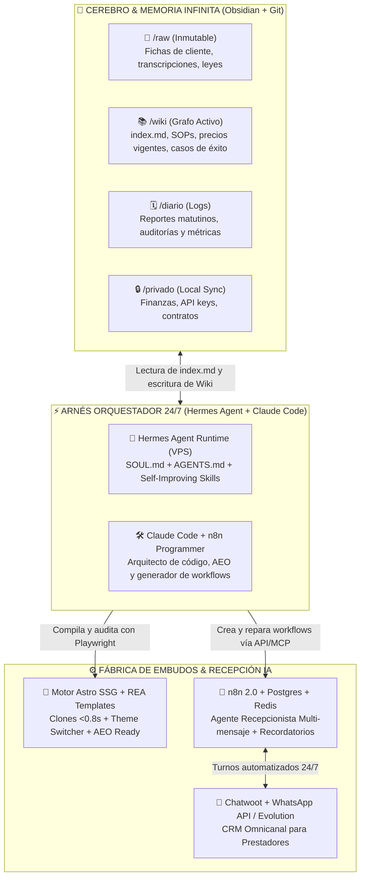

# 🗺️ NexoBow System — Master RouteMap & Estrategia de Escala ($0 a +$100,000 USD/mes)

> **Misión Core**: Transformar el tráfico frío y las consultas dispersas de **prestadores** de servicios profesionales y de salud (nutricionistas, psicólogos, abogados, médicos, clínicas) en **consultorías gratuitas agendadas y concretadas** mediante **embudos** "Bow" (su **landing** estática ultra-rápida `<0.8s`, copywriting de alivio Hormozi, posicionamiento AEO y **turno automatizado** por WhatsApp + agenda), operando el 100% del ciclo comercial, técnico y legal con agentes autónomos a costo marginal cercano a cero.
>
> **Visión**: Convertir a **NexoBow Systems** ([Making AI NexoBow Business](https://gemini.google.com/notebook/217f92c4-b853-48b8-846f-9f77e0d897f0)) en una fábrica autónoma B2B 24/7 centralizada en un VPS con **Hermes Agent**, **n8n** y segundo cerebro en **Obsidian**, capaz de prospectar, auditar AEO, compilar **clones** personalizados en vivo, gestionar **turnos automatizados** multicanal y escalar la facturación recurrente de **$0 a +$100,000 USD/mes** combinando volumen Low-Ticket con expansión Mid/High-Ticket y productos digitales.

## 📖 Ontología y Reglas del Lenguaje Oficial (`GLOSSARY.md`)

Toda comunicación humana, prompt de agente, **ficha de cliente** y script del repositorio respeta estrictamente el vocabulario oficial de NexoBow:

| Término Oficial | Definición Operativa en NexoBow | Términos Prohibidos (_Avoid_) |
| :--- | :--- | :--- |
| **Prestador** | Profesional de la salud o servicios que contrata NexoBow (rubro inicial: nutricionista). | Cliente (ambiguo con paciente), usuario |
| **Paciente** | Persona que consulta al **prestador** y reserva un turno. | Cliente, lead (salvo antes de reservar) |
| **Turno automatizado** | Reserva de una **consultoría gratuita** que el **paciente** concreta por WhatsApp y queda en la agenda sin intervención del **prestador**. Único turno que agenda NexoBow. | Cita, reserva manual |
| **Consultoría gratuita** | Llamada del **prestador** con un **paciente**, agendada como gratuita, donde el **prestador** vende su servicio pago. | Demo, reunión |
| **Upsell del prestador** | Paso de la **consultoría gratuita** a la consulta personalizada paga (resuelto por el **prestador**, no por NexoBow). | Conversión (ambiguo) |
| **Setup** | Cobro único por implementar el **embudo** completo a un **prestador**. | Instalación, pago único |
| **Abono** | Cobro mensual recurrente por mantener y operar el sistema (el primer mes es de prueba y no se paga en el Tier Base). | Mensualidad, fee, suscripción |
| **Caso de éxito** | Resultado comprobable de un **prestador**, publicado en la web de NexoBow o en su **landing**. | Testimonio |
| **Embudo** | Recorrido completo que lleva al **paciente** desde Google Maps, WhatsApp o Instagram hasta una **consultoría gratuita** agendada. Es lo que vende NexoBow. | Sistema de turnos, bot, Calendly |
| **Landing** | Página propia del **prestador**, núcleo del **embudo**, con sus **casos de éxito**, reseñas e información de confianza. Su botón principal lleva a agendar. | Sitio web, embed |
| **Consultoría agendada / concretada** | Métrica reina del **embudo**: **consultorías gratuitas** reservadas por mes y cuántas de ellas se realizaron efectivamente. | Lead, conversión |
| **Ficha de cliente** | Archivo Markdown (`N-rubro-nombre.md`) con datos, branding, contenido y estado de un **prestador**. Única fuente de verdad para generar su **landing**. | `client.json`, perfil |
| **Template** | Proyecto Astro base por rubro/arquetipo que se clona para cada **prestador**. | Plantilla, theme |
| **Clon** | Copia del **template** adaptada automáticamente con la **ficha de cliente** de un **prestador**. Se genera, no se edita a mano. | Fork, sitio |

## 💰 Tesis Económica: Por Qué $150 Setup + $10 Abono No Escala a $100k/mes (Y Cómo Destrabarlo)

### 1. Diagnóstico Matemático del Modelo Actual ($150 USD Setup + $10 USD Abono)
Cobrar **$150 USD de Setup** y **$10 USD/mes de Abono** (con el primer mes bonificado) es un **anzuelo de penetración (Trojan Horse)** imbatible para eliminar la fricción en los primeros cierres, pero presenta una trampa matemática si se mantiene como única oferta:
* **Por vía de Abono ($10 USD/mes):** Alcanzar **$100,000 USD/mes** de ingreso recurrente mensual (MRR) exigiría mantener **10,000 prestadores activos** simultáneamente. Incluso con un churn mínimo del 5% mensual, requeriría cerrar **+500 nuevos prestadores cada mes** solo para reponer bajas.
* **Por vía de Setup ($150 USD único):** Facturar **$100,000 USD/mes** solo con implementaciones obligaría a vender y entregar **667 nuevos embudos todos los meses** (~22 cierres diarios), destruyendo el foco operativo y saturando los canales de salida.
* **El Principio del Cerebro NexoBow:** Como demuestran las fuentes de [Cómo Vender Páginas Web con IA a Negocios por $3,000](https://www.youtube.com/watch?v=vq6qME9Og2c) y [NO Vendas Agentes IA, Vende Sistemas IA](https://www.youtube.com/watch?v=zhu4fzty0Ms), **la landing nunca es el negocio final: es el caballo de Troya**. Al **prestador** no le importa el código; le importa **ganar plata (más consultorías agendadas)** o **ahorrar tiempo (no responder consultas repetitivas a mano)**.

### 2. La Escalera de Valor NexoBow (Value Ladder de 4 Niveles)
Para pasar de **$0 a +$100,000 USD/mes** sin romper la simplicidad operativa, el modelo actual ($150 / $10) se conserva como **Nivel 1 (Oferta de Entrada / Tripwire)** y habilita una escalera de valor ascendente:

| Nivel de Oferta | Nombre del Sistema | Qué Incluye el Embudo Entregado | Setup (Único) | Abono (Mensual) | Rol en la Escala a $100k/mes |
| :--- | :--- | :--- | :---: | :---: | :--- |
| **Tier 0 (Gancho)** | **Preview + Auditoría AEO & Maps** | **Clon** vivo 7 días (`preview.nexobow.site`) + Theme Switcher + Diagnóstico de visibilidad en IA (`isitagentready.com`) y Google Maps ([Fuente AEO](https://www.youtube.com/watch?v=upsI04_iAQ8)). | **$0 USD** | **$0 USD** | Rompehielos de respuesta masiva en frío; demuestra trabajo hecho antes de pedir un centavo ([Fuente Webs](https://www.youtube.com/watch?v=N63_Bf2LPhk)). |
| **Tier 1 (Tripwire Actual)** | **NexoBow Starter (Landing + Link)** | **Clon** Astro SSG `<0.8s` en dominio propio + Copy Hormozi + Botón directo a Calendly + Hosting Cloudflare. *(Mes 1 de prueba sin cargo).* | **$150 USD** | **$10 USD/mes** | Liquidez inmediata para cubrir VPS/APIs, validar nichos y construir base instalada de **prestadores** con confianza ciega. |
| **Tier 2 (Core System)** | **NexoBow Autonomous (Turno Automatizado)** | Todo Tier 1 + **Recepcionista IA 24/7 en WhatsApp/IG** (vía Chatwoot + n8n + Postgres/Redis) + Agendamiento de **consultoría gratuita** + Recordatorios 24h/1h anti-ausentismo + Automatización de reseñas en Google Maps ([Fuente Sistemas](https://www.youtube.com/watch?v=zhu4fzty0Ms)). | **$500 – $950 USD** | **$197 – $297 USD/mes** | Motor principal de MRR. Un solo **paciente** recuperado que pasa al **upsell del prestador** paga todo el año de **abono**. |
| **Tier 3 (High-Ticket)** | **NexoBow Growth Partner (Clínicas & Centros)** | Todo Tier 2 para clínicas multi-profesional + Posicionamiento **AEO** completo (`llms.txt`, Schema médico/legal) + Creativos/Ads con IA (Claude + Higgsfield) + Reactivación de bases de **pacientes** inactivos ([Fuente 10 Habilidades](https://www.youtube.com/watch?v=89oIFpQ4yyY)). | **$1,500 – $3,000 USD** | **$500 – $1,000 USD/mes** | Acelerador de facturación B2B en mercados fuertes (España, USA Hispano, México, Chile y clínicas privadas de alto ticket). |
| **Tier 4 (Escala 1-a-Muchos)** | **NexoBow Digital Assets / Kit Self-Serve** | Producto digital auto-entregable (*"Kit de Agenda Llena & IA para Profesionales de Salud"* + plantillas de **upsell del prestador**), vendido con tráfico pago 24/7 sin intervención humana ([Fuente Productos Digitales](https://www.youtube.com/watch?v=dnqzOcLrejs)). | **$47 – $97 USD** | **$29 USD/mes** *(Comunidad/Bot)* | Monetización masiva de los **prestadores** que no califican para High-Ticket; escala con pauta reinvertida sin techo operativo. |

### 3. Ecuación Matemática de los +$100,000 USD/mes (Mix de Ingresos Meta en Fase 4)

| Línea de Ingreso | Volumen Mensual Activo / Nuevo | Ticket Promedio | Facturación Mensual (USD) | Margen Neto Estimado |
| :--- | :--- | :--- | :---: | :---: |
| **1. Base Instalada Tier 1 (Starter)** | 300 **prestadores** en **abono** + 40 nuevos **setups**/mes | $10 Abono / $150 Setup | **$9,000 USD** | ~95% |
| **2. Motor Recurrente Tier 2 (Autonomous)** | 180 **prestadores** en **abono** + 25 nuevos **setups**/mes | $250 Abono / $600 Setup | **$60,000 USD** | ~90% |
| **3. Cuentas Clínicas Tier 3 (Growth Partner)** | 30 clínicas en **abono** + 6 nuevos **setups**/mes | $650 Abono / $2,000 Setup | **$31,500 USD** | ~85% |
| **4. Activos Digitales Tier 4 (Low-Ticket IA)** | 200 ventas/mes ( ~6.6 ventas/día vía Meta Ads IA) | $67 USD promedio | **$13,400 USD** | ~65% (post-Ads) |
| **TOTAL CONSOLIDADO NEXOBOW** | **510 Prestadores Activos + Motor Digital** | **Mix Híbrido B2B** | **$113,900 USD / mes** | **~86% (~$98k netos)** |

## 🧠 Arquitectura del Cerebro NexoBow (Síntesis de "Making AI NexoBow Business")

El ecosistema técnico deja de ser un conjunto de scripts aislados en una laptop para convertirse en un **Sistema Operativo Agéntico de 4 Pilares** ejecutado en un VPS Linux 24/7 ($5–$12 USD/mes en Hostinger/Hetzner):



### Pilar 1: Arnés de Agentes 24/7 (`Hermes Agent` + `Claude Code`)
Siguiendo la arquitectura de [HERMES 2026: Curso Completo](https://www.youtube.com/watch?v=FQZGoSwdS_0) y [Así Se Usa Hermes Agent a Nivel Profesional](https://www.youtube.com/watch?v=4qTj2dyDPpI), el modelo LLM es un commodity; la ventaja competitiva real de NexoBow es el **arnés (harness)**:
* **División del Trabajo (Arquitecto vs. Operador 24/7):** **Claude Code** actúa en sesiones de ingeniería profunda (creación de **templates** REA, auditorías AEO y programación automática de flujos n8n mediante `n8n-mcp` y `n8n-skills` según [Claude Code Crea Automatizaciones](https://www.youtube.com/watch?v=Ivn4rX2wfxk)), mientras que **Hermes Agent** vive encendido 24/7 en el VPS ejecutando **crons** en lenguaje natural, atendiendo a Juanma por Telegram (texto y notas de voz) y coordinando subagentes por perfil (`perfil-scouting`, `perfil-build`, `perfil-ventas`, `perfil-soporte`) ([Fuente Hermes Desde Cero](https://www.youtube.com/watch?v=I9BnhFTudBY)).
* **Self-Improving Loop & Skills (`<200 líneas` en `AGENTS.md`):** Cada vez que un agente resuelve un bug de compilación o descubre una objeción nueva de un **prestador**, actualiza sus propios procedimientos operativos estándar (SOPs digitales) respaldados con rollback automático en GitHub.
* **Enrutamiento Inteligente de Costos:** Uso de suscripción fija / modelos económicos vía OpenRouter para tareas programadas y clasificación rápida ([Fuente OpenAI DevDay](https://www.youtube.com/watch?v=2v-_ustjm6k)), reservando los modelos frontier para estrategia, copywriting Hormozi y generación de arquitectura.

### Pilar 2: Memoria Infinita sin Alucinaciones (`Obsidian` + Método Karpathy)
Como establecen [Hermes Agent + Obsidian Puede Cambiar TODO](https://www.youtube.com/watch?v=FAfMhbVU9g0) y [Claude Code + Obsidian = Memoria Infinita](https://www.youtube.com/watch?v=p5YgvC6yzCs), la memoria nativa de un agente (~2.200 caracteres) produce amnesia operativa al escalar a cientos de **prestadores**. NexoBow implementa una bóveda de texto plano Markdown sincronizada vía **Syncthing** entre el VPS y el equipo local:
1. **`/raw/` (Fuente de Verdad Inmutable):** Contiene las **fichas de cliente** originales (`N-rubro-nombre.md`), el `GLOSSARY.md` y normativas (Ley 25.326). Los agentes tienen permiso de **solo lectura**; jamás pueden sobrescribir ni alucinar sobre `/raw/`.
2. **`/wiki/` (Grafo de Conocimiento Vivo):** Mantenida automáticamente por el agente principal a partir de `index.md`. Conecta con enlaces bidireccionales `[[prestador]]`, `[[rubro]]`, `[[template]]`, precios vigentes de **setup** y **abono**, y **casos de éxito** por zona. Evita que un agente cotice precios viejos o invente datos no verificados.
3. **`/diario/` (Auditoría Matutina Automatizada):** Todos los días a las 07:30 AM, una rutina de Hermes audita la bóveda buscando contradicciones, **clones** próximos a vencer (TTL días 5–6), **fichas de cliente** sin seguimiento hace >72h o enlaces rotos, enviando el parte ejecutivo al Telegram de Juanma.
4. **`/privado/` (Excluido en `.stignore`):** Credenciales maestras, márgenes financieros y contratos sensibles que nunca viajan a APIs externas.

### Pilar 3: Recepcionista IA en Producción Real (El Verdadero "Turno Automatizado")
Basado en la ingeniería de producción de [NO Vendas Agentes IA, Vende Sistemas IA](https://www.youtube.com/watch?v=zhu4fzty0Ms), [Curso Completo de n8n 2.0](https://www.youtube.com/watch?v=7Z-vRvIUqNs) y [Construye un Chatbot de $5,000](https://www.youtube.com/watch?v=x361xBKBdic), el **turno automatizado** de NexoBow (Tier 2 y Tier 3) supera por completo a los bots amateurs de YouTube mediante 6 capas industriales:
1. **Ingesta Multimodal Omnicanal:** Procesa texto, **notas de voz** (transcripción automática, vital en Argentina/LATAM donde el **paciente** envía audios largos) e imágenes (ej. órdenes médicas o estudios previos).
2. **Buffer de Mensajes en Redis (Debounce Inteligente):** Los **pacientes** escriben en ráfagas (*"Hola"*, *"¿Atienden por OSDE?"*, *"Quiero turno para el martes"*). Redis agrupa los mensajes durante 8–12 segundos antes de disparar al agente para que responda con contexto unificado en vez de contestar 3 veces seguidas sin sentido.
3. **Arquitectura Multi-Agente con Memoria en PostgreSQL:** Un **Agente Orquestador** con historial persistente por número de teléfono delega en dos subagentes especializados: el **Agente de Conocimiento (RAG/Wiki del Prestador)** que despeja dudas de modalidades y enfoque, y el **Agente de Turno Automatizado** que consulta disponibilidad real, agenda la **consultoría gratuita**, reprograma o cancela.
4. **Humanización de Salida (Message Splitter):** Un `Auto-fixing Output Parser` divide la respuesta en 2 a 4 burbujas breves con pausas naturales de escritura, eliminando los bloques robóticos de texto.
5. **Centro de Control en Chatwoot + Regla Anti-Ban:** En etapa de prospección y pruebas internas se utiliza **Evolution API** en el VPS a costo cero; cuando el **prestador** pasa a producción en Tier 2/3, se conecta a **Chatwoot** con **Meta Cloud API oficial** y validación de seguridad por headers en los webhooks para garantizar 0% riesgo de bloqueo del número del consultorio. Incluye herramienta de *Handoff Humano* (desactivación automática del bot cuando el **prestador** interviene).
6. **Secuencia Anti-Ausentismo (Show-Rate Booster):** Workflows en n8n que envían recordatorios automáticos 24 horas y 1 hora antes de la **consultoría gratuita** (con flag booleano de control en base de datos para jamás duplicar envíos), elevando drásticamente la tasa de **consultorías concretadas**.

### Pilar 4: Posicionamiento AEO (Answer Engine Optimization) en Cloudflare
Incorporando la metodología de [Cloudflare + Claude Code = Posicionamiento AEO de 1.300€](https://www.youtube.com/watch?v=upsI04_iAQ8), cada **landing** y **clon** compilado por NexoBow se optimiza automáticamente para los **AI Crawlers** (`GPTBot`, `ClaudeBot`, `PerplexityBot`, `Google-Extended`):
* **Objetivo Comercial:** Que cuando un **paciente** pregunte en ChatGPT, Perplexity o Gemini *"¿Cuál es el mejor nutricionista deportivo en Belgrano?"* o *"¿Qué clínica dermatológica me recomendás en Palermo?"*, la IA recomiende en primer lugar al **prestador** de NexoBow.
* **Implementación Técnica en el Build (`build-client-site`):** Inyección automática de JSON-LD estructurado (`MedicalBusiness`, `Physician`, `LegalService`, `FAQPage`), generación de `/llms.txt` con resumen semántico de la **ficha de cliente**, configuración de `robots.txt` amigable para agentes y cabeceras en Cloudflare verificadas contra el estándar de `isitagentready.com`.

## 🎯 El Nuevo "Golden Flow" (De Scouting a Upsell Recurrente)

```
[1. Scouting + AEO Audit] ──► [2. Ficha en /raw/ + DB ACID] ──► [3. Clon Astro + Theme Switcher + AEO]
                                                                               │
[6. Upsell a Tier 2/3 ($250-$650/m)] ◄── [5. Cierre Tier 1 ($150+$10)] ◄── [4. QA Playwright + Outbound Híbrido]
```

1. **Entrada por Voz o Cron Nocturno:** Juanma envía un audio por Telegram a Hermes (*"Buscame 20 nutricionistas y clínicas estéticas en Palermo y Belgrano"*) o se dispara el cron nocturno a las 02:00 AM.
2. **Scouting Dual & Auditoría AEO:** `scout-lead.mjs` consulta Google Maps / Serper Dev y clasifica a los prospectos en dos cubetas:
   * **Cubeta A (Sin Web):** Profesionales que solo tienen link de WhatsApp o Instagram.
   * **Cubeta B (Web Obsoleta / 0 AEO):** Profesionales o clínicas con sitios lentos (>3s), sin estructura de conversión ni lectura por AI Crawlers (los mejores candidatos para **Tier 2 y Tier 3** porque ya invierten en digital).
3. **Persistencia ACID + Ficha Inmutable:** Registra el prospecto en **SQLite/Turso** (`SqliteLeadStore`, latencia <5ms, sin colisiones de ID), sincroniza en segundo plano con Google Sheets (`'Prospección NexoBow'!B11:S1000`) y genera la **ficha de cliente** en `/raw/clients/{id}-{rubro}-{nombre}.md` respetando Ley 25.326 y dolores Hormozi.
4. **Arquitectura Visual + Compilación AEO:** El motor separa estrategia (Claude) de ejecución (Astro SSG): selecciona el **template** REA óptimo según el arquetipo del **prestador**, inyecta copywriting de alivio, empaqueta el componente `ThemeSwitcher.astro` (4 paletas en vivo + persistencia en `localStorage` + botón de cierre por WhatsApp), añade la capa **AEO** y verifica en `375px` y `1440px` con **Playwright MCP**.
5. **Contacto Híbrido de Alto Impacto (El Secreto de Conversión):** Se despliega el **clon** en `https://preview.nexobow.site/{slug}/` con **TTL de 7 días** y telemetría pasiva (<1 KB). El contacto inicial combina el enlace del **clon** ya construido con un **audio breve o llamada directa** ([Fuente Cómo Vender Webs](https://www.youtube.com/watch?v=vq6qME9Og2c)): *"Hola Dra. Gómez, vi tus reseñas en Maps y te armé sin cargo tu nueva landing lista para agendar consultorías gratuitas, además de medir cómo aparece tu consultorio en ChatGPT. Te dejé el link acá para que elijas los colores con un botón"*.
6. **Entrada por Tier 1 ($150 Setup + $10 Abono) o Diagnóstico:** El **prestador** entra sin fricción pagando los $150 USD de **setup** (o contratando el Diagnóstico AEO + Embudo).
7. **Activación del Upsell Interno a Tier 2 ($197–$297/mes):** A los 14–21 días de uso de la **landing**, cuando el **prestador** recibe tráfico pero tarda en contestar WhatsApp o sufre ausentismo en sus **consultorías gratuitas**, NexoBow activa la demostración en vivo de su **Recepcionista IA de Turno Automatizado**, migrando al **prestador** del **abono** de $10 USD/mes al sistema completo de $197–$297 USD/mes.

## 🏗️ Catálogo de Templates REA (Ingeniería Inversa de Referentes Internacionales)

> **Regla Innegociable de Producto:** Cada **template** (`/templates/{id}/`) es una arquitectura espacial y visual autónoma inspirada en un referente internacional real mediante REA, manteniendo sus tipografías originales (o equivalente anatómico exacto), **0 JS innecesario**, carga `<0.8s` y compatibilidad nativa con `ThemeSwitcher.astro` y **AEO Schema**.

| Template (`/templates/{id}/`) | Arquetipo Visual | Referente Internacional REA | Estado | Nicho B2B Objetivo | Ticket Ideal |
| :--- | :--- | :--- | :---: | :--- | :---: |
| `templates/nutricionista/` | `editorial-classic` (v1.0.0) | **Delta Cafés** (`deltacafes.com`) — Fraunces + Archivo | ✅ Activo | Nutricionistas, psicólogos, terapeutas holísticos | Tier 1 → Tier 2 |
| `templates/abogado/` | `obsidian-authority` (Ticket 20) | **Kümmerlein** (`kuemmerlein.de`) — Brutalismo ejecutivo, recortes SVG | ✅ Activo | Estudios jurídicos, contadores, escribanías | Tier 2 → Tier 3 |
| `templates/clinica/` | `architectural-prestige` (Ticket 21) | **SkyClinics** (`skyclinics.al`) — Mineral piedra, Deep Forest Teal | ✅ Activo | Clínicas médicas, centros odontológicos y quirúrgicos | Tier 2 → Tier 3 |
| `templates/producto/` | `minimalist-hardware` (Ticket 27) | **Heavn One** (`heavn-lights.com`) — Precisión óptica, Deep Matte Black | ✅ Activo | Equipamiento médico, ortopedia, suplementos propios | Tier 2 → Tier 3 |
| `templates/dermatologia/` | `clinical-pure` (Ticket 25) | **Lipedema Guru** (`lipedemaguru.com`) — Espacio negativo clínico y cian | ⏳ Prioridad Q4 | Dermatología estética, medicina estética, cirugía plástica | Tier 2 → Tier 3 |
| `templates/deportes/` | `kinetic-performance` (Ticket 24) | **The Performance Lab** (`theperformancelab.ca`) — Carbon Dark + Emerald | ⏳ Prioridad Q4 | Kinesiólogos deportivos, deportólogos, centros de alto rendimiento | Tier 1 → Tier 2 |
| `templates/corporativo/` | `high-ticket-consulting` (Ticket 22) | **Vetter Consulting** (`vetter-consulting-en.webflow.io`) — Onyx + Orange | ⏳ Backlog | Consultoras B2B, asesores financieros, brokers | Tier 3 |
| `templates/propiedades/` | `architectural-spaces` (Ticket 26) | **Lufte** (`lufte.us`) — Outfit + Manrope, galerías arquitectónicas | ⏳ Backlog | Desarrolladoras, estudios de arquitectura, inmobiliarias | Tier 3 |
| `templates/tech/` a `musica/` | Tickets 23, 28, 29, 30, 31, 32 | *Think Company, Reliable Paving, Roveia, Tahiti Numérique, Bluemore, Ethos* | ⏳ Congelados | **Regla Anti-Dispersión:** No abrir nuevos nichos hasta superar $25k/mes en Salud y Legales ([Fuente Productos](https://www.youtube.com/watch?v=dnqzOcLrejs)). | Fase 3–4 |

## 🔌 Stack de MCPs, Higiene de Contexto e Infraestructura

### 1. Higiene de Contexto Inmediata (Smart Zone `<100k tokens`)
* **Purga de Plugins Irrelevantes:** Desactivar del entorno local cualquier MCP ajeno al negocio (bioinformática `alphafold`/`chembl`/`pdb`, `flutter`, `bigquery`). Recupera **15.000 a 30.000 tokens por turno**.
* **Regla de Oro de Archivos de Agente:** Mantener `AGENTS.md` y `SOUL.md` estrictamente por debajo de **200 líneas** ([Fuente Hermes 2026](https://www.youtube.com/watch?v=FQZGoSwdS_0)), delegando el conocimiento específico a las **skills** modulares y al índice `wiki/index.md` de Obsidian.

### 2. Los 6 MCPs Estratégicos del Ecosistema NexoBow
1. **🎭 Playwright MCP (`screenshot-qa`):** Levanta servidor efímero del **clon**, captura vistas en `375px` (móvil) y `1440px` (desktop) y valida que no existan desbordes tipográficos ni errores visuales antes de subir a `dist-previews/`.
2. **🗄️ SQLite / Turso MCP (`SqliteLeadStore`):** Reemplaza a Google Sheets como motor transaccional primario (<5ms, ACID, sin colisiones en Columna B ni límites de 60 req/min). Sheets queda como espejo visual asíncrono.
3. **🔄 n8n MCP + `n8n-skills` (`Automation-Bow`):** Permite que Claude Code y Hermes construyan, auditen y reparen workflows de recepción de **turnos automatizados** directamente contra la API de n8n sin armar nodos a mano ([Fuente Claude + n8n](https://www.youtube.com/watch?v=Ivn4rX2wfxk)).
4. **🧠 Obsidian Vault / Filesystem MCP:** Conecta a los agentes con `/raw/`, `/wiki/` y `/diario/` para memoria persistente inter-sesión.
5. **☁️ Cloudflare MCP (`domain-provisioner` & AEO):** Despliegue instantáneo en Cloudflare Pages, configuración de dominios `.com.ar` / `.com`, reglas de caché y políticas de acceso para AI Crawlers.
6. **📲 WhatsApp / Chatwoot / Telegram MCP:** Bandeja de aprobación en 1 clic en el Telegram de Juanma (*"¿Aprobar envío de preview a Dr. Martínez? [Enviar / Editar Audio]"*) y gestión de webhooks en producción.

## 🚀 Roadmap de Ejecución en 4 Fases: De $0 a +$100,000 USD/mes

```
[FASE 1: $0 a $5k/mes] ──► [FASE 2: $5k a $25k/mes] ──► [FASE 3: $25k a $60k/mes] ──► [FASE 4: $60k a +$100k/mes]
 Validación & Cashflow      Sistemas de Turno IA         VPS 24/7 + Internacional       Escala Híbrida + Infoproducto
   (Días 1 a 30)              (Días 31 a 90)               (Meses 4 a 6)                  (Meses 6 a 12)
```

### 🟢 FASE 1: Tracción Inmediata y Validación de Caja ($0 a $5,000 USD/mes — Días 1 a 30)
> ** Principio Rector:** *"Al dinero le gusta la velocidad"* ([Fuente $22,963 en 30 días](https://www.youtube.com/watch?v=dnqzOcLrejs)). Prohibido construir nuevos **templates** antes de cerrar los primeros **prestadores** con los 4 **templates** ya terminados (`nutricionista`, `abogado`, `clinica`, `producto`).

- [x] Web flagship de NexoBow con 12 secciones y estándar 0 JS (`web/`).
- [x] Motor de scouting (`scout-lead.mjs`), generador de **fichas de cliente** (`generate-client-fiche.mjs`) y compilador de **clones** (`build-client-site.mjs`) con 39 tests en verde.
- [x] Componente `ThemeSwitcher.astro` activo en todas las previews (`preview.nexobow.site/{slug}/`).
- [ ] **Hito 1.1 — Higiene y Telemetría Ligera:** Purgar plugins MCP irrelevantes e inyectar el ping pasivo de 1 KB (`preview-telemetry`) para recibir alerta inmediata en Telegram cuando un **prestador** abre su **clon** o cambia la paleta de colores.
- [ ] **Hito 1.2 — Sprints de Prospección Diaria (20 Clones/día):** Ejecutar tandas en Palermo, Belgrano, Recoleta y San Isidro enfocadas 100% en **Nutricionistas, Clínicas Estéticas/Odontológicas y Estudios Jurídicos**.
- [ ] **Hito 1.3 — Cierre Asistido (Voz + WhatsApp):** Contactar a cada prospecto que abra la preview con audio personalizado + `objection-handler`. Cerrar los primeros **15 a 20 prestadores en Tier 1 ($150 USD Setup + $10 USD Abono)** = **$2,250–$3,000 USD** en caja rápida.
- [ ] **Hito 1.4 — Primeros 3 Pilotos de Tier 2 (Turno Automatizado):** Seleccionar a los 3 mejores **prestadores** de Tier 1, instalarles el **Agente Recepcionista de WhatsApp** (n8n + Chatwoot + Google Calendar) y documentar sus métricas reales de **consultorías agendadas / concretadas** para publicarlos como **casos de éxito** oficiales.

### 🟡 FASE 2: El Giro a "Sistemas IA" y Persistencia Industrial ($5,000 a $25,000 USD/mes — Días 31 a 90)
> **Principio Rector:** Dejar de vender "páginas web baratas" como producto final; usar la **landing** de $150 USD únicamente como puerta de entrada al **Embudo de Turno Automatizado** ($500–$950 Setup + $197–$297/mes Abono).

- [ ] **Hito 2.1 — Migración a Base de Datos ACID (`SqliteLeadStore`):** Reemplazar la lógica de clave primaria en Google Sheets por SQLite/Turso local/cloud con sincronización asíncrona a `'Prospección NexoBow'!B11:S1000`.
- [ ] **Hito 2.2 — Despliegue del Stack Recepcionista en VPS (Docker):** Levantar en VPS Hostinger/Hetzner la infraestructura multi-tenant: **n8n 2.0 + PostgreSQL (memoria por teléfono) + Redis (buffer anti-ráfagas) + Chatwoot + Evolution API / Meta Cloud API**.
- [ ] **Hito 2.3 — Empaquetado del Producto "Auditoría AEO + Embudo":** Incorporar el escaneo `isitagentready.com` y la optimización **AEO** en cada propuesta comercial para clínicas y estudios jurídicos, justificando **setups** de **$600 a $1,500 USD**.
- [ ] **Hito 2.4 — Automatización de Reseñas en Google Maps:** Añadir al flujo post-**consultoría concretada** un mensaje automático por WhatsApp que solicita reseña 5 estrellas en Google Maps al **paciente** satisfecho, disparando el posicionamiento orgánico del **prestador** ([Fuente Webs $3,000](https://www.youtube.com/watch?v=vq6qME9Og2c)).
- [ ] **Meta Financiera Fase 2:** 60 **prestadores** acumulados en Tier 2 ($250/mes prom. = $15,000 MRR) + 15 nuevos **setups** mensuales ($600 prom. = $9,000) + base Tier 1 = **~$25,000 USD/mes**.

### 🟣 FASE 3: Fábrica Autónoma 24/7 con Hermes + Obsidian & Expansión Internacional ($25,000 a $60,000 USD/mes — Meses 4 a 6)
> **Principio Rector:** Arbitraje geográfico e inteligencia colectiva. El mismo **embudo** que en Argentina se vende en Tier 1/2, en **España, Estados Unidos (Miami/Texas/California hispano), México y Chile** se comercializa entre **$1,500 y $3,000 USD de Setup** y **$500 a $1,000 USD/mes de Abono** ([Fuente Arbitraje](https://www.youtube.com/watch?v=vq6qME9Og2c)).

- [ ] **Hito 3.1 — Instalación de Hermes Agent + Bóveda Obsidian en VPS:**
  - Configurar `Hermes Agent` en Docker conectado por Tailscale y Telegram.
  - Desplegar la bóveda Obsidian (`/raw/`, `/wiki/`, `/diario/`, `/privado/`) con la rutina matutina de auditoría de las 07:30 AM y tablero Kanban de agentes.
- [ ] **Hito 3.2 — Daemons Autónomos 24/7:**
  - `Batch Hunter Daemon` (02:00 AM): Scouting nocturno en Madrid, Valencia, Barcelona, Miami, CDMX y Santiago de Chile; compilación de **clones** con QA de Playwright y preparación de bandeja de salida.
  - `Lifecycle Daemon`: Control estricto del **TTL de 7 días**, envío automático de alerta de urgencia en los días 5–6 (<48hs antes de purgar la demo) y limpieza de almacenamiento.
- [ ] **Hito 3.3 — Activación de `templates/dermatologia/` y `templates/deportes/`:** Lanzamiento de los dos verticales médicos de mayor retorno publicitario (estética/dermatología y rehabilitación deportiva).
- [ ] **Hito 3.4 — Célula de Closers a Comisión:** Con los **clones** y diagnósticos AEO generados 100% por IA, incorporar 2 closers comisionistas dedicados exclusivamente a llamar y cerrar las oportunidades calientes (los prospectos que abrieron la preview y jugaron con el Theme Switcher).
- [ ] **Meta Financiera Fase 3:** 120 **prestadores** en Tier 2 ($30,000 MRR) + 15 clínicas en Tier 3 ($9,750 MRR) + 25 **setups** mensuales entre Tier 2 y Tier 3 ($20,000) = **~$60,000 USD/mes**.

### 🔴 FASE 4: Escala Híbrida a +$100,000 USD/mes (Agencia Autónoma + Activos Digitales — Meses 6 a 12)
> **Principio Rector:** Combinar el flujo de caja predecible de los **abonos** B2B con la escalabilidad infinita sin costo marginal de los **productos digitales y anuncios generados con IA** ([Fuente 10 Habilidades](https://www.youtube.com/watch?v=89oIFpQ4yyY) y [Fuente $22,963 con Claude + Higgsfield](https://www.youtube.com/watch?v=dnqzOcLrejs)).

- [ ] **Hito 4.1 — Motor de Ads con IA (Claude + Higgsfield) para Tier 3 y Marca Propia:**
  - Generación automatizada de decenas de variantes de anuncios de video y ángulos de venta para llenar las agendas de las clínicas Tier 3 y atraer **prestadores** de forma inbound (sin depender solo del outbound en frío).
- [ ] **Hito 4.2 — Lanzamiento de "NexoBow Self-Serve / Digital Kit" (Tier 4):**
  - Empaquetar el conocimiento validado en cientos de **prestadores** en un activo digital low-ticket ($47–$97 USD + orden bump de plantillas de WhatsApp y guiones para el **upsell del prestador**).
  - Escalar con campañas de Meta Ads auditadas por `Business-Bow`, convirtiendo en ingreso pasivo a miles de profesionales independientes de toda Iberoamérica.
- [ ] **Hito 4.3 — Gobernanza Ejecutiva Completa (`Business-Bow` & `Legal-Bow`):**
  - Automatización de contratos de adhesión, cobros recurrentes internacionales (Stripe / LemonSqueezy / MercadoPago Suscripciones), suspensión automática de **embudos** por mora y reportes de LTV/CAC en tiempo real.
- [ ] **Meta Financiera Fase 4:** Superar de forma sostenida los **$100,000 USD/mes** con >85% de margen operativo y menos de 2 horas diarias de supervisión estratégica en Telegram y Obsidian.

## 📋 Matriz Actualizada de Agentes y Skills del Ecosistema NexoBow

| Agente / Skill | Capa del Sistema | Estado | Función Específica en la Escala a $100k/mes |
| :--- | :--- | :---: | :--- |
| `scout-lead` | Adquisición (CLI / Cron) | ✅ Activo | Búsqueda en Google Maps / Serper Dev y clasificación en Cubeta A (sin web) y Cubeta B (web obsoleta / 0 AEO). |
| `generate-client-fiche` | Contenido (`/raw/`) | ✅ Activo | Creación de la **ficha de cliente** en Markdown con dolores Hormozi, cumplimiento Ley 25.326 y metadatos de TTL. |
| `build-client-site` | Producto (Astro SSG) | ✅ Activo | Compilación determinista del **clon** con `ThemeSwitcher.astro`, bloqueo de versión y presupuesto estricto de JS. |
| `audit-code` & `impeccable` | Calidad Técnica & Diseño | ✅ Activo | Verificación de 0-JS en `web/`, performance `<0.8s` y curaduría estética anti-mediocridad. |
| `screenshot-qa` | QA Visual (Playwright) | ✅ Activo | Captura y validación headless en `375px` y `1440px` antes de publicar cualquier preview. |
| `preview-telemetry` | Observabilidad | ✅ Activo | Ping ultraliviano (<1 KB, 0 cookies) que detecta aperturas de preview y cambios en el Theme Switcher en tiempo real. |
| `lead-lifecycle` | Retención & Urgencia | ✅ Activo | Gestión del ciclo TTL de 7 días, disparo de alertas de escasez (<48hs) y purga automática de **clones** vencidos. |
| `objection-handler` | Cierre Comercial | ✅ Activo | Matriz de respuestas en voseo argentino / español neutro para rebatir objeciones de **setup**, **abono** y redes sociales. |
| `domain-provisioner` | Handoff Post-Venta | ✅ Activo | Paso automatizado de `preview.nexobow.site/{slug}` al dominio definitivo del **prestador** en Cloudflare. |
| `aeo-optimizer` | **NUEVO (Fase 2)** | 🛠️ En Desarrollo | Auditoría con `isitagentready.com`, generación de `/llms.txt`, JSON-LD médico/legal y apertura a AI Crawlers. |
| `n8n-receptionist-builder` | **NUEVO (Fase 2)** | 🛠️ En Desarrollo | Programador automático de flujos n8n (`n8n-mcp` + `n8n-skills`) que despliega el **turno automatizado** con Redis + Postgres + Chatwoot. |
| `review-booster` | **NUEVO (Fase 2)** | 🛠️ En Desarrollo | Automatización post-**consultoría concretada** para multiplicar reseñas 5 estrellas del **prestador** en Google Maps. |
| `Hermes Orchestrator` | **NUEVO (Fase 3)** | ⏳ Planificado | Arnés central 24/7 en VPS conectado a Telegram y a la bóveda **Obsidian** (`/raw`, `/wiki`, `/diario`, `/privado`). |
| `Creative-Ads-Bow` | **NUEVO (Fase 4)** | ⏳ Planificado | Fábrica de anuncios de video y ángulos de venta con Claude + Higgsfield para clínicas Tier 3 y productos digitales Tier 4. |
| `Business-Bow` & `Legal-Bow` | **NUEVO (Fase 3–4)** | ⏳ Planificado | Control de unit economics (MRR, Churn, CAC, LTV), cobros automáticos de **abonos** y contratos bajo Ley 25.326. |
