# ⚡ NexoBow — Especificación Técnica Formal (`spec-admin-alignment.md`)
## Alineación de `/admin` (Verdad Única Supabase + Tiers `routemap.md`) & Embudos Flexibles (Presencial / Consulta Paga / Turnero o Secretaría)

> **Fase del Main Flow:** `[FASE ACTUAL: 2. /to-spec]`  
> **Contratos Anclados:** [`AGENTS.md`](./AGENTS.md) · [`brain.md`](./brain.md) · [`memory.md`](./memory.md) · [`routemap.md`](./routemap.md) · [`GLOSSARY.md`](./GLOSSARY.md)  
> **Estado de Producción Base:** `https://nexobow.site/admin/` conectado a Supabase vivo (`henpyuwguwvflhgbxmvn.supabase.co`, RLS owner `juanma@nexobow.site`). Tablas actuales: `leads` (29 filas reales: 15 Nutrición + 14 Odontología/Estética/Abogacía), `alaynow_videos` (1), `habits` (1), `financial_transactions` (0), `schedule_blocks` (0), `habit_logs` (0).

---

## 1. Objetivo y Métricas de Éxito Medibles

El propósito de esta especificación es erradicar las 4 brechas operativas y comerciales detectadas en producción entre el Cockpit Administrativo (`/admin`), la Escalera de Valor de [`routemap.md`](./routemap.md) y la fábrica de previews para profesionales que **solo atienden presencial** o **no ofrecen consulta inicial gratuita**.

### Métricas de Éxito Ejecutables (KPIs de Aceptación)
1. **0 Datos Fantasma Silenciosos en `/admin`:** Cuando Supabase responde exitosamente (`error === null`) con `0` filas en `financial_transactions`, `schedule_blocks`, `habit_logs` o `leads`, la interfaz muestra el estado vacío real (`0` registros) junto con el badge explícito **`Supabase Live (0 registros)`** y acción de carga/creación rápida. Los datos mock (`INITIAL_TRANSACTIONS`, `INITIAL_SCHEDULE_BLOCKS`, `INITIAL_MOCK_LOGS`, `INITIAL_DEMO_LEADS`) quedan estrictamente aislados para fallos de red/cliente offline con el badge **`Modo Offline (Demo)`**.
2. **100% Alineación de Tiers y Precios en `/admin` (`routemap.md`):** Erradicación del antiguo abono parásito de `$12.259 ARS/mes` y `$329.999 ARS` como defaults en `finances.ts` y `FinanceView.tsx`, reemplazándolos por la Escalera de Valor vigente:
   - **Tier 1 (NexoBow Starter):** `$189.999 ARS` Setup único + `$0 ARS/mes` (Año 1 de hosting incluido).
   - **Tier 2 (NexoBow Autonomous):** `$549.999 ARS` Setup único + `$229.999 ARS/mes` (Recepcionista IA 24/7 + Turno Automatizado).
3. **100% Soporte para Modalidad Presencial y Consulta Arancelada:** Ningún prospecto de Odontología, Medicina Estética, Clínica o Abogacía recibe textos forzados de *"consultoría gratuita"*, *"20 minutos · Online"*, *"$0 ARS"* ni *"Recoleta o Virtual HD"* salvo que se configure explícitamente.
4. **0 Bytes de JS en la Home Pública de `web/`:** El build de `web/` (`npm run build`) mantiene estrictamente `0` etiquetas `<script>` ejecutables en `web/dist/index.html`, aislando toda la interactividad React en `/admin/[...all].astro`.

---

## 2. Arquitectura y Deep Modules (Tajadas Verticales)

> **Prioridad de Ejecución Acordada:** Implementar **Tajada 1** y **Tajada 2** primero para destrabar las ventas hoy mismo sin fricción comercial, seguidas inmediatamente por la **Tajada 3** en el mismo ciclo de tickets.

```mermaid
flowchart LR
    subgraph S1 ["🥇 TAJADA 1: Embudos Flexibles & CRM"]
        F1["scripts/generate-client-fiche.mjs<br/>scripts/build-client-site.mjs"]
        T1["templates/{nutricionista,clinica,dermatologia,abogado}"]
        C1["web/src/components/admin/views/CrmView.tsx<br/>(metadata + WA por rubro/objeción + Nuevo Lead)"]
    end

    subgraph S2 ["🥈 TAJADA 2: Verdad Única & Tiers en /admin"]
        FIN["web/src/lib/finances.ts<br/>FinanceView.tsx"]
        STR["web/src/lib/streaks.ts<br/>HabitsView.tsx"]
        CKP["web/src/lib/cockpit.ts<br/>CockpitView.tsx"]
        API["web/functions/api/v1/bow-system/create.ts"]
    end

    subgraph S3 ["🥉 TAJADA 3: Rutina Escuela + Prospección"]
        SCH["web/src/lib/schedule.ts<br/>ScheduleView.tsx<br/>(Preset 1-Clic Lun-Vie)"]
    end

    S1 --> S2 --> S3
```



---

### 🥇 Tajada Vertical 1: Embudos Flexibles (Presencial / Consulta Paga / Turnero o Secretaría) y CRM Táctico

#### 1.1 Archivos Afectados
- [`scripts/generate-client-fiche.mjs`](./scripts/generate-client-fiche.mjs)
- [`scripts/build-client-site.mjs`](./scripts/build-client-site.mjs)
- [`templates/nutricionista/src/components/Hero.astro`](./templates/nutricionista/src/components/Hero.astro)
- [`templates/nutricionista/src/components/Footer.astro`](./templates/nutricionista/src/components/Footer.astro)
- [`templates/clinica/src/components/BookingScheduler.astro`](./templates/clinica/src/components/BookingScheduler.astro)
- [`templates/dermatologia/src/components/MedicalBooking.astro`](./templates/dermatologia/src/components/MedicalBooking.astro)
- [`templates/abogado/src/components/ConsultationCta.astro`](./templates/abogado/src/components/ConsultationCta.astro)
- [`web/src/components/admin/views/CrmView.tsx`](./web/src/components/admin/views/CrmView.tsx)

#### 1.2 Contrato de Configuración de Agenda en Fichas y `site.json`
Se incorpora un módulo profundo de resolución de agenda (`resolveBookingConfig(leadOrFm)`) en [`scripts/generate-client-fiche.mjs`](./scripts/generate-client-fiche.mjs) y [`scripts/build-client-site.mjs`](./scripts/build-client-site.mjs) que soporta los siguientes parámetros (con defaults inteligentes por rubro):

| Campo | Valores Permitidos | Default en `nutricionista` / `psicologo` | Default en `odontologo` / `clinica` / `estetica` / `dermatologia` / `abogado` |
| :--- | :--- | :--- | :--- |
| `modalidad` | `"presencial"` \| `"mixto"` \| `"online"` | `"mixto"` | `"presencial"` (en `abogado`: `"mixto"`) |
| `tipo_consulta` | `"gratuita"` \| `"arancelada"` \| `"consultar"` | `"consultar"` *(o `"gratuita"` si se indica)* | `"consultar"` *(nunca `$0 ARS` por defecto)* |
| `canal_agenda` | `"whatsapp_secretaria"` \| `"google_calendar"` \| `"turnero_externo"` | `"whatsapp_secretaria"` | `"whatsapp_secretaria"` |
| `arancel_consulta_ars` | `number \| null` | `null` | `null` *(si es `> 0`, formatea `$XX.XXX ARS`; si es `0` y `tipo_consulta === "consultar"`, muestra `"Arancel en consulta"` / `"Valoración Diagnóstica"`)* |

#### 1.3 Ajustes Quirúrgicos en Templates
1. **`templates/nutricionista/src/components/Hero.astro` y `Footer.astro`:**
   - Reemplazar el texto hardcodeado `"Agendá tu consultoría gratuita"` por `pricing?.cta || hero?.cta_primary || "Consultar disponibilidad de turno"`.
   - Reemplazar el pie del Hero `"Consultoría gratuita · 20 minutos · Online — sin cargo y sin compromiso."` por `hero?.microcopy_agenda || "Atención personalizada · Presencial y Online · Coordinación ágil por WhatsApp."`.
2. **`templates/clinica/src/components/BookingScheduler.astro`:**
   - En la línea 35, si `booking.precio_ars` es `0`, `null` o `undefined` y `booking.tipo_consulta !== "gratuita"`, `precioStr` renderiza `booking.precio_texto || "Valoración Inicial"` en lugar de `"$0 ARS"`.
   - En la línea 91, reemplazar `"45 minutos presencial u online"` por `booking.precio_label || "Atención personalizada en consultorio · Coordinación directa"`.
   - El mensaje de WhatsApp precargado (`waMessage`) usa `booking.whatsapp_prefill` o el neutro: `"Hola! Me comunico desde la web de {nombre} para consultar disponibilidad para una primera consulta."`.
3. **`templates/dermatologia/src/components/MedicalBooking.astro`:**
   - En la línea 81, reemplazar el badge hardcodeado `"Presencial en Recoleta o Virtual HD"` por `booking.badge_modalidad || (prestador.ubicacion ? "Atención en " + prestador.ubicacion : "Atención Médica Personalizada en Consultorio")`.
4. **`templates/abogado/src/components/ConsultationCta.astro`:**
   - Si `pricing.precio_ars` es `0` o no está definido y `pricing.tipo_consulta !== "gratuita"`, mostrar `pricing.precio_texto || "Honorarios Claros"` en lugar de `"$0 ARS"`.

#### 1.4 Evolución de `CrmView.tsx` (`/admin/crm`)
- **Estado de Conexión Transparente:** Si Supabase devuelve `0` filas sin error, mostrar `0` leads con badge `Supabase Live (0 registros)`. Solo usar `INITIAL_DEMO_LEADS` cuando ocurra un error de conexión (`isOfflineFallback === true`), mostrando el badge `Modo Offline (Demo)`.
- **Badge `Inbound Web`:** Todo lead con `lead.metadata?.source === "inbound_web"` muestra un badge destacado `Inbound Web` (color `#BF40FA` / `#E3D9FC`) en la tarjeta Kanban, en la fila de Data Table y en el `LeadDrawer`, más un filtro rápido `"Inbound Web"` en la barra superior.
- **Botón `+ Nuevo Prospecto`:** Modal/Drawer de creación manual de prospecto en `/admin/crm` que calcula el próximo `id` correlativo (`max(id) + 1`), genera el `slug` canónico con `slugify`, establece el TTL de +7 días, inicializa `metadata` y hace `insert` en `public.leads`.
- **Configuración de Embudo en `LeadDrawer`:** Selectores editables que persisten en `lead.metadata`:
  - `modalidad`: `Presencial (Solo Consultorio)` | `Mixto (Presencial + Online)` | `100% Online`
  - `tipo_consulta`: `Valoración Arancelada` | `A Consultar con Secretaría` | `Consultoría Inicial Gratuita`
  - `canal_agenda`: `WhatsApp / Secretaría` | `Google Calendar / Calendly` | `Turnero Externo (Doctoralia / Propio)`
- **Generador de WhatsApp Contextual (`buildVoseoWhatsAppUrl(lead, mode)`):** Soporta envío de primer contacto adaptado al rubro (Salud vs. Abogacía) y botones de respuesta rápida a las 2 objeciones clave (*"Solo atiendo presencial"* y *"No doy consulta gratis"*).

---

### 🥈 Tajada Vertical 2: Verdad Única en `/admin` y Alineación de Tiers `routemap.md`

#### 2.1 Archivos Afectados
- [`web/src/lib/finances.ts`](./web/src/lib/finances.ts)
- [`web/src/components/admin/views/FinanceView.tsx`](./web/src/components/admin/views/FinanceView.tsx)
- [`web/src/lib/streaks.ts`](./web/src/lib/streaks.ts)
- [`web/src/components/admin/views/HabitsView.tsx`](./web/src/components/admin/views/HabitsView.tsx)
- [`web/src/lib/cockpit.ts`](./web/src/lib/cockpit.ts)
- [`web/src/components/admin/views/CockpitView.tsx`](./web/src/components/admin/views/CockpitView.tsx)
- [`web/functions/api/v1/bow-system/create.ts`](./web/functions/api/v1/bow-system/create.ts)

#### 2.2 Categorías y Tiers Financieros (`web/src/lib/finances.ts` & `FinanceView.tsx`)
Se actualiza `CATEGORIES_BY_UNIT.nexobow` para reflejar la Escalera de Valor de [`routemap.md`](./routemap.md):
```ts
export const CATEGORIES_BY_UNIT: Record<BusinessUnit, string[]> = {
  nexobow: [
    "Tier 1 · Setup Starter ($189.999 ARS · $0/mes Año 1)",
    "Tier 2 · Setup Autonomous ($549.999 ARS)",
    "Tier 2 · Abono Mensual Autonomous ($229.999 ARS/mes)",
    "Tier 3 · Growth Partner Clínicas (High-Ticket)",
    "Alianza Audiovisual AfterBow",
    "Adicional Dominio (.com.ar / .com)",
    "Otros Ingresos Agencia",
  ],
  // ... alaynow, gastos_operativos, gastos_personales se mantienen intactos
};
```
- **Comportamiento con 0 registros en `FinanceView.tsx`:**
  - `fetchFinancialTransactions()` retorna `{ data: FinancialTransaction[], isOffline: boolean }`.
  - Si `isOffline === false` y `data.length === 0`, `transactions` se setea en `[]` (mostrando `$0 ARS` de ingresos/egresos reales, badge `Supabase Live (0 registros)` y un botón secundario `"Cargar ejemplos de prueba"` por si el usuario desea simular escenarios sin contaminar la vista por defecto).
  - Si `isOffline === true`, se activa `INITIAL_TRANSACTIONS` (actualizado con los precios Tier 1 y Tier 2 vigentes) y el badge `Modo Offline (Demo)`.

#### 2.3 Verdad Única en Hábitos (`streaks.ts` & `HabitsView.tsx`) y Cockpit (`cockpit.ts`)
- En `fetchHabitLogs()`: si Supabase responde sin error (`error === null`) con `data: []` (como ocurre hoy en producción con `habit_logs = 0`), devuelve `[]` en lugar de inyectar los ~300 registros ficticios de `INITIAL_MOCK_LOGS`. Así la racha del fundador arranca honestamente en `0 días` lista para marcar el primer check real de hoy.
- En `fetchHabits()`: si Supabase devuelve la fila real existente (`habits = 1`), muestra ese hábito real y ofrece un botón `"Restaurar pack de 6 hábitos base"` en `HabitsView.tsx` para insertar en Supabase los hábitos faltantes si Juanma lo desea.
- En `cockpit.ts` (`fetchDailyCockpitSummary` y `buildUrgentWhatsAppUrl`):
  - `buildUrgentWhatsAppUrl(lead)` adapta el sustantivo según `lead.niche` (`"tu estudio"` para abogados/contadores, `"tu centro"` para clínicas/estética, `"tu consultorio"` para salud).
  - Respeta las listas vacías reales de `financial_transactions`, `schedule_blocks` y `habit_logs` cuando Supabase está conectado.

#### 2.4 Limpieza de Fallback URL en `web/functions/api/v1/bow-system/create.ts`
- En la línea 50 de [`web/functions/api/v1/bow-system/create.ts`](./web/functions/api/v1/bow-system/create.ts), reemplazar el fallback URL antiguo `"https://bcfhwwqkgmwboflytmtm.supabase.co"` por el proyecto productivo real `"https://henpyuwguwvflhgbxmvn.supabase.co"`.
- Incluir en `insertPayload.metadata` los campos por defecto de embudo (`modalidad: "presencial"`, `tipo_consulta: "consultar"`, `canal_agenda: "whatsapp_secretaria"`).

---

### 🥉 Tajada Vertical 3: Onboarding de Rutina Real Escuela + Prospección en `/admin/calendar`

#### 3.1 Archivos Afectados
- [`web/src/lib/schedule.ts`](./web/src/lib/schedule.ts)
- [`web/src/components/admin/views/ScheduleView.tsx`](./web/src/components/admin/views/ScheduleView.tsx)

#### 3.2 Preset Semanal "Rutina Escuela + NexoBow (Lun–Vie)"
- Se define en [`web/src/lib/schedule.ts`](./web/src/lib/schedule.ts) la constante exportada `SCHOOL_AND_PROSPECTING_PRESET: Omit<ScheduleBlock, "id">[]` con 10 bloques recurrentes de Lunes (`day_of_week: 1`) a Viernes (`day_of_week: 5`):
  1. **Bloque Escuela / Cursada (`07:30` a `13:00`, categoría `"personal"`, recurrente):** `"Cursada Escuela (Mañana)"` — Bloque fijo de estudio presencial.
  2. **Sprint Diario de Prospección NexoBow (`17:00` a `17:45`, categoría `"prospeccion"`, recurrente):** `"Sprint Prospección NexoBow (45m)"` — Envío de previews y seguimiento por WhatsApp en `/admin/crm`.
- Se exporta la función `seedSchoolAndProspectingSchedule()` que inserta en lote estos bloques en `public.schedule_blocks` de Supabase.
- **UX en `ScheduleView.tsx`:**
  - Cuando Supabase está conectado y `schedule_blocks` devuelve `0` filas, `ScheduleView.tsx` muestra el estado `Supabase Live (0 bloques)` con un banner destacado de 1 clic: **`"Cargar Rutina Escuela (07:30–13:00) + Prospección (17:00–17:45)"`**, además de la opción de crear bloques individuales.

---

### 🛡️ Regla Anti-Dispersión (Out of Scope Explícito)
Quedan **estrictamente fuera de alcance** de esta especificación (congelados hasta cerrar los primeros 3 clientes pagos de Tier 1):
- Modificaciones o paneles nuevos para `preview-telemetry`.
- Automatizaciones de Tier 2 (n8n, Meta Cloud API WABA, Redis debounce, Chatwoot).
- Nuevos templates REA adicionales fuera de los ajustes de copy/agenda en los templates existentes.

---

## 3. Esquema de Datos Exacto (`leads.metadata`) y Copywriting Definitivo (Voseo Argentino)

### 3.1 Esquema No Destructivo para `public.leads.metadata` (JSONB)
No se requiere ninguna migración SQL destructiva ni alteración de columnas sobre las 29 filas existentes en `public.leads`. Se estandariza el contrato TypeScript `LeadMetadata` sobre la columna `metadata JSONB DEFAULT '{}'::jsonb`:

```ts
export type LeadModalidad = "presencial" | "mixto" | "online";
export type LeadTipoConsulta = "gratuita" | "arancelada" | "consultar";
export type LeadCanalAgenda = "whatsapp_secretaria" | "google_calendar" | "turnero_externo";

export interface LeadMetadata {
  source?: "inbound_web" | "scout_maps" | "manual_crm" | string;
  email?: string | null;
  maps_url?: string | null;
  modalidad?: LeadModalidad;
  tipo_consulta?: LeadTipoConsulta;
  canal_agenda?: LeadCanalAgenda;
  arancel_consulta_ars?: number | null;
  tier_interes?: "tier_1_starter" | "tier_2_autonomous" | "tier_3_growth";
  [key: string]: any;
}
```
*Retrocompatibilidad:* Si una de las 29 filas existentes tiene `metadata: {}` o `null`, el helper `resolveLeadMetadata(lead)` infiere sin mutar la base de datos:
- Para `niche` en `["odontologo", "clinica", "estetica", "dermatologia", "cirugia"]`: `modalidad = "presencial"`, `tipo_consulta = "consultar"`, `canal_agenda = "whatsapp_secretaria"`.
- Para `niche === "abogado"`: `modalidad = "mixto"`, `tipo_consulta = "arancelada"`, `canal_agenda = "whatsapp_secretaria"`.
- Para `niche === "nutricionista"`: `modalidad = "mixto"`, `tipo_consulta = "consultar"`, `canal_agenda = "whatsapp_secretaria"`.

---

### 3.2 Copywriting Definitivo en Español Argentino (Voseo Profesional)

#### A. WhatsApp de Prospección Saliente por Rubro (`buildVoseoWhatsAppUrl(lead, mode)`)
1. **Rubro Salud / Odontología / Estética / Nutrición (`mode = "initial"`):**
   > `"Hola {Nombre}! Te escribo de NexoBow. Armé una propuesta web a medida para tu consultorio en {Ciudad} pensada para que los pacientes que te buscan en Google Maps o Instagram vean tus reseñas y pidan turno presencial u online directo en tu WhatsApp con el motivo de consulta ya filtrado: {DemoUrl}. ¿Qué te parece el diseño?"`
2. **Rubro Abogacía / Estudios Jurídicos (`mode = "initial"`):**
   > `"Hola {Nombre}! Te escribo de NexoBow. Preparé un sitio de autoridad para tu estudio jurídico en {Ciudad}, diseñado para filtrar consultas sin sustento y recibir en tu WhatsApp o agenda solo casos calificados listos para consulta diagnóstica: {DemoUrl}. ¿Tenés 5 minutos hoy para chusmearlo?"`

#### B. CTA y WhatsApp Precargado Neutro en Previews (`generate-client-fiche.mjs` & `build-client-site.mjs`)
- **Texto del enlace `wa.me` en botones de la landing cuando no hay link externo de Calendly:**
  > `"Hola! Vi su web y quería consultar disponibilidad para agendar una primera consulta."`
- **Etiqueta de botón CTA primario por defecto (cuando `tipo_consulta !== "gratuita"`):**
  > `"Consultar Disponibilidad de Turno"` (o `"Solicitar Turno por WhatsApp"`).

#### C. Respuestas Rápidas en `/admin/crm` (`LeadDrawer`) para Destrabar Objeciones
En el `LeadDrawer` de [`CrmView.tsx`](./web/src/components/admin/views/CrmView.tsx) se incluyen 2 botones de acción táctica que abren WhatsApp (o copian al portapapeles) con el mensaje exacto para el prospecto activo:

1. **Objeción 1: *"Solo atiendo presencial (no hago online)"* (`mode = "objecion_presencial"`):**
   > `"¡Excelente, {Nombre}! Justamente el sistema se configura 100% para atención presencial en tu dirección de {Ciudad}. La página muestra el mapa de tu consultorio, tus horarios y hace que el paciente llegue a tu WhatsApp o secretaría con nombre y motivo de consulta listos para coordinar el turno en persona, sin que pierdas tiempo respondiendo preguntas repetidas. Si querés, ya mismo te dejo la demo ajustada solo a presencial: {DemoUrl}"`
2. **Objeción 2: *"No doy consulta gratis (cobro la primera consulta / valoración)"* (`mode = "objecion_arancelada"`):**
   > `"Totalmente de acuerdo, {Nombre}. En tu rubro la valoración inicial es trabajo diagnóstico y se cobra. La página no te obliga para nada a dar consulta gratis: ponemos el valor de tu consulta inicial (o 'arancel a coordinar con secretaría') para que la web filtre a los curiosos y solo te escriban pacientes dispuestos a pagar tus honorarios profesionales. Mirá cómo queda planteado acá: {DemoUrl}"`

---

## 4. Criterios de Aceptación Ejecutables (TDD & Verificación)

Cada tajada vertical se validará mediante pruebas automatizadas en `tests/` usando `node:test` antes y después de la implementación:

### AC-01: Embudos Presenciales / Arancelados y Copy Contextual (`tests/flexible-booking-funnel.test.mjs`)
- [ ] `resolveBookingConfig()` asigna `modalidad: "presencial"` y `tipo_consulta: "consultar"` por defecto a `odontologo`, `clinica`, `estetica` y `dermatologia`, y genera un link de WhatsApp neutro (`"consultar disponibilidad para agendar una primera consulta"`) sin la palabra `"gratuita"`.
- [ ] Al compilar `templates/clinica` o `templates/abogado` con `precio_ars: 0` y `tipo_consulta: "consultar"`, el HTML resultante **NO contiene** el string `"$0 ARS"`.
- [ ] `templates/dermatologia/src/components/MedicalBooking.astro` **NO contiene** el string hardcodeado `"Presencial en Recoleta o Virtual HD"`, sino la ubicación/modalidad inyectada del prestador.
- [ ] `buildVoseoWhatsAppUrl()` en `CrmView.tsx` distingue entre estudios jurídicos (`"tu estudio jurídico"`) y consultorios de salud (`"tu consultorio"`), y genera los enlaces para `objecion_presencial` y `objecion_arancelada`.

### AC-02: Verdad Única en `/admin` y Tiers `routemap.md` (`tests/admin-finances.test.mjs` & `tests/admin-cockpit.test.mjs`)
- [ ] `CATEGORIES_BY_UNIT.nexobow` en `web/src/lib/finances.ts` contiene `"Tier 1 · Setup Starter ($189.999 ARS · $0/mes Año 1)"`, `"Tier 2 · Setup Autonomous ($549.999 ARS)"` y `"Tier 2 · Abono Mensual Autonomous ($229.999 ARS/mes)"`, y **NO contiene** `"Abono Mensual ($12.259 ARS)"`.
- [ ] Cuando el cliente de Supabase devuelve `data: []` y `error: null` en `fetchFinancialTransactions()`, `fetchScheduleBlocks()` o `fetchHabitLogs()`, las funciones retornan `[]` con indicador `isOffline: false` (0 datos fantasma).
- [ ] `web/functions/api/v1/bow-system/create.ts` apunta a `https://henpyuwguwvflhgbxmvn.supabase.co` como fallback URL y etiqueta el lead con `metadata.source = "inbound_web"`.

### AC-03: Preset de Rutina Escuela + Prospección (`tests/admin-schedule.test.mjs`)
- [ ] `SCHOOL_AND_PROSPECTING_PRESET` en `web/src/lib/schedule.ts` contiene exactamente 10 bloques de Lunes a Viernes sin solapamientos (`findOverlappingBlocks(SCHOOL_AND_PROSPECTING_PRESET)` devuelve `[]`): Escuela `07:30`–`13:00` y Sprint Prospección NexoBow `17:00`–`17:45`.

### AC-04: Suite Completa y Guardrail 0-JS en `web/`
- [ ] `npm test` en la raíz del repositorio ejecuta toda la suite de tests unitarios y de integración con **0 fallos**.
- [ ] `npm --prefix web run build` finaliza con código `0` y `web/dist/index.html` mantiene estrictamente **0 etiquetas `<script>` ejecutables en cliente**.
