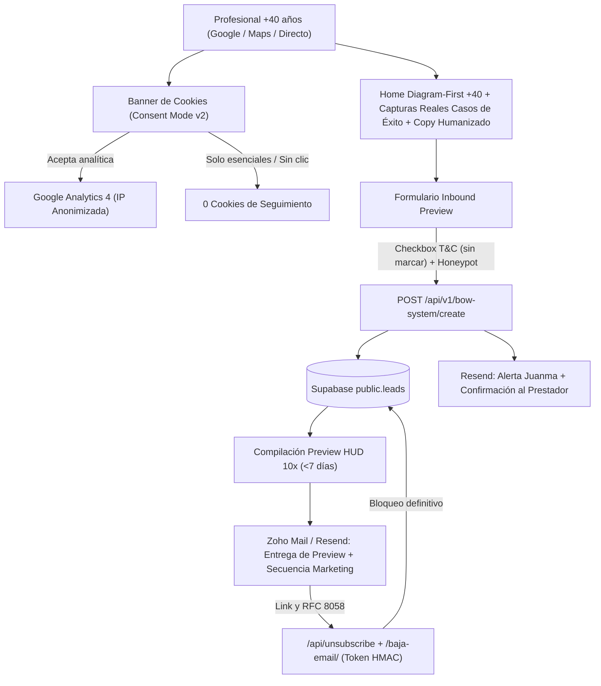

# ⚡ NexoBow — Especificación Técnica Formal: Optimización Final, Blindaje Legal, UX +40, Email Marketing, SEO & Ciberseguridad (`spec-final-polish.md`)

> **Fase del Main Flow:** `[FASE ACTUAL: 2. /to-spec]`  
> **Estado / Triage Label:** `ready-for-agent`  
> **Contratos Anclados:** [`AGENTS.md`](./AGENTS.md) · [`brain.md`](./brain.md) · [`memory.md`](./memory.md) · [`routemap.md`](./routemap.md) · [`GLOSSARY.md`](./GLOSSARY.md) · [`spec-gate0-validation.md`](./spec-gate0-validation.md)

---

## Problem Statement

Si bien NexoBow ya cuenta con su plataforma institucional (`web/`), su fábrica de **templates** REA, su panel operativo `/admin` y su pipeline de lotes Gate 0 (`spec-gate0-validation.md`), todavía existen **20 falencias críticas** de negocio, confianza legal, experiencia visual, automatización de correo, posicionamiento orgánico y ciberseguridad que impiden lanzar la operación final al público de forma profesional y segura:

### Eje 1 — Legal, Compliance Ley 25.326 y Políticas Comerciales (Puntos 1, 2, 4, 5, 6, 7)
1. **Ausencia de Términos y Condiciones y casilla opt-in en la solicitud de preview (Punto 1):** El formulario Inbound permite pedir una preview sin aceptar Términos y Condiciones mediante una casilla explícitamente **sin marcar por defecto** (`unchecked`), dejando al servicio sin respaldo contractual ni consentimiento registrado.
2. **Falta de Política de Privacidad dedicada (Punto 2):** Existen menciones sueltas a la Ley 25.326 en la página principal, pero falta un documento formal accesible desde el pie de página y los formularios explicando responsable del tratamiento, finalidad, derechos ARCO y base legal.
3. **Garantía comercial expuesta a abuso sin Política de Reembolsos razonada (Punto 4):** La web promete devolver el 100% del dinero y dejar el dominio registrado a nombre del **prestador** sin distinguir costos de terceros no reembolsables ni etapas de aprobación, lo que expone a NexoBow a pérdidas económicas.
4. **Falta de Política de Débito Automático (Punto 5):** Al adherirse al Plan Autonomous o renovaciones de infraestructura a partir del segundo año, no están documentadas las reglas de ciclo de cobro, ajustes, reintentos ante rechazo ni el procedimiento de baja anticipada.
5. **Plazos de conservación de datos sin definir (Punto 6):** No está formalizado cuánto tiempo exacto se conservan los datos de una preview inactiva, los metadatos de prospección sin respuesta, las listas de supresión (`unsubscribe`) y los respaldos/comprobantes de clientes activos.
6. **Falta de Banner de Cookies al incorporar analítica (Punto 7):** Al instalar Google Analytics 4 (`GA4`), resulta obligatorio informar y solicitar consentimiento explícito antes de activar cookies de medición, manteniendo intacta la promesa de `0 cookies` hasta que el visitante acepte.

### Eje 2 — UX Visual para Profesionales +40 Años, Humanización Anti-Humo y Capturas Reales (Puntos 3, 8, 13)
7. **Exceso de texto frente a una audiencia +40 años (Punto 3):** Muchos **prestadores** (médicos, odontólogos, abogados, psicólogos mayores de 40 años) no leen bloques densos de texto técnico; necesitan entender el funcionamiento del **embudo** en segundos mediante diagramas visuales claros, pasos gráficos y tipografía cómoda.
8. **Casos de éxito sin evidencia visual inmediata (Punto 8):** Los casos de éxito listan métricas y enlaces externos, pero carecen de una captura real del *Hero* de cada sitio desarrollado (AfterBow, Embudo Infoproducto, Esencia Técnica y Lic. Sofía Ramos) para generar credibilidad visual al instante.
9. **Vocabulario artificial de IA que suena a "vende humos" (Punto 13):** El copy de scripts, **templates**, correos y CRM abusa de términos generados por IA como `"silla vacía"` / `"Anti-Silla Vacía"` y frases exageradas (`"estallar tu agenda"`), alejando al profesional serio +40 que busca orden y seriedad en su agenda.

### Eje 3 — Cierre del Circuito Inbound Preview, Zoho Mail + Resend, Email Marketing y Baja (Puntos 9, 11, 12)
10. **Inbound Preview inconclusa (Punto 9):** El formulario de solicitud de preview guarda el registro en Supabase y redirige a una página estática, pero no valida términos ni bots, no confirma por correo al solicitante ni dispara el flujo completo de entrega y seguimiento en CRM.
11. **Desconexión entre Zoho Mail, Resend, envío de preview terminada y email marketing (Punto 11):** Falta automatizar el ciclo de correos transaccionales y comerciales: confirmación instantánea vía **Resend** al pedir preview, entrega formal de la preview terminada vía **Zoho Mail / Resend** una vez compilada, y alimentación de una secuencia de seguimiento respetuosa para leads inbound.
12. **Ausencia de enlace de baja (`unsubscribe`) (Punto 12):** Los correos enviados por **Resend** y **Zoho Mail** carecen de enlace visible de desuscripción en 1 clic, cabecera `List-Unsubscribe` (RFC 8058) y bloqueo automático contra futuros envíos.

### Eje 4 — Analítica, SEO Real, Search Console, Google Business Profile y ElevenLabs MCP (Puntos 10, 14, 15, 16, 17, 20)
13. **Falta de Google Analytics 4 (Punto 10):** No hay visibilidad de tráfico orgánico, fuentes de adquisición, secciones más vistas ni tasa de conversión en el sitio institucional.
14. **Desaprovechamiento de ElevenLabs Plan Starter como MCP (Punto 14):** Juanma cuenta con plan Starter de ElevenLabs sin conectarlo como servidor MCP ni herramienta de apoyo para generar audios de 35 segundos con su propia voz sobre el guion humanizado.
15. **Relevamiento pendiente de Google Business Profile (Punto 15):** No está definido si NexoBow necesita ficha en Google Business Profile, bajo qué modalidad operativa (*Empresa de Área de Servicio* sin exponer domicilio particular) y qué requisitos de validación aplica en Argentina.
16. **Falta de conexión e indexación en Google Search Console (Punto 16):** El sitio carece de meta etiqueta de verificación, `sitemap.xml` y etiquetas `canonical` configuradas para acelerar la indexación orgánica.
17. **Títulos sin presencia uniforme de la marca NexoBow (Punto 17):** Todas las páginas del sitio deben llevar explícitamente **`NexoBow`** en su `<title>` y metadatos OpenGraph para consolidar marca en buscadores.
18. **SEO desconectado de lo que realmente buscan los clientes potenciales (Punto 20):** El copy actual prioriza jerga técnica (*"Astro SSG 0 JS"*, *"Sistema Bow"*) en lugar de responder a búsquedas reales de profesionales +40 en Google (*"página web para consultorio médico"*, *"sistema de turnos por WhatsApp para médicos y abogados"*).

### Eje 5 — Ciberseguridad y Blindaje Perimetral (Puntos 18, 19)
19. **Ausencia de `robots.txt` estructurado (Punto 18):** Faltan directivas explícitas que guíen a los rastreadores hacia las páginas comerciales públicas e indiquen `Disallow` sobre `/admin/`, `/api/` y rutas privadas/transaccionales.
20. **Falta de relevamiento y blindaje cibernético de primer nivel (Punto 19):** La superficie web y sus endpoints de Cloudflare Pages carecen de cabeceras de seguridad HTTP estrictas (CSP, HSTS, X-Frame-Options, Referrer-Policy), tienen CORS abierto (`*`) en `/api/ping`, carecen de protección anti-bot, límites de tamaño y sanitización en `/api/v1/bow-system/create`, no firman tokens en `/api/unsubscribe` y deben sanitizar cabeceras contra inyección CRLF en el transporte SMTP.

---

## Solution

Se define la especificación integral de cierre de **NexoBow**, organizada en **5 pilares coordinados** que resuelven los 20 puntos manteniendo el estándar **0 JS** en el contenido comercial de la home (salvo la carga estrictamente condicional y aislada de GA4 tras consentimiento explícito del banner de cookies) y preservando los **templates** de **prestadores** bajo el HUD 10x.



### Pilar 1 — Marco Legal, Políticas Comerciales & Consentimiento (Puntos 1, 2, 4, 5, 6, 7)

1. **Términos y Condiciones + Casilla Opt-In sin marcar (Punto 1):**
   - Nueva página pública estática en `/terminos/` (0 JS ejecutable, estética Soft-Obsidian) detallando objeto del servicio (creación de **embudo**, **landing** estática y automatización de turnos), alcance de la preview gratuita por 7 días, propiedad intelectual de código base vs. contenidos del **prestador**, jurisdicción ordinaria de la República Argentina (CABA / Provincia de Buenos Aires) y limitación razonable de responsabilidad.
   - En el formulario de solicitud de preview (`CreateBowSystem`), se incorpora un checkbox obligatorio **sin marcar por defecto** (`required`, sin atributo `checked`), acompañado del texto en voseo claro: *"Leí y acepto los Términos y Condiciones y la Política de Privacidad de NexoBow"*, con enlaces navegables a `/terminos/` y `/privacidad/`.
   - El servidor rechaza con HTTP `400` cualquier envío donde `accept_terms` no sea explícitamente verdadero (`"true"`, `"on"` o `true`), registrando en la ficha del lead `terms_accepted_at` (ISO timestamp) y `terms_version`.

2. **Política de Privacidad Formal — Ley 25.326 (Punto 2):**
   - Nueva página pública estática en `/privacidad/` explicando en lenguaje claro para profesionales: identidad del responsable (NexoBow — Juanma Merodio, correo de contacto oficial), categorías de datos recolectados (nombre, especialidad, email, WhatsApp, enlace de Google Maps/web pública y métricas anónimas de navegación si el usuario acepta cookies), finalidad (armado de preview, contacto comercial, prestación del servicio y envío de novedades con opción de baja), base legal (consentimiento expreso e interés legítimo comercial dentro de la Ley 25.326) y canal directo para ejercer derechos de **acceso, rectificación, actualización y supresión (ARCO)** sin costo ante el responsable y ante la Agencia de Acceso a la Información Pública (AAIP).

3. **Política de Reembolsos Profesional y Sostenible (Punto 4):**
   - Publicada como sección dedicada en `/terminos/#reembolsos` y referenciada desde la tabla de planes y preguntas frecuentes:
     - **Etapa 0 — Prueba sin riesgo previa al pago:** Todo **prestador** recibe y evalúa su preview personalizada durante 7 días antes de abonar el **Setup**.
     - **Garantía Técnica de Entrega y Velocidad (14 días corridos desde el pago del Setup):** Si NexoBow no entrega la **landing** en producción dentro de las 72 horas hábiles desde la recepción completa de los datos del **prestador**, o si la página compilada no alcanza carga inicial menor a 1 segundo en red estándar, corresponde reembolso del **100% del Setup**.
     - **Desistimiento dentro de los 14 días corridos antes de la publicación definitiva:** Si el **prestador** decide cancelar durante los primeros 14 días previos a la aprobación final de salida a producción, NexoBow reintegra el **100% de lo abonado deduciendo únicamente los gastos directos no reembolsables de terceros ya ejecutados** (registro de dominio `.com`/`.com.ar` o licencias pagadas a nombre del cliente), transfiriendo la titularidad de dicho dominio al profesional.
     - **Servicios ejecutados y aprobados / Planes mensuales:** Una vez aprobada la publicación en producción y superados los 14 días corridos, el **Setup** (trabajo de ingeniería, diseño y copywriting ya ejecutado) no es reembolsable. Las cancelaciones de abonos mensuales detienen el próximo período de facturación sin devolución proporcional de días ya transcurridos del mes en curso.

4. **Política de Débito Automático (Punto 5):**
   - Publicada en `/terminos/#debito-automatico` y vinculada al plan `NexoBow Autonomous` y renovaciones anuales:
     - **Plan Starter (Tier 1):** Durante los primeros 12 meses el mantenimiento y hosting es de `$0 ARS/mes` (sin adhesión a débito automático obligatorio). A los 11 meses se notifica por email y WhatsApp con 30 días de anticipación las opciones para el Año 2 (renovar hosting anual o migrar a dominio autogestionado sin penalidades).
     - **Plan Autonomous (Tier 2) y Abonos Mensuales:** El débito automático mensual se procesa entre el día **1 y el 5 de cada mes** calendario por el monto pactado en ARS. Si el **prestador** accede al beneficio de 30 días de prueba inicial, el primer débito mensual se ejecuta recién a partir del día 31 si decide continuar.
     - **Actualización de arancel:** Todo ajuste por inflación (referencia IPC oficial) o cambio de infraestructura se notifica por email con al menos **15 días corridos de anticipación** antes de impactar en el débito.
     - **Rechazos y mora:** Ante un rechazo bancario o de tarjeta, el sistema notifica al titular y realiza hasta **3 reintentos dentro de un período de gracia de 10 días corridos** antes de pausar el servicio automatizado (sin borrar los datos ni el dominio del cliente).
     - **Baja sin permanencia:** No existe permanencia mínima. El **prestador** puede solicitar la baja del débito automático en cualquier momento por WhatsApp o email, o con 48 horas hábiles de anticipación al próximo ciclo para evitar el cobro del mes siguiente.

5. **Cronograma Explícito de Retención y Guarda de Datos (Punto 6):**
   - Tabla oficial publicada en `/privacidad/#retencion` y alineada con el motor `lead-lifecycle`:
     - **Previews temporales no contratadas:** **7 días corridos** desde su última actividad (`expires_at`), tras lo cual el clon web y sus activos compilados se purgan automáticamente del servidor.
     - **Fichas de prospección y solicitudes inbound sin avance:** **90 días corridos** como registro histórico de contacto (para evitar contactar dos veces a la misma persona por error), luego pasan a purga o anonimización.
     - **Registro mínimo de baja (`unsubscribe`):** Conservación indefinida exclusivamente del identificador mínimo necesario (hash o correo bloqueado con estado `unsubscribed: true`) con la única finalidad técnica de **impedir que vuelva a recibir correos**; todo el resto de la ficha comercial se puede suprimir ante pedido ARCO.
     - **Clientes activos y respaldos post-baja:** Durante la vigencia del contrato más **30 días corridos** posteriores a la baja para permitir migración segura; comprobantes fiscales y registros de facturación por **10 años** conforme al Código Civil y Comercial Argentino y normativa ARCA/AFIP.

6. **Banner de Cookies y Google Consent Mode v2 (Punto 7 & Punto 10):**
   - Nuevo componente `CookieConsentBanner` ubicado en el layout público de `web/`.
   - Por defecto, Google Consent Mode v2 inicia con `analytics_storage: 'denied'`, `ad_storage: 'denied'`, `ad_user_data: 'denied'` y `ad_personalization: 'denied'`.
   - El banner ofrece dos botones con jerarquía clara y sin patrones oscuros: **`Aceptar analítica`** y **`Solo esenciales`**, más un enlace directo a `/privacidad/#cookies` y un acceso `"Configurar cookies"` en el `Footer`.
   - Hasta que el usuario presione **`Aceptar analítica`** (persistido en `localStorage("nexobow_cookie_consent")`), **no se descarga `gtag.js` ni se escribe ninguna cookie analítica**.
   - Se excluye explícitamente `/admin/*` del tracking de Google Analytics para aislar métricas internas de administración.

---

### Pilar 2 — UX Visual "Diagram-First" para +40 Años, Capturas Reales y Humanización Total (Puntos 3, 8, 13)

7. **Rediseño "Menos Texto, Más Diagramas" orientado a +40 años (Punto 3):**
   - Principio visual transversal para `web/`: **si una idea puede mostrarse en un esquema de 3 o 4 bloques conectados con flechas, eliminar el párrafo explicativo.**
   - **Tipografía y legibilidad:** Cuerpo mínimo `16px` a `18px`, alto contraste entre texto (`#F8F6FF` / `#E3D9FC`) y fondo (`#040607` / `#0B0D12`), tarjetas con aire generoso y títulos directos en lenguaje cotidiano (evitar anglicismos innecesarios como *LCP*, *Edge CDN*, *AST*, *API* en las secciones comerciales principales; dejar lo técnico como respaldo discreto en pie de tarjeta).
   - **Diagramas visuales SVG/CSS (0 JS) a incorporar/simplificar:**
     - **`Hero`:** Reemplazar la tarjeta recargada de texto por un diagrama visual limpio de **4 etapas conectadas con flechas** (*1. Te buscan en Google/IG → 2. Ven tu página clara → 3. Eligen horario o escriben decididos → 4. Vos solo atendés*).
     - **`BeforeAfter`:** Reducir cada columna a **3 pasos gráficos cortos** ("Hoy: mensajes sueltos a las 11 PM" vs. "Con NexoBow: consulta ordenada directo en tu agenda"), eliminando párrafos largos.
     - **`InteractiveFunnel`:** Convertir cada uno de los 4 paneles en una **infografía visual de 3 nodos con iconos y líneas conectoras** en lugar de bloques narrativos.
     - **`RoiCalculator`:** Simplificar las opciones y mostrar una barra visual comparativa de *"Horas que recuperás por semana"* frente al costo único del sistema.

8. **Capturas Reales del Hero de los Casos de Éxito (Punto 8):**
   - Capturar en alta resolución (`1440x900` escritorio, comprimido en WebP `< 120 KB`) el *Hero* real de cada caso de éxito publicado en `CaseStudies`:
     1. `afterbow-hero.webp` (`https://www.afterbow.com`)
     2. `infoproducto-hero.webp` (`https://juanmamerodio.github.io`)
     3. `esenciatecnica-hero.webp` (`https://esenciatecnica.vercel.app`)
     4. `sofia-ramos-hero.webp` (demo en vivo `sites/demo-nutricionista` / `demo-nutri-sofia`)
   - Integrar la miniatura optimizada en formato `16:9` con marco limpio en la parte superior de cada tarjeta de caso de éxito (`loading="lazy"`, `decoding="async"`, `alt` descriptivo, relación de aspecto fija para `CLS = 0`), permitiendo abrir el sitio en vivo al hacer clic en la captura o en el botón inferior.

9. **Humanización Integral del Copy — Cero `"Silla Vacía"` y Cero Tono "Vende Humos" (Punto 13):**
   - **Prohibición absoluta:** Erradicar de toda la aplicación, **templates**, correos, scripts CLI, CRM y tests las expresiones `"silla vacía"`, `"sillas vacías"`, `"Anti-Silla Vacía"`, `"estallar tu agenda"`, `"revolucionario"`, `"secretos"`, `"disruptivo"` o tono de promesa exagerada.
   - **Reemplazo editorial humanizado (habla real de profesional argentino):**
     - En lugar de *"Sistema Anti-Silla Vacía & Cero-Secretaria"*: usar **"Orden de Consultas y Turnos Confirmados"**, **"Recordatorios automáticos para reducir ausencias"** o **"Agenda ordenada sin responder mensajes uno por uno"**.
     - En lugar de *"evitar apenas 2 sillas vacías por semana cubre el sistema completo"*: usar **"con solo recuperar 2 consultas por mes que hoy se pierden sin respuesta, el sistema ya se paga solo"**.
     - En lugar de *"estallar tu agenda"*: usar **"recibir consultas de pacientes ya decididos a atenderse"**.
     - Revisión y reemplazo sistemático en:
       - `web/src/components/*` (`Hero`, `BeforeAfter`, `Pricing`, `CreateBowSystem`, `CaseStudies`, `Founder`, `Faq`, `FinalCta`, `config.ts`).
       - Los 10 `templates/*/src/components/ThemeSwitcher.astro` (mini-simulador y comparador 20% vs 10x).
       - `scripts/send-zoho-outreach.mjs`, `scripts/intake-maps-batch.mjs`, `scripts/generate-client-fiche.mjs`.
       - `web/src/components/admin/views/CrmView.tsx` (los 5 modos de WhatsApp y guion de 35s) y `web/src/lib/cockpit.ts`.

---

### Pilar 3 — Cierre de Inbound Preview, Zoho Mail + Resend, Email Marketing y Baja (Puntos 9, 11, 12)

10. **Circuito Completo de Solicitud Inbound Preview (Punto 9):**
    - **`CreateBowSystem` (Formulario Público):** Campos claros (`Nombre y apellido`, `Especialidad / Rubro`, `Link de Google Maps o Instagram`, `WhatsApp`, `Email`), campo oculto antispam (*honeypot* `website_confirm`), y casilla obligatoria **sin marcar** `accept_terms`. Botón claro en español cotidiano: `"Pedir mi muestra gratuita"`.
    - **`POST /api/v1/bow-system/create`:**
      1. Verifica origen, tamaño máximo de cuerpo (`8 KB`) y honeypot vacío.
      2. Exige `accept_terms === true`, email con formato válido y teléfono normalizado al estándar argentino (`+549...`).
      3. Persiste en Supabase `public.leads` con `source: "inbound_web"`, `terms_accepted_at`, `terms_version: "2026-11"`, `marketing_opt_in: true`, `unsubscribed: false` y `expires_at` a +7 días.
      4. Dispara vía **Resend** (`RESEND_API_KEY`) dos correos en paralelo sin bloquear al usuario si uno falla (registro del resultado en `metadata`):
         - **Alerta inmediata a Juanma (`ADMIN_OWNER_EMAIL`):** ficha completa del solicitante con botón para abrir WhatsApp directo y acceso a `/admin/crm`.
         - **Confirmación inmediata al prestador:** recibo limpio explicando que su muestra está en armado (<24 hs hábiles), recordando qué incluye, e incluyendo enlace de baja de comunicaciones.

11. **Entrega de Preview Terminada con Zoho Mail + Resend y Secuencia Email Marketing (Punto 11):**
    - **Flujo unificado de entrega (`scripts/process-inbound-leads.mjs` + endpoint `/api/v1/email/send-preview` en `/admin/crm`):**
      - Cuando la preview de un lead (`inbound_web` o `intake_batch`) queda compilada y desplegada en `https://preview.nexobow.site/{slug}/`, Juanma puede despachar con un clic desde `/admin/crm` (o por CLI) el correo oficial **"Tu muestra interactiva de NexoBow ya está lista"**.
      - **Motor dual coordinado (`Zoho Mail` + `Resend`):**
        - **Zoho Mail SMTP:** canal principal para prospección 1 a 1 y entrega personalizada desde `juanma@nexobow.site` (manteniendo conversación directa en bandeja de entrada).
        - **Resend API:** canal transaccional para alertas instantáneas (`/api/ping` y `/api/v1/bow-system/create`), confirmaciones automáticas de formulario inbound, y envío/respaldo de secuencia de seguimiento (Día 0: confirmación, Día 1: entrega de preview, Día 4: recordatorio amable de los 3 días restantes antes de archivar la muestra).
      - **Respeto estricto de `unsubscribed`:** Tanto Zoho Mail como Resend consultan `metadata.email_marketing.unsubscribed` (y el registro global de bajas) antes de enviar cualquier correo; si el contacto se dio de baja, la operación se omite con estado `skipped_unsubscribed`.

12. **Enlace de Baja (`Unsubscribe`) Real y Verificable (Punto 12):**
    - Generación de enlaces de baja firmados con **HMAC-SHA256** (`UNSUBSCRIBE_SECRET`) conteniendo el identificador del lead/email y firma verificable sin exponer datos ni permitir bajas ajenas.
    - Nuevo endpoint `/api/unsubscribe` con soporte para:
      - `GET /api/unsubscribe?token=...`: valida firma HMAC, marca `metadata.email_marketing.unsubscribed = true` y `unsubscribed_at` en Supabase `public.leads` (y/o tabla de supresión), y redirige a `/baja-email/?status=ok`.
      - `POST /api/unsubscribe` (cabecera `List-Unsubscribe-Post: List-Unsubscribe=One-Click` según estándar RFC 8058 exigido por Gmail y Yahoo desde 2024): procesa baja instantánea en 1 clic sin interacción adicional.
    - Todos los correos salientes de **Resend** y **Zoho Mail** (tanto de prospección como de entrega de preview o seguimiento) incluyen al pie un enlace claro `"Si preferís no recibir más correos sobre tu muestra web, podés darte de baja acá en 1 clic"` más las cabeceras `List-Unsubscribe` y `List-Unsubscribe-Post`.
    - Nueva página estática `/baja-email/` confirmando en tono amable y respetuoso que el correo fue removido de la lista y que no volverá a recibir mensajes comerciales.

---

### Pilar 4 — Analítica, SEO de Intención Real, Search Console, Google Business Profile & ElevenLabs MCP (Puntos 10, 14, 15, 16, 17, 20)

13. **Instalación de Google Analytics 4 Condicional (Punto 10):**
    - Variable pública de entorno `PUBLIC_GA_MEASUREMENT_ID` (`G-XXXXXXXXXX`) documentada en `.env.example`.
    - Integración dentro del componente `CookieConsentBanner` en `web/src/layouts/Layout.astro`: si `PUBLIC_GA_MEASUREMENT_ID` está configurado y el visitante aceptó la analítica en el banner, se inyecta dinámicamente `https://www.googletagmanager.com/gtag/js?id=...` con `anonymize_ip: true` y Consent Mode v2 actualizado a `granted`.
    - Seguimiento limpio de eventos clave tras aceptación: vista de página, envío del formulario inbound (`generate_lead`), clic en botón de WhatsApp (`contact_whatsapp`) y apertura de demos (`view_demo`). Mientras el usuario no acepte, la home pública mantiene **0 cookies** de analítica.

14. **Conexión con Google Search Console y SEO de Marca + Intención Real (Puntos 16, 17, 20):**
    - **Marca NexoBow en todos los títulos (Punto 17):** En `Layout.astro`, normalizar la generación de `<title>` para asegurar que **todas las páginas públicas** (`/`, `/terminos/`, `/privacidad/`, `/solicitud-enviada/`, `/baja-email/`) incluyan explícitamente **`NexoBow`** (por ejemplo: `"NexoBow | Páginas Web y Turnos por WhatsApp para Médicos y Profesionales"`, `"Términos y Condiciones | NexoBow"`, `"Política de Privacidad | NexoBow"`), junto con `og:title`, `og:site_name="NexoBow"` y `<link rel="canonical">`.
    - **Google Search Console (Punto 16):**
      - Soporte en `Layout.astro` para la meta etiqueta `<meta name="google-site-verification" content={...} />` alimentada por `PUBLIC_GOOGLE_SITE_VERIFICATION` (o verificación por DNS TXT en Cloudflare para `nexobow.site`, que además cubre todos los subdominios).
      - Generación de `web/public/sitemap.xml` estático incluyendo exclusivamente las URLs indexables públicas (`/`, `/terminos/`, `/privacidad/`) y excluyendo `/admin/`, `/solicitud-enviada/` y `/baja-email/`.
    - **Investigación y Optimización SEO por Intención de Búsqueda de Clientes +40 (Punto 20):**
      - Los profesionales independientes y clínicas de +40 años no buscan *"embudo Astro 0 JS"* en Google; buscan por problema y rubro:
        - **Clúster 1 (Consultorios médicos / salud):** *"página web para consultorio médico"*, *"diseño web para nutricionistas y psicólogos"*, *"página web para odontólogos argentina"*.
        - **Clúster 2 (Estudios profesionales):** *"página web para estudio jurídico"*, *"diseño web para abogados en Argentina"*.
        - **Clúster 3 (Problema operativo):** *"cómo ordenar turnos por WhatsApp en mi consultorio"*, *"sistema de turnos online con WhatsApp"*, *"recibir más pacientes desde Google Maps"*.
      - Incorporar de forma natural estas frases en `title`, `meta description`, `h1`/`h2`, sección de rubros compatibles, `Faq` y datos estructurados **JSON-LD (`ProfessionalService` + `FAQPage`)** en `web/`.

15. **Relevamiento de Google Business Profile (Punto 15):**
    - **Diagnóstico de necesidad:** **SÍ es necesario y altamente recomendable** para generar confianza frente a profesionales +40 años (cuando alguien busca `"NexoBow"` o `"NexoBow opiniones"` antes de pagar `$189.999 ARS`, espera ver una ficha real en Google con reseñas) y por coherencia comercial (NexoBow vende optimización de Google Maps, por lo que debe tener la suya impecable).
    - **Configuración recomendada (sin exponer domicilio privado):** Crear el perfil bajo la modalidad **Empresa de Área de Servicio (Service-Area Business)** ocultando la dirección física particular, configurando zonas de atención principales (`CABA`, `Zona Norte`, `Campana`, `Zárate`, `Argentina`), categoría principal *"Diseño de sitios web"* / *"Agencia de marketing"* y enlace directo a `https://nexobow.site` + WhatsApp profesional.
    - **Acción derivada en el spec:** Documentar el checklist de alta, verificación por video y enlace de reseñas, e incorporar la entidad de negocio en el JSON-LD de `web/`.

16. **Integración de ElevenLabs MCP — Plan Starter (Punto 14):**
    - **Evaluación de utilidad real en NexoBow:** Con el Plan Starter (permite clonación instantánea de voz y generación de audio hasta el límite mensual de caracteres), ElevenLabs aporta un caso de uso concreto de alto valor: **automatizar las notas de voz personalizadas de 35 segundos en MP3/OGG** con el tono natural de Juanma a partir del guion generado para cada lead en `/admin/crm`, ahorrando horas de grabación manual manteniendo cercanía humana.
    - **Integración técnica:**
      - Documentar la configuración del servidor MCP oficial (`elevenlabs-mcp` vía `uvx`) en `~/.gemini/config/mcp_config.json` con la variable `ELEVENLABS_API_KEY` (sin commitear secretos en el repo) y documentar `ELEVENLABS_API_KEY` / `ELEVENLABS_VOICE_ID` en `.env.example`.
      - Crear una costura opcional (`scripts/generate-voice-note.mjs`) que toma el `audio_script_35s` humanizado de un lead y, cuando `ELEVENLABS_API_KEY` y `ELEVENLABS_VOICE_ID` están presentes, genera el archivo de audio para enviarlo por WhatsApp desde `/admin/crm` (sin acoplar el test suite a llamadas reales a la API).

---

### Pilar 5 — `robots.txt` y Blindaje Cibernético de Primer Nivel (Puntos 18, 19)

17. **Archivo `robots.txt` (Punto 18):**
    - Crear `web/public/robots.txt` sirviendo en la raíz del sitio:
      - Permitir rastreo de páginas comerciales y legales (`/`, `/terminos/`, `/privacidad/`).
      - Bloquear explícitamente indexación de superficies operativas o privadas: `/admin/`, `/api/`, `/solicitud-enviada/`, `/baja-email/`.
      - Referenciar `Sitemap: https://nexobow.site/sitemap.xml`.
    - Complementar con `<meta name="robots" content="noindex, nofollow" />` en `/admin/*`, `/solicitud-enviada/` y `/baja-email/` (ya que `robots.txt` por sí solo no garantiza desindexación si existen enlaces externos).

18. **Relevamiento y Blindaje Cibernético Integral en Cloudflare Pages y Scripts (Punto 19):**
    - **Auditoría de vulnerabilidades detectadas hoy en el codebase:**
      1. Ausencia total de archivo `_headers` en `web/public/`: el navegador no recibe `Content-Security-Policy`, `Strict-Transport-Security`, `X-Frame-Options`, `X-Content-Type-Options` ni `Permissions-Policy`.
      2. En `web/functions/api/ping.ts`: `Access-Control-Allow-Origin: *` permite que sitios externos disparen pings arbitrarios; el campo `meta` no acota longitud ni sanitiza etiquetas HTML antes de armar alertas.
      3. En `web/functions/api/v1/bow-system/create.ts`: no valida tamaño máximo de payload, no tiene *honeypot* contra bots de spam, no valida T&C obligatorios, no valida origen ni formato estricto de email/teléfono/URL (`javascript:` o esquemas peligrosos en `maps_url`), y ante fallos o entradas vacías puede registrar basura o usar fallback público sin control.
      4. Ausencia de firma criptográfica en bajas de email (vulnerabilidad IDOR si se usara solo `?email=` o `?id=`).
      5. Riesgo de inyección de cabeceras SMTP (`\r` / `\n` en `subject`, `to`, `fromName`) en `scripts/send-zoho-outreach.mjs`.
      6. Posible exposición de claves de Supabase o variables en cliente si se confunden prefijos `PUBLIC_` vs secretos del Worker.
    - **Medidas de Blindaje Obligatorias a Implementar:**
      - **Cabeceras de Seguridad HTTP (`web/public/_headers`):**
        - `X-Frame-Options: DENY` (anti-clickjacking).
        - `X-Content-Type-Options: nosniff` (anti-MIME sniffing).
        - `Referrer-Policy: strict-origin-when-cross-origin`.
        - `Permissions-Policy: camera=(), microphone=(), geolocation=(), payment=(), usb=()`.
        - `Strict-Transport-Security: max-age=31536000; includeSubDomains; preload`.
        - `Content-Security-Policy` restrictiva para páginas públicas y compatible con Supabase + `/admin` + GA4 únicamente desde `https://www.googletagmanager.com` / `https://www.google-analytics.com`, bloqueando `object-src 'none'`, `base-uri 'self'` y `frame-ancestors 'none'`.
        - `Cache-Control: no-store` y `X-Robots-Tag: noindex, nofollow` sobre `/admin/*` y `/api/*`.
      - **Endurecimiento de `/api/v1/bow-system/create`:**
        - Límite estricto de tamaño de request (`<= 8 KB`), rechazo HTTP `413` / `400` si excede.
        - Verificación de campo honeypot oculto (`website_confirm === ""`).
        - Validación estricta de `accept_terms === true`, formato de email RFC simplificado, longitud acotada de cada campo y validación de esquema `https://` / `http://` para `maps_url` (rechazando `javascript:`, `data:` o `vbscript:`).
        - Sanitización de caracteres de control y tags HTML en textos almacenados y renderizados en correos.
      - **Endurecimiento de `/api/ping`:**
        - Reemplazar `Access-Control-Allow-Origin: *` por validación dinámica contra lista blanca de orígenes permitidos (`https://nexobow.site`, `https://www.nexobow.site`, `https://preview.nexobow.site` y subdominios propios de **prestadores** verificados o `*.pages.dev` de entorno preview), rechazando orígenes arbitrarios y agregando `Vary: Origin`.
        - Acotar tamaño de `request.text()` (`<= 2 KB`), longitud de `meta.theme` y `meta.ctaLabel` (`<= 80` chars) y validación de esquema estricto.
      - **Endurecimiento de `/api/unsubscribe`:**
        - Token firmado con HMAC-SHA256 (`crypto.subtle`) y comparación en tiempo constante para evitar falsificación o baja masiva maliciosa de otros leads.
      - **Endurecimiento de `scripts/send-zoho-outreach.mjs`:**
        - Sanitización obligatoria eliminando `\r` y `\n` de `to`, `subject`, `replyTo` y `fromName` antes de emitir comandos SMTP.
      - **Protección Cloudflare Edge (Dashboard / Infraestructura):**
        - Documentar reglas WAF gratuitas de Cloudflare (Bot Fight Mode + Rate Limiting sobre `/api/v1/bow-system/create` y `/api/ping` + Cloudflare Turnstile opcional si se detecta tráfico automatizado, manteniendo `0 JS` por defecto salvo activación progresiva si hiciera falta).

---

## Seams de Prueba y Verificación (Test Seams)

Se definen **5 seams de alto nivel** verificables mediante `node:test` sin dependencias de red externa en CI:

1. **Seam 1 (`Legal Pages, SEO, Robots, Security Headers & Cookie Consent Seam`):**
   - Compila `web/` con `npm run build` y verifica: existencia de `/terminos/`, `/privacidad/`, `/baja-email/`, `robots.txt`, `sitemap.xml` y `_headers` (CSP, HSTS, X-Frame-Options, nosniff, Permissions-Policy); presencia de la marca `"NexoBow"` en el `<title>` de todas las páginas públicas; presencia de JSON-LD `ProfessionalService` y `FAQPage`; imágenes WebP de casos de éxito en `CaseStudies`; presencia de `CookieConsentBanner` con GA4 bloqueado (`analytics_storage: 'denied'`) hasta consentimiento explícito; y preservación del principio de `0` scripts ejecutables de negocio en la home cuando GA4 no está activado.
2. **Seam 2 (`Humanized Copy & Diagram-First +40 UX Seam`):**
   - Escanea los archivos fuente de `web/`, `templates/`, `scripts/` y `CrmView.tsx` asegurando **0 ocurrencias** de `"silla vacía"`, `"sillas vacías"` y `"Anti-Silla Vacía"`, y verifica en el HTML compilado de `web/` la presencia de diagramas SVG visuales en `Hero`, `BeforeAfter` e `InteractiveFunnel`.
3. **Seam 3 (`Inbound Preview & T&C Checkbox Gate Seam`):**
   - Verifica en el HTML compilado de `CreateBowSystem` la existencia de `<input type="checkbox" ... name="accept_terms" required>` **sin atributo `checked`** y campo honeypot oculto; y verifica sobre el handler `POST /api/v1/bow-system/create` inyectable que rechace con HTTP `400` envíos sin `accept_terms`, envíos con honeypot completo o payloads `> 8 KB`, y que ante envíos válidos guarde `terms_accepted_at` en Supabase mock y dispare las notificaciones Resend (alerta a Juanma + confirmación al solicitante).
4. **Seam 4 (`Zoho + Resend Preview Delivery, Email Marketing & Unsubscribe Seam`):**
   - Verifica el módulo unificado de envío de preview terminada (Zoho Mail / Resend), la generación y verificación de tokens HMAC de baja, los handlers `GET` y `POST` de `/api/unsubscribe` marcando `unsubscribed: true` en Supabase mock, la presencia de enlace y cabecera `List-Unsubscribe` en todo correo saliente, y que `sendZohoOutreachEmail` y el envío Resend omitan con `skipped_unsubscribed` a cualquier contacto dado de baja.
5. **Seam 5 (`Cybersecurity & API Perimeter Hardening Seam`):**
   - Verifica que `/api/ping` valide `Origin` contra la lista blanca en lugar de devolver `*` universal, que `/api/v1/bow-system/create` rechace URLs `javascript:` y payloads sobredimensionados, que `/api/unsubscribe` rechace tokens HMAC alterados, y que `send-zoho-outreach.mjs` neutralice saltos `\r\n` en cabeceras SMTP.

---

## User Stories

1. As a +40-year-old healthcare or legal professional visiting `nexobow.site`, I want to understand how the consultation and appointment workflow works in under 5 seconds through clean visual diagrams instead of dense walls of text, so that I immediately grasp the value without technical friction.
2. As a +40-year-old visitor evaluating NexoBow's credibility, I want to see real Hero screenshots of previous projects (`AfterBow`, `Embudo Infoproducto`, `Esencia Técnica`, `Lic. Sofía Ramos`) directly in the case studies section, so that I verify real engineering work before requesting a preview.
3. As a healthcare or legal professional reading NexoBow's website, emails, or demo HUD, I want natural, grounded Argentine Spanish copy without artificial AI buzzwords like "silla vacía" or exaggerated promises, so that I trust the agency as a serious business partner.
4. As a prospect requesting a free preview on `nexobow.site`, I want to read and explicitly check an unchecked Terms & Conditions and Privacy Policy box before submitting my details, so that I know the rules and knowingly consent to the processing of my data.
5. As a prospect visiting `nexobow.site`, I want to read clear, dedicated `/terminos/` and `/privacidad/` pages compliant with Argentine Law 25.326, so that I know who handles my data, for what purpose, and how to request access or deletion (ARCO rights).
6. As a prospect considering paying for the Setup, I want to see a fair and transparent Refund Policy explaining the 7-day free preview, the 14-day technical delivery/speed guarantee, and how third-party domain registration costs are handled, so that I feel protected without exposing the agency to abuse.
7. As a client subscribing to `NexoBow Autonomous` or future recurring services, I want a clear Automatic Debit Policy explaining billing dates (1st–5th), advance notice of price updates, retry grace periods, and 1-click cancellation without lock-in, so that there are never surprise charges.
8. As a visitor or prospect, I want to know exact data retention timelines (7 days for uncontracted previews, 90 days for inactive prospecting records, minimal indefinite suppression record for unsubscribes, and 30 days post-cancellation backup plus statutory tax retention for active clients), so that my privacy expectations are clear.
9. As a visitor arriving at `nexobow.site`, I want a clean Cookie Consent Banner that blocks analytics cookies until I explicitly accept them, so that my browsing privacy is respected by default.
10. As the NexoBow founder, I want Google Analytics 4 connected conditionally when visitors accept analytics cookies, so that I can measure traffic sources, engagement, and inbound conversion rates legally.
11. As a prospect who submits the Inbound Preview form, I want to receive an immediate confirmation email via Resend while Juanma gets notified with my CRM record ready in `/admin/crm`, so that my request never gets lost.
12. As the NexoBow operator, I want a streamlined workflow from `/admin/crm` and CLI to compile an inbound lead's preview and send the finished preview delivery email via Zoho Mail / Resend, so that every inbound request moves smoothly into my email marketing follow-up.
13. As any recipient of a NexoBow email (outreach, preview delivery, or follow-up), I want a 1-click unsubscribe link and RFC 8058 header inside every email leading to a clear confirmation page, so that I can opt out immediately and permanently.
14. As the NexoBow operator, I want every email sender (Zoho Mail and Resend) to automatically skip any contact marked as `unsubscribed: true`, so that we never email someone who opted out.
15. As the NexoBow founder with an ElevenLabs Starter plan, I want ElevenLabs configured as an MCP tool and integrated with an optional voice-note helper for the 35-second outreach script, so that I can produce natural voice messages faster without robotic phrasing.
16. As the NexoBow founder, I want an actionable assessment and implementation checklist for Google Business Profile configured as a Service-Area Business, so that local prospects looking up NexoBow on Google see verified authority without exposing my home address.
17. As the NexoBow founder, I want Google Search Console verification support, canonical tags, and a clean `sitemap.xml` configured on `nexobow.site`, so that Google indexes all public commercial and legal pages quickly.
18. As the NexoBow founder, I want every public page `<title>` and OpenGraph title to include the brand name `"NexoBow"`, so that brand recognition and search snippets stay consistent across Google.
19. As a professional searching Google in Argentina for *"página web para consultorio médico"* or *"turnos por WhatsApp para abogados"*, I want NexoBow's pages, headings, FAQs, and Schema.org JSON-LD to match those exact search intents, so that I find NexoBow organically.
20. As the NexoBow operator, I want a strict `robots.txt` file and `noindex` tags protecting `/admin/`, `/api/`, `/solicitud-enviada/`, and `/baja-email/`, so that search engines never index private operational or transactional routes.
21. As the NexoBow operator, I want enterprise-grade HTTP security headers (`_headers` with CSP, HSTS, X-Frame-Options, X-Content-Type-Options, Referrer-Policy, Permissions-Policy) deployed on Cloudflare Pages, so that the site is hardened against XSS, clickjacking, and MIME-sniffing attacks.
22. As the NexoBow operator, I want `/api/ping` to enforce an explicit `Origin` allowlist instead of wildcard `*` CORS and sanitize metadata lengths, so that third-party domains cannot abuse our telemetry endpoint.
23. As the NexoBow operator, I want `/api/v1/bow-system/create` to enforce payload size limits, honeypot spam filtering, strict URL scheme validation, and mandatory T&C consent verification, so that automated bots and malicious payloads are rejected at the edge.
24. As the NexoBow operator, I want `/api/unsubscribe` links protected with HMAC-SHA256 signatures and Zoho SMTP headers sanitized against CRLF injection, so that attackers cannot forge unsubscriptions or inject email headers.
25. As the NexoBow operator, I want all security, legal, SEO, humanization, and email-flow invariants protected by automated `node:test` suites while preserving zero unnecessary JS on public pages, so that future deploys remain regression-free.

---

## Implementation Decisions

### 1. Arquitectura de Cumplimiento Legal & Consentimiento
- **Rutas legales estáticas (`0 JS`):** Se crean las páginas dedicadas de Términos y Condiciones (incluyendo las secciones de Política de Reembolsos y Política de Débito Automático) y Política de Privacidad (incluyendo el cuadro de Tiempos de Conservación de Datos y Derechos ARCO), más la página de confirmación de baja de correo. Todas heredan la identidad Soft-Obsidian y el `Layout` base con la marca `NexoBow` en el título.
- **Contrato de consentimiento en formulario inbound y API:** El checkbox de Términos y Condiciones es obligatorio tanto en HTML (`required`, **sin** `checked`) como en servidor (`POST /api/v1/bow-system/create`), rechazando con HTTP `400` cualquier petición sin consentimiento expreso. La aceptación queda registrada dentro de `lead.metadata` sin requerir migración SQL destructiva:

```ts
export interface LeadComplianceMetadata {
  terms_accepted: boolean;
  terms_accepted_at: string;
  terms_version: string;
  marketing_opt_in: boolean;
  email_marketing?: {
    unsubscribed: boolean;
    unsubscribed_at?: string | null;
    welcome_sent_at?: string | null;
    preview_ready_sent_at?: string | null;
    followup_stage?: "none" | "welcome" | "preview_delivered" | "ttl_reminder";
    provider_last?: "zoho_mail" | "resend" | null;
  };
}
```
*(Extensión compatible del contrato `metadata JSONB` en `public.leads`, preservando retrocompatibilidad mediante `resolveLeadMetadata`).*

### 2. Google Consent Mode v2 + GA4 + Cero-JS Condicional
- El banner de cookies opera con un script inline mínimo y encapsulado únicamente para leer/guardar la preferencia en `localStorage` (`nexobow_cookie_consent`: `"accepted"` | `"essential"`), actualizar `gtag('consent', 'update', ...)` e inyectar `gtag.js` solo cuando el usuario elige aceptar analítica y `PUBLIC_GA_MEASUREMENT_ID` está presente.
- La auditoría `audit-site` y `tests/web-redesign.test.mjs` deben actualizarse explícitamente para distinguir entre **0 JS de lógica de aplicación / 0 trackers cargados antes del consentimiento** y el cargador aislado de consentimiento/GA4 (o mantener una bandera de verificación estricta sobre las páginas que no usan GA4 como `/admin` y los scripts del DOM). En caso de no aceptar cookies, el sitio no ejecuta llamadas a Google Analytics ni escribe cookies de analítica.

### 3. Rediseño "Diagram-First +40" y Capturas de Casos de Éxito
- Cada bloque complejo de la landing (`Hero`, `BeforeAfter`, `InteractiveFunnel`, `RoiCalculator`) se simplifica a un máximo de 3–4 nodos visuales con SVG inline liviano (conectores, flechas, iconos claros), reduciendo densidad textual en al menos un 40% y elevando la legibilidad para adultos de +40 años.
- Las capturas de casos de éxito se generan y almacenan localmente como imágenes estáticas WebP optimizadas dentro del repositorio (`web/public/images/cases/`) para que carguen desde el mismo edge de Cloudflare sin dependencias ni hotlinking externo, garantizando dimensiones explícitas (`width` y `height` o `aspect-video`) para evitar `CLS`.

### 4. Pipeline Dual Zoho Mail + Resend y Protocolo Unsubscribe HMAC
- **División clara de roles:**
  - **Resend API:** Alertas instantáneas al fundador (`/api/ping`, `/api/v1/bow-system/create`), confirmación automática al **prestador** cuando pide una preview, y secuencia automatizada de seguimiento / entrega cuando se ejecuta por worker/API edge.
  - **Zoho Mail SMTP:** Envío 1 a 1 de prospección desde Google Maps y entrega ejecutiva personalizada desde `juanma@nexobow.site` para que las respuestas lleguen directo a la bandeja de entrada de Juanma.
- **Seguridad del Enlace de Baja (`/api/unsubscribe`):**
  - El token firmado combina payload Base64URL (`{ slug, email, exp }`) + firma HMAC-SHA256 calculada con `UNSUBSCRIBE_SECRET` (o fallback controlado derivado si falta en entorno dev, rechazando tokens inválidos en producción).
  - Toda función de envío (`sendZohoOutreachEmail`, envío de preview terminada y emails vía Resend) consulta previamente el estado `unsubscribed` y adjunta `List-Unsubscribe: <https://nexobow.site/api/unsubscribe?token=...>` y `List-Unsubscribe-Post: List-Unsubscribe=One-Click`.

### 5. SEO de Intención Real, Search Console y Google Business Profile
- Se estandariza en el `Layout` base el sufijo o prefijo `NexoBow` en `<title>` y `og:title` para que ninguna página salga sin marca.
- Se agregan `sitemap.xml`, meta tag condicional `google-site-verification`, etiqueta `<link rel="canonical">`, y bloques JSON-LD (`ProfessionalService` con `areaServed: "Argentina"` y `FAQPage`) con palabras clave transaccionales reales para médicos, odontólogos, nutricionistas, psicólogos y abogados.
- Se documenta el relevamiento y guía paso a paso de alta de **Google Business Profile** como *Empresa de Área de Servicio* (sin dirección residencial visible) en un archivo operativo o guía del proyecto, vinculando el enlace de reseñas al flujo post-implementación.

### 6. ElevenLabs MCP (Plan Starter)
- Se registra el servidor MCP oficial de ElevenLabs en la configuración local de Antigravity (sin exponer la API key en el repositorio git) y se documentan `ELEVENLABS_API_KEY` y `ELEVENLABS_VOICE_ID` en `.env.example`.
- Se provee un helper CLI desacoplado que lee el `audio_script_35s` ya humanizado de una ficha o lead en Supabase y genera un archivo de audio listo para enviar manualmente por WhatsApp (respetando la regla Gate 0 de WhatsApp semi-asistido sin envíos masivos automáticos).

### 7. Blindaje Cibernético & `robots.txt`
- Se incorporan `robots.txt` y `_headers` como activos estáticos servidos directamente por Cloudflare Pages.
- La validación de entrada, control de tamaño de payload (`<= 8 KB` en create, `<= 2 KB` en ping), verificación `Origin` estricta por lista blanca en `/api/ping`, filtro honeypot, sanitización anti-XSS en HTML de correos, firma HMAC en `/api/unsubscribe` y eliminación de `\r\n` en cabeceras SMTP de Zoho Mail se implementan como funciones puras testables en las Functions y scripts.
- Se consolida un documento/checklist de hardening perimetral en Cloudflare Dashboard (WAF, Bot Fight Mode, Rate Limiting por IP sobre `/api/*` y rotación de secretos).

---

## Testing Decisions

- **Criterio de buen test:** Probar exclusivamente contratos observables externos (HTML generado por Astro, contenido de `robots.txt`, `sitemap.xml` y `_headers`, ausencia de palabras prohibidas en archivos fuente, respuestas HTTP `200`/`303`/`400`/`403`/`413` de Cloudflare Functions ante mocks inyectados de Supabase, Resend y fetch, tokens HMAC válidos vs alterados, e imposibilidad de enviar correo a leads con `unsubscribed: true`). Ningún test automatizado debe hacer peticiones reales a Google Analytics, Search Console, Zoho SMTP, Resend, ElevenLabs ni Supabase en producción.
- **Módulos a testear:**
  1. Suite de `web/` (`tests/web-redesign.test.mjs` + nueva suite legal/SEO/seguridad): páginas legales, títulos con `NexoBow`, diagramas visuales, capturas en `CaseStudies`, banner de cookies + GA4 condicional, `robots.txt`, `sitemap.xml` y `_headers`.
  2. Suite de humanización transversal (`tests/copy-humanization.test.mjs`): verificación automática de 0 ocurrencias de `"silla vacía"` / `"Anti-Silla Vacía"` en `web/`, `templates/`, `scripts/`, `CrmView.tsx` y `cockpit.ts` (y actualización de aserciones antiguas en `tests/intake-maps-batch.test.mjs`, `tests/theme-switcher.test.mjs`, `tests/zoho-outreach.test.mjs` y `tests/flexible-booking-funnel.test.mjs`).
  3. Suite de Inbound & Perimeter Security (`tests/inbound-security.test.mjs`): T&C checkbox obligatorio, honeypot, límites de payload, sanitización de URLs, verificación de orígenes en `/api/ping` y notificaciones Resend.
  4. Suite de Email Delivery & Unsubscribe (`tests/email-unsubscribe.test.mjs`): firma/verificación HMAC, `GET` y `POST` `/api/unsubscribe`, cabeceras `List-Unsubscribe` y bloqueo `skipped_unsubscribed` en Zoho/Resend, más sanitización CRLF SMTP.
- **Prior art en el repositorio:** `tests/web-redesign.test.mjs`, `tests/preview-telemetry.test.mjs`, `tests/zoho-outreach.test.mjs`, `tests/flexible-booking-funnel.test.mjs` y `tests/theme-switcher.test.mjs`.

---

## Out of Scope

- Pasarela de cobro automático con tarjeta en vivo (Stripe / MercadoPago Checkout API / débito CBU directo) dentro de `web/`: el cierre sigue ocurriendo en forma directa tras la preview por WhatsApp/transferencia/link de pago asistido, aunque la **Política de Débito Automático** queda redactada y publicada para respaldar los planes recurrentes.
- Envío masivo automático en frío por WhatsApp sin intervención humana (sigue bloqueado por riesgo de baneo en Gate 0).
- Implementación de un portal de clientes multi-tenant con login propio para editar pagos o facturas (solo `/baja-email/` y `/api/unsubscribe` para desuscripción pública).
- Aprovisionamiento de VPS Hetzner / n8n / Docker Zero-Trust o desarrollo de los templates REA congelados (`propiedades`, `farmaceutica`, `profesional`, `turismo`, `musica`), que permanecen fuera del alcance hasta superar Gate 0 comercial.

---

## Further Notes

- **Impacto sobre tests previos:** Al erradicar `"silla vacía"` / `"Anti-Silla Vacía"` de los scripts, templates y CRM (Punto 13) y al incorporar el cargador condicional de consentimiento de cookies + GA4 en `web/` (Puntos 7 y 10), las aserciones existentes en `tests/web-redesign.test.mjs`, `tests/theme-switcher.test.mjs`, `tests/intake-maps-batch.test.mjs`, `tests/zoho-outreach.test.mjs` y `tests/flexible-booking-funnel.test.mjs` deben actualizarse explícitamente durante el ticket correspondiente para reflejar el nuevo copy humanizado y el aislamiento del banner de cookies.
- **Variables de entorno nuevas a documentar en `.env.example`:** `PUBLIC_GA_MEASUREMENT_ID`, `PUBLIC_GOOGLE_SITE_VERIFICATION`, `RESEND_FROM_EMAIL`, `UNSUBSCRIBE_SECRET` y `ELEVENLABS_API_KEY` / `ELEVENLABS_VOICE_ID` (todas sin valores secretos reales).
- **Siguiente paso del Main Flow (`/to-tickets`):** Una vez aprobado este spec, descomponer los 20 puntos en **tickets verticales atómicos** (`Ticket #54+`) agrupados por los 5 Pilares para ejecutar con TDD estricto.
