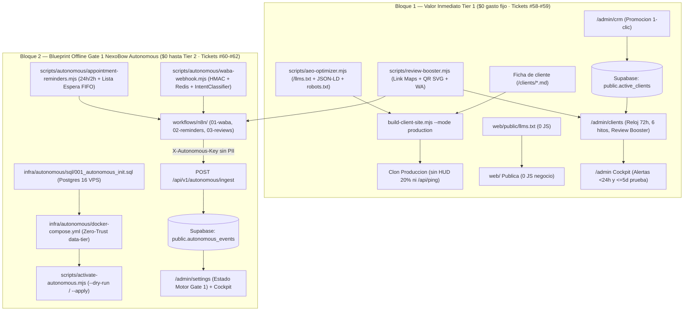

# ⚡ NexoBow — Especificación Técnica Formal: Valor Inmediato Tier 1 & Blueprint Offline Gate 1 — NexoBow Autonomous (spec-frente-i.md)

> **Fase del Main Flow:** `[FASE ACTUAL: 2. /to-spec]`  
> **Estado / Triage Label:** `ready-for-agent`  
> **Frente y Tickets:** Frente I (`#58`–`#62`)  
> **Contratos Anclados:** [`AGENTS.md`](./AGENTS.md) · [`brain.md`](./brain.md) · [`memory.md`](./memory.md) · [`routemap.md`](./routemap.md) · [`GLOSSARY.md`](./GLOSSARY.md) · [`spec-final-polish.md`](./spec-final-polish.md)

---

## Trazabilidad de Decisiones Cerradas (`/grill-me` 12/12)

| Eje | Decisión Cerrada | Ticket(s) |
| :--- | :--- | :---: |
| **Q1 · Alcance y corte** | Corte híbrido `$0-fijo`: Bloque 1 de valor inmediato para **prestadores** Tier 1 (AEO, reseñas 5★, Entrega 72h en `/admin`) + Bloque 2 de código/IaC 100% offline para Gate 1 (`NexoBow Autonomous`), listo para activar en 1 comando al cobrar el primer **abono** Tier 2. | `#58`–`#62` |
| **Q2 · Estructura `/admin`** | Nueva vista dedicada `/admin/clients` (*"Prestadores & Operaciones"*) + bloque resumen en Cockpit (`/admin`) + estado y salud del motor Gate 1 en `/admin/settings`. `/admin/crm` permanece enfocado en prospección efímera con TTL de 7 días. | `#59`, `#62` |
| **Q3 · Humanización +40 (`#55`)** | Lenguaje sobrio para profesionales +40 en todo el Frente I (*"Confirmación automática de turnos y lista de espera"*, *"Atención automática por WhatsApp"*, *"Impulso de reseñas en Google Maps"*, `"credenciales"`/`"claves privadas"`). Ampliar `tests/copy-humanization.test.mjs` a `infra/`, `workflows/` y documentación operativa nueva. | `#58`–`#62` |
| **Q4 · Límite Gate 2 & Router** | Gate 2 queda 100% `Out of Scope` (`Hermes Agent`, `Obsidian Sync`, `Treg.to`, `Crawl4AI`, `Cal.com`, `Chatwoot Cloud` pago, alquiler real de VPS y **templates** congelados `#26`/`#29`–`#32`). En Gate 1 la intención del **paciente** se resuelve con un seam `IntentClassifier` determinista por reglas (`$0`, offline), enchufable luego a `Jev`/LLM. | `#61`, Out of Scope |
| **Q5 · AEO + Modo Producción** | Módulo profundo centralizado `scripts/aeo-optimizer.mjs` (`/llms.txt`, `JSON-LD` por especialidad — `Physician`, `Dentist`, `MedicalClinic`, `LegalService`, `ProfessionalService` / `LocalBusiness` + `FAQPage` — y `robots.txt`) invocado desde `scripts/build-client-site.mjs` con `--mode preview\|production`. En `production` omite el HUD `20%` y `/api/ping` y apunta `<link rel="canonical">` al dominio propio sin duplicar lógica en los 10 `/templates/*/`. | `#58` |
| **Q6 · Motor de Reseñas 5★** | `scripts/review-booster.mjs` en doble modo: en Tier 1 (`$0`) genera enlace directo `writereview?placeid=...` (con fallback a `maps_url`), código QR SVG offline y mensaje respetuoso en voseo +40 en 1 clic desde `/admin/clients`; en Tier 2 alimenta el workflow `n8n` post-consultoría. | `#59`, `#61` |
| **Q7 · Persistencia dual** | Supabase con RLS `public.is_admin_owner()` suma `public.active_clients` y `public.autonomous_events` para `/admin` hoy. Postgres 16 del VPS (`infra/autonomous/sql/001_autonomous_init.sql`) define el esquema transaccional propio de `n8n` (`appointments`, `waitlist_entries`, `reminder_dispatches`, `conversation_state`) aislado en la red `data-tier`. | `#59`, `#60` |
| **Q8 · Blueprint Gate 1 offline** | 4 piezas verificables 100% offline con `node --test`: (1) `infra/autonomous/` Docker Compose Zero-Trust + `.env.autonomous.example` + `scripts/activate-autonomous.mjs --dry-run`; (2) `scripts/autonomous/waba-webhook.mjs` (desafío `GET`, HMAC-SHA256 tiempo constante, normalizador texto/audio/botones, debounce Redis inyectable, `IntentClassifier`); (3) `scripts/autonomous/appointment-reminders.mjs` (recordatorios `24h`/`2h` idempotentes con flags booleanos, cancelación/reprogramación y lista de espera FIFO bajo Ley 25.326); (4) 3 workflows JSON en `workflows/n8n/`. | `#60`, `#61` |
| **Q9 · Entrega 72h en `/admin/clients`** | Promoción en 1 clic desde `LeadDrawer` (`/admin/crm`) hacia `public.active_clients` con cálculo automático de `delivery_deadline_at` (`+72h` hábiles), `trial_ends_at` (`+30d`) y `hosting_renews_at` (`+365d`), checklist operativo de 6 hitos, alertas en Cockpit (`<24h` entrega y `<=5d` fin de prueba) y ampliación de `settings.ts` y `realtime.ts` de 6 a 8 tablas. | `#59` |
| **Q10 · `web/` (`0 JS`) y `routemap.md` v4.0** | En `web/` pública no se rediseña la landing: solo se agrega `web/public/llms.txt` (`0 JS`) y la ruta estática aislada `/admin/clients` en `web/src/pages/admin/[...all].astro`. Se actualiza `routemap.md` a **v4.0** separando las 4 fases reales del negocio y limpiando expresiones anteriores al Ticket `#55`. | `#58`, `#59` |
| **Q11 · Puente Edge y Salud Gate 1** | Endpoint `web/functions/api/v1/autonomous/ingest.ts` autenticado con cabecera `X-Autonomous-Key` (`constantTimeEqual`, falla cerrada en `CF_PAGES === "1"`, solo contadores agregados sin PII bajo Ley 25.326) y panel *"Motor Gate 1 (NexoBow Autonomous)"* en `/admin/settings` (`Preparado (Gate 0 · $0 VPS)` → `Operativo`). | `#62` |
| **Q12 · Secuencia de Tajadas (`#58`–`#62`)** | Orden estricto: `#58` (AEO + `--mode production` + `web/public/llms.txt` + `routemap.md` v4.0) ➔ `#59` (`review-booster` + Supabase 8 tablas + `/admin/clients` + Cockpit) ➔ `#60` (IaC Zero-Trust + Postgres 16 SQL + `activate-autonomous.mjs` + runbook) ➔ `#61` (Seams WABA/recordatorios/lista de espera + 3 workflows `n8n` JSON) ➔ `#62` (`/api/v1/autonomous/ingest` + panel Gate 1 + humanización ampliada + auditoría E2E). | `#58`–`#62` |

---

## Problem Statement

Tras el cierre integral del Frente H (`Tickets #54`–`#57`), NexoBow opera con **177 tests automatizados en verde**, 10 **templates** REA inmutables, una landing pública institucional (`web/`) con `0` bytes de JavaScript ejecutable de negocio, páginas legales formales (`/terminos/`, `/privacidad/`), protección perimetral en Cloudflare Pages (`_headers`, `robots.txt`, baja HMAC RFC 8058) y un Cockpit administrativo (`/admin`) sobre 6 tablas con RLS estricto en Supabase.

Sin embargo, existen **6 brechas concretas** para atender con excelencia a los primeros **prestadores** que paguen el **Setup** Tier 1 (`$189.999 ARS`) y dejar preparado sin costo fijo el motor recurrente **NexoBow Autonomous** (Gate 1, `$549.999 ARS` **setup** + `$229.999 ARS/mes` **abono**):

1. **Separación `preview` vs. `production` y posicionamiento AEO ausentes:** Los 10 `templates/*/src/pages/index.astro` renderizan siempre `<ThemeSwitcher />` (`NexoBow Preview Studio HUD · PROTOTIPO CONCEPTUAL · 20%`) y `scripts/build-client-site.mjs` inyecta `/api/ping` post-build. Cuando un **prestador** contrata Tier 1 y pasa a dominio propio, su **clon** no puede salir publicado con el banner de prototipo ni con telemetría de preview; además carece de `/llms.txt`, `JSON-LD` específico por especialidad médica o jurídica y `<link rel="canonical">` al dominio propio, y `nexobow.site` aún no publica `web/public/llms.txt`.
2. **Falta de motor de reseñas 5★ en Google Maps (`review-booster`):** Un **prestador** Tier 1 atiende pacientes desde el primer día sin requerir Meta Cloud API todavía, pero hoy no existe una herramienta `$0` que genere el enlace directo de reseña en Google Maps, el código QR imprimible para consultorio y el mensaje cordial en voseo +40 listo para enviar en 1 clic, ni un payload compartido para automatizar el pedido post-consultoría en Tier 2.
3. **Ausencia de seguimiento post-venta para la Entrega en 72h hábiles:** La política comercial en `/terminos/#reembolsos` compromete la entrega en producción dentro de **72 horas hábiles** y una prueba de **30 días**, y `/terminos/#debito-automatico` prevé un aviso antes de renovar el Año 1 (**365 días**). Hoy `/admin/crm` gestiona únicamente prospectos temporales con TTL de 7 días (`public.leads`) y no distingue clientes pagos ni hitos de entrega.
4. **Falta de blueprint IaC y seams offline para Gate 1 (`NexoBow Autonomous`):** Al concretar el primer cliente Tier 2, no existen todavía el `docker-compose.yml` Zero-Trust (`n8n 2.0` + `Postgres 16` + `Redis 7`), el esquema transaccional SQL aislado, los adaptadores verificables para Meta Cloud API (WABA), la lógica idempotente de confirmaciones `24h`/`2h` con lista de espera FIFO ni los workflows JSON exportables para `n8n`.
5. **Falta de canal de salud y métricas agregadas sin PII desde el futuro VPS:** No existe un endpoint Edge autenticado que reciba resúmenes agregados y latidos de salud desde `n8n` hacia Supabase sin abrir puertos públicos en el VPS ni transferir datos personales de **pacientes** (Ley 25.326).
6. **Desalineación documental de `routemap.md` y alcance parcial del guardia de humanización:** `routemap.md` mantiene estructura v3.0 con expresiones anteriores al Ticket `#55`, y `tests/copy-humanization.test.mjs` todavía no audita carpetas nuevas de infraestructura (`infra/`), automatización (`workflows/`) ni documentación operativa del Gate 1.

### Regla Innegociable de Gates (`$0` gasto fijo)

De acuerdo con la regla financiera de NexoBow, **ningún entregable del Frente I puede generar gasto fijo mensual ni requerir infraestructura paga activa durante la construcción y verificación**:
- Hasta cobrar **1–3 Setups Tier 1** (`~$500–$1.000 USD` de caja real), no se contrata VPS Hetzner, no se activa Meta Cloud API productiva ni se habilitan servicios pagos.
- Todo el código, migraciones, configuraciones Docker Compose, workflows JSON de `n8n`, endpoints Edge y suites `node --test` deben diseñarse con dependencias inyectables para ejecutarse **100% offline a costo `$0`**, quedando la activación del VPS en producción preparada para ejecutarse mediante **1 comando** (`scripts/activate-autonomous.mjs --apply`) únicamente cuando el fundador decida abrir Gate 1.

---

## Solution

El Frente I adopta un **corte híbrido `$0-fijo`** ejecutado en **5 tajadas verticales (`#58`–`#62`)** divididas en dos bloques coordinados:



### Secuencia de Tajadas Verticales (`Tickets #58`–`#62`)

| Ticket | Alcance Vertical | Depende de | Verificación Principal |
| :---: | :--- | :---: | :--- |
| **`#58`** | AEO (`scripts/aeo-optimizer.mjs`), `--mode preview\|production` en `scripts/build-client-site.mjs`, `web/public/llms.txt` (`0 JS`) y actualización `routemap.md` v4.0 por fases. | Frente H (`#57`) | `tests/aeo-production-mode.test.mjs` + `npm run build` en `web/` (`0 JS` negocio) |
| **`#59`** | `scripts/review-booster.mjs` doble modo + migración Supabase (`active_clients`, `autonomous_events`) + `/admin/clients` (Entrega 72h) + promoción 1-clic desde CRM + alertas en Cockpit + `settings`/`realtime` 8 tablas. | `#58` | `tests/review-booster-clients.test.mjs` + `tests/admin-cockpit-e2e.test.mjs` (8 tablas) |
| **`#60`** | Blueprint IaC Zero-Trust Gate 1 (`infra/autonomous/docker-compose.yml`, `.env.autonomous.example`, `001_autonomous_init.sql`, `scripts/activate-autonomous.mjs` y `docs/gate1-vps-activation.md`). | `#59` | `tests/autonomous-infra.test.mjs` + `activate-autonomous.mjs --dry-run` |
| **`#61`** | Seams puros `NexoBow Autonomous` (`waba-webhook.mjs`, `appointment-reminders.mjs`) + 3 workflows `n8n` JSON en `workflows/n8n/` (`01-waba-receptionist`, `02-reminders-waitlist`, `03-review-booster`). | `#60` | `tests/autonomous-engine.test.mjs` (100% offline con mocks inyectados) |
| **`#62`** | Endpoint Edge `web/functions/api/v1/autonomous/ingest.ts` (0 PII), panel Gate 1 en `/admin/settings`, ampliación de `tests/copy-humanization.test.mjs` y auditoría E2E (`wrangler`, `0 JS`, `impeccable detect`, `/audit-code`). | `#58`–`#61` | `tests/autonomous-ingest-e2e.test.mjs` + `npm test` + `wrangler` + `/audit-code` |

---

## Seams de Prueba y Verificación (Test Seams)

Siguiendo la regla de minimizar costuras de testeo sobre comportamiento observable externo y 100% offline con `node --test`:

1. **Seam 1 (`AEO Optimizer & Production Mode Build Seam` — `#58`):**
   - Verifica la salida de `scripts/aeo-optimizer.mjs` (bloques `JSON-LD` válidos según rubro/especialidad + `FAQPage`, contenido estructurado de `/llms.txt` y `robots.txt`) y la compilación dual en `scripts/build-client-site.mjs`: `--mode preview` conserva el comportamiento vigente en `dist-previews/{slug}/`, mientras `--mode production --domain <dominio>` genera el **clon** limpio sin `<ThemeSwitcher />` (`PROTOTIPO CONCEPTUAL · 20%`), sin `/api/ping`, con `<link rel="canonical">` al dominio propio, `JSON-LD`, `/llms.txt` y `/robots.txt`, dejando intactos los archivos dentro de `/templates/*/`. También verifica `web/dist/llms.txt` y `0` bytes de JS de negocio en `web/dist/index.html`.
2. **Seam 2 (`Review Booster Dual-Mode Seam` — `#59`):**
   - Verifica la extracción segura de `placeId`, generación de URL `writereview?placeid=...` (y fallback seguro a `maps_url`), generación determinista del código QR SVG en memoria sin llamadas de red, redacción de mensajes en voseo argentino +40 sin incentivos económicos prohibidos por Google, y construcción del payload estándar consumido tanto por `/admin/clients` como por el workflow `03-review-booster.json`.
3. **Seam 3 (`Active Clients, Delivery 72h SLA & 8-Table Admin Cockpit Seam` — `#59`):**
   - Verifica la promoción 1-clic desde `LeadEntity` hacia `ActiveClient`, el cálculo de `addBusinessHours(+72h)` excluyendo sábados y domingos, fechas de prueba (`+30d`) y renovación Año 1 (`+365d`), avance de los 6 hitos de entrega, integración con `scripts/domain-provisioner.mjs`, alertas en `cockpit.ts` (`<24h` entrega, `<=5d` fin de prueba) respetando el contrato `{ data, isOffline }` sin datos fantasma cuando Supabase está online con 0 filas, montaje de `/admin/clients` en `web/dist/admin/clients/index.html` y registro de las **8 tablas** en `settings.ts` y `realtime.ts`.
4. **Seam 4 (`Zero-Trust IaC, Postgres 16 SQL & 1-Command Activation Preflight Seam` — `#60`):**
   - Valida estructuralmente `infra/autonomous/docker-compose.yml` (red `data-tier` con `internal: true`, ausencia de `/var/run/docker.sock`, ausencia de exposición `0.0.0.0` para Postgres/Redis/n8n, `no-new-privileges:true`, límites de memoria), ausencia de valores reales en `.env.autonomous.example`, integridad DDL de `infra/autonomous/sql/001_autonomous_init.sql` (4 tablas, `UNIQUE` anti-duplicados, índices), y ejecución de `scripts/activate-autonomous.mjs --dry-run` con runner inyectable (código `0` si el preflight pasa, error explícito ante variables obligatorias faltantes sin ejecutar comandos reales).
5. **Seam 5 (`Autonomous WABA Webhook, Debounce, IntentClassifier, Reminders & n8n Workflows Seam` — `#61`):**
   - Verifica handshake `GET` de Meta (`hub.verify_token` + `hub.challenge`), validación `X-Hub-Signature-256` en tiempo constante (aceptando firmas válidas y rechazando alteradas), normalización de mensajes (texto, nota de voz con transcripción, botones interactivos `Confirmar` / `Reprogramar`), buffer de ráfagas sobre store Redis inyectable (`8–12s`), clasificación determinista de intención (`IntentClassifier` `$0` + hook enchufable `customClassifier` + derivación humana obligatoria en urgencia clínica), máquina de recordatorios `24h`/`2h` idempotente (sin reenvíos duplicados), liberación de turno cancelado ofreciendo al siguiente **paciente** FIFO con consentimiento Ley 25.326 y expiración de oferta, más validación estructural JSON de los 3 workflows de `workflows/n8n/`.
6. **Seam 6 (`Autonomous Edge Ingest, Settings Gate 1 Health, Extended Humanization & E2E Audit Seam` — `#62`):**
   - Verifica `POST /api/v1/autonomous/ingest` (falla cerrada HTTP `503` en `CF_PAGES === "1"` sin `AUTONOMOUS_INGEST_KEY`, rechazo `401`/`403` ante clave inválida vía `constantTimeEqual`, rechazo `413` > `4 KB`, rechazo `400` ante cualquier campo con PII como teléfono, email o nombre de **paciente**, `Cache-Control: no-store`, inserción en `autonomous_events`), transición de estado Gate 1 en `settings.ts` (`Preparado (Gate 0 · $0 VPS)` → `Operativo`), cobertura ampliada de `tests/copy-humanization.test.mjs` sobre `infra/`, `workflows/`, `docs/gate1-vps-activation.md`, `web/public/llms.txt` y `routemap.md`, build de `web/` (`0 JS` de negocio), compilación `wrangler pages functions build` (sin módulos `node:*`), `impeccable detect` y dictamen limpio en `/audit-code`.

---

## User Stories

1. As a Tier 1 paying **prestador**, I want my **clon** compiled with `--mode production` for my own domain without the conceptual `20%` prototype HUD or preview tracking script, so that my patients see an authoritative, finished **landing** rather than an internal demo.
2. As a Tier 1 or Tier 2 **prestador**, I want my compiled **landing** to include `/llms.txt`, `robots.txt`, canonical domain URL, and accurate Schema.org `JSON-LD` for my clinical or legal specialty plus `FAQPage`, so that Google, ChatGPT, and Perplexity understand my services, location, and booking flow accurately.
3. As a visitor or AI assistant querying `nexobow.site`, I want a clean static `/llms.txt` file published on `web/` without adding any client-side JavaScript, so that NexoBow's value ladder, service areas, and official channels are machine-readable at `$0` extra cost.
4. As the NexoBow founder, I want `routemap.md` reorganized into v4.0 separating Gate 0 (`#50`–`#57` completed), Gate 1 (Frente I `$0` offline + 1-command VPS activation), Gate 2, and Phase 4 with clean +40 language, so that the business roadmap reflects current reality with zero obsolete claims.
5. As a Tier 1 **prestador** already seeing **pacientes**, I want a direct Google Maps review link, an offline printable QR SVG, and a polite Argentine Spanish WhatsApp message template ready from day one, so that satisfied **pacientes** leave 5-star reviews without requiring a paid VPS or WhatsApp API yet.
6. As the NexoBow operator, I want to promote a converted lead from `/admin/crm` (`LeadDrawer`) to `public.active_clients` in 1 click, so that operational delivery tracking begins immediately without retyping their data.
7. As the NexoBow operator, I want `/admin/clients` to calculate the contractual **72 business-hour** delivery deadline, the **30-day** trial end date, and the **365-day** Year 1 hosting renewal date automatically, so that I never breach the SLA promised in `/terminos/#reembolsos` or `/terminos/#debito-automatico`.
8. As the NexoBow operator, I want a 6-milestone onboarding checklist per active **prestador** (photos/material, copy approval, `--mode production` + AEO build, DNS/SSL check via `domain-provisioner`, `review-booster` configured, confirmed delivery), so that every launch follows a repeatable quality standard.
9. As the NexoBow operator looking at the `/admin` Cockpit each morning, I want urgent alerts when an active **prestador** delivery is within `<24h` or a 30-day trial ends within `<=5` days (alongside aggregated Gate 1 counts when live), so that I prioritize operations and upsells on time.
10. As the NexoBow operator inspecting `/admin/settings`, I want all 8 Supabase tables (`leads`, `active_clients`, `autonomous_events`, `financial_transactions`, `schedule_blocks`, `alaynow_videos`, `habits`, `habit_logs`) monitored under strict `is_admin_owner()` RLS and Realtime, so that platform health and Single-Truth (`{ data, isOffline }`) remain consistent across every module.
11. As the NexoBow operator obeying the Gates rule, I want the entire Gate 1 VPS stack (`n8n 2.0`, `Postgres 16`, `Redis 7`, optional `cloudflared` tunnel) defined as Zero-Trust IaC in `infra/autonomous/` with `$0` monthly burn today, so that no infrastructure is paid until Tier 1 cash validates demand.
12. As the NexoBow security owner, I want `Postgres 16` and `Redis 7` confined to an internal Docker network (`data-tier: internal: true`) without host port exposure (`0.0.0.0`), without `/var/run/docker.sock`, and with `no-new-privileges:true`, so that database and **paciente** conversation state remain isolated from the public internet.
13. As the NexoBow operator unlocking Gate 1 after closing the first Tier 2 client, I want a single activation script (`scripts/activate-autonomous.mjs`) with `--dry-run` preflight and a clear runbook (`docs/gate1-vps-activation.md`), so that bringing up the VPS stack is deterministic, auditable, and reproducible in 1 command.
14. As a Tier 2 **prestador** clinic using Meta Cloud API (WABA), I want incoming webhook verification (`GET` challenge and constant-time HMAC `X-Hub-Signature-256`) validated before processing any message, so that spoofed webhook requests are rejected immediately.
15. As a **paciente** sending multiple short messages or voice notes in bursts on WhatsApp, I want a Redis debounce buffer (8–12 seconds) to consolidate my messages before answering, so that the assistant sends one clear reply instead of several fragmented messages.
16. As the NexoBow Autonomous engine running at minimal API cost, I want a deterministic rule-based `IntentClassifier` (`$0`, offline) with a pluggable classifier seam for future `Jev`/LLM routing and mandatory human handoff on clinical urgency or explicit human request, so that routine intents route reliably without LLM overhead.
17. As a Tier 2 **prestador**, I want automated `24h` and `2h` confirmation reminders (`[Confirmar / Reprogramar]`) tracked with idempotent boolean flags in Postgres 16, so that no **paciente** receives duplicate reminders and no-shows decrease reliably.
18. As a **paciente** on an opted-in waitlist under Ley 25.326, I want an available slot released by a cancellation to be offered in strict FIFO order with an expiration window (and immediate stop upon `"baja"`), so that earlier appointments are filled fairly and consent is respected.
19. As the NexoBow operator deploying `n8n 2.0` on the VPS, I want 3 validated, version-controlled JSON workflows (`01-waba-receptionist.json`, `02-reminders-waitlist.json`, `03-review-booster.json`) referencing environment variables without hardcoded credentials, so that importing the automation engine requires zero manual node reconstruction.
20. As the future VPS `n8n` instance, I want to post non-PII aggregated counters and heartbeats to `POST /api/v1/autonomous/ingest` signed with `X-Autonomous-Key`, so that `/admin` reflects Gate 1 health and confirmed appointments without exposing database credentials to the browser or opening VPS inbound ports.
21. As the NexoBow security owner, I want `/api/v1/autonomous/ingest` to reject any payload containing personal **paciente** fields (`phone`, `email`, `dni`, `patient_name`) with HTTP `400`, fail closed when `AUTONOMOUS_INGEST_KEY` is missing in Cloudflare production, and verify the key in constant time, so that Ley 25.326 privacy boundaries hold even at the Edge boundary.
22. As the NexoBow operator checking `/admin/settings`, I want a clear *"Motor Gate 1 (NexoBow Autonomous)"* panel showing `"Preparado (Gate 0 · $0 VPS)"` while no VPS heartbeat exists and `"Operativo"` once valid aggregated heartbeats arrive, so that operational readiness is unambiguous.
23. As a +40 healthcare or legal professional reading NexoBow docs, review templates, WhatsApp reminders, or `/admin` UI, I want calm, respectful, trustworthy Argentine Spanish free of artificial marketing clichés, so that the entire platform matches the credibility of the brand.
24. As the NexoBow engineering workflow, I want every new script, SQL migration, workflow JSON, Edge function, and UI component verified offline via `node --test` while keeping `0` business JavaScript on public `web/` pages and passing `impeccable detect` plus a clean `/audit-code` review, so that Gate 0 conversion quality is never regressed.

---

## Implementation Decisions

### 1. Módulo Profundo AEO, Modo Producción & `web/public/llms.txt` (`#58`)

- **Módulo `scripts/aeo-optimizer.mjs`:**
  - Encapsula la generación determinista de activos AEO por **prestador** sin llamadas de red:
    - Mapeo canónico `RUBRO_SCHEMA_MAP`: `odontologo` → `"Dentist"`, `clinica` → `"MedicalClinic"`, `nutricionista` / `psicologo` / `dermatologia` / `estetica` / `cirugia` / `medico` / `kinesiologo` → `"Physician"` (o `"MedicalBusiness"` cuando es centro multipersonal), `abogado` → `"LegalService"`, `corporativo` / `consultor` / `tech` / `construccion` / `producto` / `deportes` → `"ProfessionalService"` (con `"LocalBusiness"` como respaldo).
    - `buildProviderJsonLd(siteData, options)`: emite arreglo JSON-LD `[EntitySchema, FAQPage]` incluyendo `name`, `description`, `url` (dominio productivo o URL de preview), `telephone`, `areaServed`, `address`, `hasOfferCatalog` / `availableService` y preguntas frecuentes reales desde `content.faq.items`.
    - `buildProviderLlmsTxt(siteData, options)`: genera `/llms.txt` en Markdown estructurado con resumen del **prestador**, especialidades, modalidad de atención, arancel/tipo de consulta, ciudad/zona, canal de agenda y enlace oficial, en español rioplatense claro.
    - `buildProviderRobotsTxt({ origin, allowIndexing })`: en `--mode production` permite rastreo público (`Allow: /`, referencia a `llms.txt` y `sitemap.xml` si aplica); en `--mode preview` conserva política no indexable para no competir con la web definitiva del **prestador**.
    - `injectAeoIntoHtml(html, { jsonLd, canonicalUrl, indexable })`: inyección idempotente en `<head>` de `<link rel="canonical">`, meta `robots` (`index, follow` en producción; `noindex, nofollow` en preview) y `<script type="application/ld+json">` sin alterar el resto del documento ni introducir JS ejecutable.

- **Extensión de `scripts/build-client-site.mjs` (`--mode preview|production`, `--domain`):**
  - El valor por defecto sigue siendo `--mode preview` para preservar 100% de retrocompatibilidad con `intake-maps-batch.mjs`, scripts existentes y tests actuales.
  - En `--mode production`:
    1. Exige dominio destino (`--domain` o `fm.dominio_propio` válido; falla con código de salida `2` si falta o no tiene formato de dominio válido).
    2. **Sin tocar `/templates/*/` ni requerir bumps de tags git**, limpia la importación y etiqueta `<ThemeSwitcher />` únicamente dentro de la copia efímera `sites/{slug}/src/pages/index.astro` antes de ejecutar `npm run build` en el clon.
    3. Compila Astro con `--base /` (raíz de dominio propio en lugar de `/{slug}/`), **omite** la inyección de `preview-telemetry.mjs` (`/api/ping`), invoca `scripts/aeo-optimizer.mjs` para inyectar `JSON-LD` + `<link rel="canonical" href="https://{domain}/" />` + `index, follow` en `dist/index.html` y escribe `dist/llms.txt` y `dist/robots.txt`.
    4. **No** sobreescribe `dist-previews/{slug}/` ni pisa Columna G (`Web Demo URL` de preview) en `LeadStore`, manteniendo separada la salida productiva en `sites/{slug}/dist/` (o `dist-production/{slug}/` opcional por flag `--out-dir`) y preparando el handoff hacia `scripts/domain-provisioner.mjs`.

- **AEO Institucional en `web/` y Alineación de `routemap.md` v4.0:**
  - `web/public/llms.txt`: archivo estático puro servido en `https://nexobow.site/llms.txt` (`0 JS`), describiendo la propuesta de valor +40, los planes vigentes (`Starter $189.999 ARS · $0/mes Año 1`, `Autonomous $549.999 ARS + $229.999 ARS/mes`, `Growth Partner`), rubros compatibles, enlace a `/terminos/` y `/privacidad/`, y canal oficial WhatsApp `+54 9 3489 53-6088`.
  - `routemap.md` v4.0: reestructura el documento en las 4 fases reales del negocio: **Fase 1 / Gate 0 (`[COMPLETADO — Tickets #50–#57]`)**, **Fase 2 / Gate 1 (`[Frente I — Tickets #58–#62: Bloque Tier 1 $0 + Blueprint VPS Offline 1 Comando]`)**, **Fase 3 / Gate 2 (`[Out of Scope actual — Hermes, Obsidian Sync, Treg.to, Arbitraje]`)** y **Fase 4 (`[Ads + Activos Digitales]`)**, depurando el lenguaje previo al Ticket `#55` para cumplir la guardia extendida de humanización.

---

### 2. Motor de Reseñas 5★ en Doble Modo (`scripts/review-booster.mjs` — `#59`, `#61`)

- **Contrato del módulo profundo `scripts/review-booster.mjs`:**
  - `extractPlaceIdFromMapsUrl(mapsUrl)`: extrae `place_id` / `query_place_id` cuando está presente en URLs de Google Maps; si recibe un enlace corto o `/maps/place/` sin `place_id` explícito, devuelve `null` de forma determinista sin efectuar red.
  - `buildGoogleReviewUrl({ placeId, mapsUrl, businessName })`: si existe `placeId`, construye `https://search.google.com/local/writereview?placeid=${encodeURIComponent(placeId)}`; si no, sanitiza `mapsUrl` (`https://` únicamente, rechazando esquemas `javascript:`/`data:`) o genera búsqueda controlada `https://www.google.com/maps/search/?api=1&query=...`.
  - `generateReviewQrSvg(targetUrl, { size, label })`: genera un `<svg>` determinista y autocontenido offline (matriz QR determinista basada en librería local o codificador puro sin peticiones HTTP externas) listo para descargar o imprimir en consultorio.
  - `buildReviewRequestMessage({ providerName, specialty, patientFirstName, reviewUrl, mode })`: genera texto respetuoso en voseo argentino para profesionales +40 sin promesas ni incentivos económicos prohibidos por las políticas de Google (`mode: "tier1_manual"` para copiar/enviar desde `/admin/clients` y `mode: "tier2_post_consult"` para disparar 2–4 horas después de una **consultoría** concretada).
  - `buildReviewBoosterWorkflowPayload(clientRecord)`: adapta los datos de `ActiveClient` al esquema esperado por el workflow `03-review-booster.json` de `n8n` (manteniendo paridad entre Tier 1 y Tier 2).

---

### 3. Persistencia Dual: Supabase (`active_clients`, `autonomous_events`) & Vista `/admin/clients` (`#59`)

- **Migración SQL Supabase (`supabase/migrations/20261121000000_active_clients_and_autonomous_events.sql`):**
  - Nota de integridad referencial verificada en el esquema existente: `public.leads.id` es `bigint` (`20261102010000_crm_leads_init.sql`), por lo que la clave foránea `lead_id` debe ser **`bigint`** (nunca `uuid`).
  - Todas las políticas RLS replican el patrón estricto de las 6 tablas previas anclado en `public.is_admin_owner()`.
  - `public.autonomous_events` **prohíbe almacenar datos personales de pacientes** (`phone`, `email`, `dni`, `patient_name`): únicamente registra métricas agregadas y estado operativo por `client_slug`.

```sql
-- Contrato de esquema Supabase (Ticket #59)
CREATE TYPE public.client_tier_type AS ENUM ('starter_tier1', 'autonomous_tier2', 'growth_tier3');
CREATE TYPE public.delivery_sla_status AS ENUM ('en_curso', 'entregado_en_tiempo', 'alerta_24h', 'vencido_sla', 'pausado');
CREATE TYPE public.autonomous_event_type AS ENUM (
  'heartbeat', 'appointment_confirmed', 'appointment_rescheduled',
  'appointment_cancelled', 'waitlist_filled', 'review_invite_sent', 'human_handoff'
);

CREATE TABLE IF NOT EXISTS public.active_clients (
  id uuid PRIMARY KEY DEFAULT gen_random_uuid(),
  lead_id bigint UNIQUE REFERENCES public.leads(id) ON DELETE SET NULL,
  slug text UNIQUE NOT NULL,
  provider_name text NOT NULL,
  niche text NOT NULL DEFAULT 'clinica',
  tier public.client_tier_type NOT NULL DEFAULT 'starter_tier1',
  primary_domain text,
  maps_place_id text,
  review_url text,
  delivery_status public.delivery_sla_status NOT NULL DEFAULT 'en_curso',
  checklist jsonb NOT NULL DEFAULT '{
    "material_received": false,
    "copy_approved": false,
    "production_aeo_built": false,
    "domain_ssl_verified": false,
    "review_booster_ready": false,
    "delivery_confirmed": false
  }'::jsonb,
  aeo_verified boolean NOT NULL DEFAULT false,
  promoted_at timestamptz NOT NULL DEFAULT now(),
  delivery_deadline_at timestamptz NOT NULL,
  delivered_at timestamptz,
  trial_ends_at timestamptz NOT NULL,
  hosting_renews_at timestamptz NOT NULL,
  metadata jsonb NOT NULL DEFAULT '{}'::jsonb,
  created_at timestamptz NOT NULL DEFAULT now(),
  updated_at timestamptz NOT NULL DEFAULT now()
);

CREATE TABLE IF NOT EXISTS public.autonomous_events (
  id uuid PRIMARY KEY DEFAULT gen_random_uuid(),
  client_slug text NOT NULL,
  event_type public.autonomous_event_type NOT NULL,
  period_date date NOT NULL DEFAULT CURRENT_DATE,
  count_delta integer NOT NULL DEFAULT 1 CHECK (count_delta >= 0 AND count_delta <= 10000),
  engine_version text NOT NULL DEFAULT 'gate1-v1',
  summary jsonb NOT NULL DEFAULT '{}'::jsonb,
  received_at timestamptz NOT NULL DEFAULT now()
);
```

- **Módulo de dominio `web/src/lib/active-clients.ts` y contratos TypeScript:**

```ts
export interface DeliveryChecklist {
  material_received: boolean;
  copy_approved: boolean;
  production_aeo_built: boolean;
  domain_ssl_verified: boolean;
  review_booster_ready: boolean;
  delivery_confirmed: boolean;
}

export interface ActiveClient {
  id: string;
  lead_id: number | null;
  slug: string;
  provider_name: string;
  niche: string;
  tier: "starter_tier1" | "autonomous_tier2" | "growth_tier3";
  primary_domain: string | null;
  maps_place_id: string | null;
  review_url: string | null;
  delivery_status: "en_curso" | "entregado_en_tiempo" | "alerta_24h" | "vencido_sla" | "pausado";
  checklist: DeliveryChecklist;
  aeo_verified: boolean;
  promoted_at: string;
  delivery_deadline_at: string;
  delivered_at: string | null;
  trial_ends_at: string;
  hosting_renews_at: string;
}
```
  - Funciones puras exportadas: `addBusinessHours(startDate, 72)` (avanza horas hábiles lun–vie saltando sábados y domingos), `buildActiveClientFromLead(lead, options)` (calcula `delivery_deadline_at` `+72h` hábiles, `trial_ends_at` `+30d`, `hosting_renews_at` `+365d` y `review_url` inicial), `computeChecklistProgress(checklist)`, `resolveDeliverySlaState(client, now)` y `extractOperationalAlerts(clients, now)` (alertas `<24h` de entrega pendiente y `<=5d` de fin de prueba de 30 días).
  - Repositorio resiliente respetando el patrón **Verdad Única (`{ data, isOffline }`)** del Ticket `#48`: si Supabase responde online con `error === null` y `0` filas, devuelve `{ data: [], isOffline: false }` (cero datos fantasma); solo usa fallback mock explícito si falta configuración o `forceMock` está activo en pruebas.

- **Integración UI en `/admin` (`0 JS` intacto en `web/` pública):**
  - `web/src/pages/admin/[...all].astro`: añade `{ params: { all: "clients" } }` en `getStaticPaths()` dentro de la isla React aislada.
  - `AdminLayout.tsx` y `AdminApp.tsx`: incorporan el ítem de navegación **`Prestadores & Operaciones`** (`/admin/clients`) y montan `<ClientsView onNavigate={navigate} />`.
  - `CrmView.tsx` (`LeadDrawer`): incorpora el botón de 1 clic **`Convertir a Prestador Activo`**, promoviendo el registro hacia `public.active_clients` y navegando o enlazando a `/admin/clients`.
  - `ClientsView.tsx`: tablero operativo con filtros por `tier` y estado SLA, reloj regresivo de 72h hábiles, barra de progreso de los 6 hitos interactivos, verificador DNS/comando `domain-provisioner` por dominio propio, botón de descarga/copiado del kit `review-booster` (link Maps + QR SVG + mensaje WhatsApp en voseo +40), y contadores agregados de `autonomous_events`.
  - `cockpit.ts` y `CockpitView.tsx`: suman widget de alertas de **Entrega 72h (<24h)**, **Fin de Prueba 30d (<=5d)** y resumen agregado Gate 1 sin romper el contrato `{ data, isOffline }`.
  - `web/src/lib/settings.ts` y `web/src/lib/realtime.ts`: amplían `ADMIN_DATABASE_TABLES` y `DEFAULT_WATCHED_TABLES` de **6 a 8 tablas** agregando `"active_clients"` y `"autonomous_events"`.

---

### 4. Blueprint IaC Zero-Trust Gate 1 & Postgres 16 VPS (`#60`)

- **Topología Zero-Trust en `infra/autonomous/docker-compose.yml`:**
  - **Redes aisladas:** `front-ingress` (salida controlada / proxy Cloudflare Tunnel), `app-tier` (comunicación entre `n8n` y puente saliente) y `data-tier` con **`internal: true`** (sin acceso directo a internet).
  - **Servicios contemplados:**
    - `postgres` (`postgres:16-alpine`): montado solo en `data-tier`, sin mapeo `ports` a host, healthcheck `pg_isready`, volumen persistente y script de inicialización `./sql/001_autonomous_init.sql` montado en `/docker-entrypoint-initdb.d/`.
    - `redis` (`redis:7-alpine`): montado solo en `data-tier`, sin mapeo `ports` a host, `appendonly yes` y contraseña por `${REDIS_PASSWORD}`.
    - `n8n` (`n8nio/n8n:2.0` o pin explícito compatible 2.x): conectado a `app-tier` y `data-tier`, conectado únicamente a loopback `127.0.0.1:${N8N_LOCAL_PORT:-5678}:5678` (accesible solo vía Tailscale / SSH tunnel o Cloudflare Zero Trust Tunnel), sin `/var/run/docker.sock`, con `security_opt: ["no-new-privileges:true"]` y límites `mem_limit` ajustados para VPS de 2–4 GB RAM.
    - `cloudflared` (perfil opcional `profiles: ["tunnel"]`): puente saliente cifrado hacia webhook WABA sin abrir puertos entrantes en el firewall `UFW`.
    - **Chatwoot desacoplado:** explícitamente fuera de este Compose central para preservar memoria RAM (se documenta conexión externa en `docs/gate1-vps-activation.md`).
- **Archivo `infra/autonomous/.env.autonomous.example`:**
  - Documenta todas las variables requeridas (`POSTGRES_DB`, `POSTGRES_USER`, `POSTGRES_PASSWORD`, `REDIS_PASSWORD`, `N8N_ENCRYPTION_KEY`, `WEBHOOK_URL`, `META_WABA_VERIFY_TOKEN`, `META_WABA_APP_SECRET`, `META_WABA_ACCESS_TOKEN`, `NEXOBOW_INGEST_URL`, `AUTONOMOUS_INGEST_KEY`) utilizando exclusivamente placeholders descriptivos y terminología limpia (*"credenciales"* / *"claves privadas"*).
- **Esquema SQL Transaccional VPS (`infra/autonomous/sql/001_autonomous_init.sql`):**
  - Tablas dedicadas a la operación en vivo de turnos (los datos de contacto de **pacientes** viven exclusivamente en este Postgres 16 aislado dentro de `data-tier` y nunca se replican a Supabase ni a Cloudflare Edge):
    - `appointments`: `id uuid`, `client_slug text`, `patient_phone_hash text`, `patient_phone_e164 text`, `patient_first_name text`, `specialty text`, `scheduled_at timestamptz`, `status text CHECK (status IN ('pendiente','confirmado','reprogramado','cancelado','concretado','ausente'))`, `confirmed_24h boolean DEFAULT false`, `confirmed_2h boolean DEFAULT false`, `review_requested_at timestamptz`, `external_calendar_event_id text`, `created_at`, `updated_at`.
    - `waitlist_entries`: `id uuid`, `client_slug text`, `patient_phone_hash text`, `patient_phone_e164 text`, `patient_first_name text`, `specialty text`, `preferred_window text`, `consent_waitlist boolean NOT NULL DEFAULT false`, `opted_out boolean NOT NULL DEFAULT false`, `status text CHECK (status IN ('esperando','ofertado','tomado','expirado','baja'))`, `offered_slot_id uuid`, `offer_expires_at timestamptz`, `created_at timestamptz`. Índice FIFO `(client_slug, status, created_at ASC)`.
    - `reminder_dispatches`: `id uuid`, `appointment_id uuid REFERENCES appointments(id) ON DELETE CASCADE`, `reminder_type text CHECK (reminder_type IN ('24h','2h','waitlist_offer','review_5star'))`, `status text`, `provider_message_id text`, `dispatched_at timestamptz`, con restricción **`UNIQUE (appointment_id, reminder_type)`** garantizando idempotencia estricta ante reintentos.
    - `conversation_state`: `id uuid`, `client_slug text`, `patient_phone_hash text`, `current_intent text`, `pending_slot jsonb`, `handoff_active boolean NOT NULL DEFAULT false`, `opted_out boolean NOT NULL DEFAULT false`, `last_message_at timestamptz`, con **`UNIQUE (client_slug, patient_phone_hash)`**.
- **Orquestador de Activación en 1 Comando (`scripts/activate-autonomous.mjs` + `docs/gate1-vps-activation.md`):**
  - Soporta `--dry-run` (por defecto cuando se verifica offline) y `--apply` (ejecuta `docker compose -f infra/autonomous/docker-compose.yml up -d` solo tras validar todas las variables requeridas contra `.env.autonomous.example` y no detectar placeholders sin reemplazar).
  - Acepta `commandRunner` y `envLoader` inyectables para verificación completa con `node --test`, y registra el parte de despliegue en `docs/gate1-vps-activation.md` junto con instrucciones `Tailscale + UFW + CrowdSec + Meta Embedded Signup`.

---

### 5. Seams Puros `NexoBow Autonomous` & 3 Workflows `n8n` JSON (`#61`)

- **Seam `scripts/autonomous/waba-webhook.mjs`:**
  - `verifyMetaWebhookChallenge({ mode, token, challenge }, expectedVerifyToken)`: responde HTTP `200` con `challenge` exacto solo si `mode === "subscribe"` y el token coincide en tiempo constante; si no, HTTP `403`.
  - `verifyMetaSignature(rawBody, signatureHeader, appSecret)`: calcula HMAC-SHA256 (`sha256=<hex>`) sobre el cuerpo crudo usando `crypto.subtle` / `node:crypto` y compara mediante `constantTimeEqual`.
  - `normalizeWabaIncomingPayload(payload)`: normaliza eventos de Meta Cloud API (`text`, `audio` con metadato de transcripción inyectable, `interactive.button_reply` para botones `Confirmar` / `Reprogramar` / `Cancelar`, y opt-out explícito `"baja"`), devolviendo arreglo de mensajes estructurados y tolerando notificaciones de estado sin romper.
  - `createInMemoryRedisStore()` + `bufferIncomingMessages({ store, key, message, debounceMs = 10000, now })`: acumula ráfagas del mismo **paciente** en una ventana `8–12s` y devuelve `{ readyToProcess: boolean, mergedText, messages }` evitando respuestas duplicadas.
  - `classifyPatientIntent(text, { customClassifier, context })`: clasificador determinista por reglas `$0` que retorna `{ intent, confidence, requiresHumanHandoff, reason }` sobre las categorías:
    - `turno_nuevo`
    - `confirmar_turno`
    - `reprogramar_turno`
    - `cancelar_turno`
    - `consulta_arancel_obra_social`
    - `baja_comunicaciones`
    - `urgencia_clinica` (regla de seguridad innegociable: activa siempre `requiresHumanHandoff: true`)
    - `handoff_humano`
    - Si se inyecta `customClassifier` (futuro conector `Jev` o LLM en Gate 2), valida la salida con contrato estricto y hace fallback al determinista ante error, manteniendo siempre el guardarraíl de derivación humana en urgencias.

- **Seam `scripts/autonomous/appointment-reminders.mjs`:**
  - `selectDueReminders(appointments, { now, windowMinutes = 30 })`: selecciona turnos en estado `pendiente` o `confirmado` dentro de la ventana `24h` (`confirmed_24h === false`) o `2h` (`confirmed_2h === false`) excluyendo turnos cancelados, concretados o ya notificados en `reminder_dispatches`.
  - `buildReminderDispatchMessage({ appointment, reminderType, providerName })`: genera mensaje respetuoso en voseo argentino +40 con botones `[Confirmar turno]` y `[Reprogramar]` y recordatorio breve de aviso ante ausencia (sin lenguaje artificial).
  - `processPatientAppointmentResponse({ appointment, action, waitlistQueue, now, offerTtlMinutes = 45 })`:
    - Si `action === "confirmar"`: marca confirmación y cancela escalamiento.
    - Si `action === "cancelar"` o `"reprogramar"`: libera el hueco, busca en `waitlistQueue` al primer **paciente** elegible en orden estricto **FIFO** (`status === "esperando" && consent_waitlist === true && opted_out !== true`), genera oferta temporal con `offer_expires_at = now + offerTtlMinutes` y retorna `{ updatedAppointment, releasedSlot, waitlistOffer }`.
  - `advanceExpiredWaitlistOffers({ waitlistQueue, now, offerTtlMinutes = 45 })`: expira ofertas cuyo `offer_expires_at <= now` y promueve automáticamente al siguiente candidato FIFO con consentimiento vigente bajo Ley 25.326.

- **3 Workflows JSON Versionados en `workflows/n8n/`:**
  - `01-waba-receptionist.json`: Webhook Meta WABA (`GET`/`POST`) → verificación firma → debounce Redis `10s` → transcripción condicional de audio / `IntentClassifier` → respuesta / reserva en Postgres 16 / handoff humano → envío agregado sin PII a `/api/v1/autonomous/ingest`.
  - `02-reminders-waitlist.json`: Cron horario → consulta Postgres 16 `24h`/`2h` (`reminder_dispatches` idempotente) → envío WABA `[Confirmar / Reprogramar]` → webhook de respuesta que ante cancelación dispara oferta FIFO de `waitlist_entries` y notifica contador agregado a `/api/v1/autonomous/ingest`.
  - `03-review-booster.json`: Trigger post-consulta concretada (+2–4 horas) → verificación de consentimiento / no opt-out → construcción de enlace directo de Google Maps (contrato `review-booster.mjs`) → envío respetuoso en voseo +40 → registro idempotente `review_5star` + ping agregado sin PII a `/api/v1/autonomous/ingest`.
  - Todos los JSON usan exclusivamente `{{$env.*}}` para tokens/URLs y **0 credenciales literales**.

---

### 6. Puente Edge `/api/v1/autonomous/ingest` & Salud Gate 1 en `/admin/settings` (`#62`)

- **Cloudflare Pages Function `web/functions/api/v1/autonomous/ingest.ts`:**
  - Reutiliza `constantTimeEqual` desde `web/src/lib/unsubscribe-token.ts` (Web Crypto / `Uint8Array` puro, **0 imports `node:*`** para compilación limpia en `wrangler pages functions build`).
  - **Validación de entorno y autenticación (fail-closed):**
    - Si falta `AUTONOMOUS_INGEST_KEY` cuando `CF_PAGES === "1"` o `ENVIRONMENT === "production"`, responde HTTP `503` con `Cache-Control: no-store`.
    - Lee cabecera `X-Autonomous-Key` y valida con `constantTimeEqual`; ante ausencia o discrepancia responde HTTP `401` / `403`.
  - **Validación de payload y privacidad Ley 25.326:**
    - Límite máximo `<= 4 KB` (`413 Payload Too Large`).
    - Rechaza con HTTP `400` cualquier objeto o clave anidada que contenga campos personales de **pacientes** (`phone`, `telefono`, `patient_phone`, `patient_name`, `email`, `dni`, `cuit`, `message_text`, `audio_transcript`).
    - Valida `client_slug`, `event_type` contra el enum permitido de `public.autonomous_events`, `count_delta` (`0..10000`) y `period_date` (`YYYY-MM-DD`).
  - **Persistencia:** inserta en Supabase `public.autonomous_events` usando `SUPABASE_SERVICE_ROLE_KEY` (sin fallback a `PUBLIC_SUPABASE_ANON_KEY`) y acepta cliente/env inyectables para testing offline.

- **Estado Gate 1 en `web/src/lib/settings.ts` y `SettingsView.tsx`:**
  - `ADMIN_DATABASE_TABLES` y `DEFAULT_WATCHED_TABLES` pasan de 6 a **8 tablas**.
  - Nueva función pura `resolveGate1EngineStatus({ events, envConfigured, now })` que retorna:
    - `"Preparado (Gate 0 · $0 VPS)"` cuando no existen latidos recientes y no hay errores de configuración (estado normal en Gate 0).
    - `"Operativo"` cuando existe un evento `heartbeat` o métrica válida en las últimas 24 horas.
    - `"Requiere revisión"` cuando `envConfigured === false` en entorno activo o el último latido supera el umbral esperado estando Gate 1 marcado como activo.
  - Nuevo panel visual **"Motor Gate 1 (NexoBow Autonomous)"** en `SettingsView.tsx` mostrando estado actual, última fecha de latido agregado y conteo de eventos sin exponer credenciales ni datos de pacientes.

---

## Testing Decisions

- **Principio de buen test:** Todas las suites de `tests/*.test.mjs` verifican exclusivamente **contratos externos observables** (archivos HTML/`llms.txt`/`robots.txt`/`JSON-LD` generados, esquemas YAML/SQL/JSON, códigos de estado HTTP `200`/`400`/`401`/`403`/`413`/`503` con dependencias inyectables, mutaciones de estado ante acciones de negocio, ausencia de frases prohibidas y `0 JS` de negocio en `web/` pública). Ningún test realiza conexiones reales a VPS, Docker daemon, Meta WhatsApp API, Google Maps, Supabase en producción ni LLM pagos.
- **Suites nuevas a incorporar (5 suites en `tests/`):**
  1. `tests/aeo-production-mode.test.mjs` (`#58`): contratos de `scripts/aeo-optimizer.mjs`, compilación `--mode production` vs `--mode preview` en `scripts/build-client-site.mjs`, preservación de `/templates/*/` y existencia de `web/dist/llms.txt`.
  2. `tests/review-booster-clients.test.mjs` (`#59`): contratos de `scripts/review-booster.mjs`, cálculos de `active-clients.ts` (`+72h` hábiles, `+30d`, `+365d`, 6 hitos, verdad única `{ data, isOffline }`) y alertas del Cockpit.
  3. `tests/autonomous-infra.test.mjs` (`#60`): validación Zero-Trust de `infra/autonomous/docker-compose.yml`, `.env.autonomous.example`, `001_autonomous_init.sql` y `scripts/activate-autonomous.mjs --dry-run`.
  4. `tests/autonomous-engine.test.mjs` (`#61`): desafío/firma WABA, debounce Redis en memoria, `IntentClassifier` + derivación urgente, recordatorios `24h`/`2h` idempotentes, lista de espera FIFO Ley 25.326 y estructura de los 3 JSON en `workflows/n8n/`.
  5. `tests/autonomous-ingest-e2e.test.mjs` (`#62`): endpoint `/api/v1/autonomous/ingest` (auth constante, anti-PII, falla cerrada), transición de estado Gate 1 en `settings.ts` y compilación `wrangler pages functions build`.
- **Suites existentes a actualizar:**
  - `tests/admin-cockpit-e2e.test.mjs`: actualizar conteo de tablas registradas y suscriptas en Realtime de **6 a 8** (`active_clients` y `autonomous_events`) en el Ticket `#59`.
  - `tests/copy-humanization.test.mjs`: ampliar el escaneo recursivo en el Ticket `#62` para incluir `infra/`, `workflows/`, `docs/gate1-vps-activation.md`, `web/public/llms.txt` y `routemap.md`, manteniendo el uso obligatorio del lock `nexobow-web-dist.lock` cuando se compile `web/`.
- **Prior art en el repositorio:** `tests/web-redesign.test.mjs`, `tests/preview-telemetry.test.mjs`, `tests/inbound-security.test.mjs`, `tests/admin-cockpit.test.mjs`, `tests/admin-cockpit-e2e.test.mjs` y `tests/copy-humanization.test.mjs`.

---

## Criterios de Aceptación Ejecutables (AC-01 a AC-10)

- **AC-01 (`$0` Gasto Fijo & Cero Red en CI):** `npm test` (`node --test --test-concurrency=1 tests/*.test.mjs`) pasa al 100% offline con 0 llamadas a servidores externos, 0 credenciales reales versionadas en git y `infra/autonomous/.env.autonomous.example` únicamente con placeholders.
- **AC-02 (`0 JS` de Negocio en `web/` Pública):** Tras `npm --prefix web run build`, `node scripts/audit-site.mjs web` aprueba todas las rutas públicas (`/`, `/terminos/`, `/privacidad/`, `/solicitud-enviada/`, `/baja-email/`) con `0 KB` de JS de negocio (`executableScriptCount === 0`, conservando únicamente el cargador aislado de consentimiento de cookies), y `web/dist/admin/clients/index.html` existe aislada bajo la isla React.
- **AC-03 (`AEO + --mode production` sin Tocar Templates):** `node scripts/build-client-site.mjs <ficha.md> --mode production --domain ejemplo.com.ar` genera un **clon** cuyo `dist/index.html` contiene `0` ocurrencias de `PROTOTIPO CONCEPTUAL`, `ThemeSwitcher` o `/api/ping`, incluye `<link rel="canonical" href="https://ejemplo.com.ar/">` + `JSON-LD` válido (`Physician` / `Dentist` / `MedicalClinic` / `LegalService` / `ProfessionalService` + `FAQPage`) y emite `dist/llms.txt` y `dist/robots.txt`, mientras `git diff templates/` permanece vacío; además `web/dist/llms.txt` se genera en el build de `web/`.
- **AC-04 (`review-booster` Doble Modo):** `scripts/review-booster.mjs` genera URL `writereview?placeid=...` (o fallback sanitizado), código QR `<svg>` válido sin red, mensaje en voseo +40 sin incentivos prohibidos por Google y contrato JSON compatible con `workflows/n8n/03-review-booster.json`.
- **AC-05 (`Entrega 72h`, `/admin/clients` y 8 Tablas):** `addBusinessHours` calcula exactamente +72 horas hábiles lun–vie; `CrmView` expone la promoción en 1 clic a `public.active_clients`; `CockpitView` muestra alertas `<24h` y `<=5d` respetando `{ data, isOffline }` sin datos fantasma; `ADMIN_DATABASE_TABLES` y `DEFAULT_WATCHED_TABLES` registran las **8 tablas** y la migración SQL Supabase define RLS estricto con `public.is_admin_owner()`.
- **AC-06 (`Blueprint IaC Zero-Trust` y Activación Gate 1 en 1 Comando):** `node scripts/activate-autonomous.mjs --dry-run` ejecuta el preflight completo y termina con código `0`; `infra/autonomous/docker-compose.yml` mantiene `data-tier: internal: true`, `no-new-privileges:true`, cero `docker.sock` y cero exposición `0.0.0.0` de Postgres/Redis/n8n; `infra/autonomous/sql/001_autonomous_init.sql` define las 4 tablas con restricciones `UNIQUE` anti-duplicados.
- **AC-07 (`WABA, Recordatorios 24h/2h, Lista de Espera FIFO & 3 Workflows n8n`):** `waba-webhook.mjs` valida desafío `GET` + firma HMAC-SHA256 en tiempo constante + debounce `8–12s` + `IntentClassifier` determinista con `requiresHumanHandoff: true` ante urgencias; `appointment-reminders.mjs` garantiza 0 envíos duplicados y asignación FIFO estricta bajo `consent_waitlist === true && opted_out !== true`; los 3 archivos en `workflows/n8n/` parsean como JSON válidos sin credenciales literales.
- **AC-08 (`Puente Edge /api/v1/autonomous/ingest`, Wrangler & Panel Gate 1):** `POST /api/v1/autonomous/ingest` rechaza claves inválidas (`401`/`403`), payloads `> 4 KB` (`413`), payloads con campos PII (`400`) y falta de `AUTONOMOUS_INGEST_KEY` en `CF_PAGES === "1"` (`503`), responde con `Cache-Control: no-store`, actualiza estado en `SettingsView.tsx` (`Preparado (Gate 0 · $0 VPS)` → `Operativo`), y `npx wrangler pages functions build` compila con `0` errores y `0` módulos `node:*`.
- **AC-09 (`Humanización +40 Extendida & routemap.md v4.0`):** `tests/copy-humanization.test.mjs` reporta **0 violaciones** en `web/src/`, los 10 `templates/*/src/`, `scripts/`, `tests/`, `infra/`, `workflows/`, `docs/gate1-vps-activation.md`, `web/public/llms.txt` y `routemap.md`, y `routemap.md` v4.0 separa con claridad Gate 0 (cerrado), Gate 1, Gate 2 y Fase 4.
- **AC-10 (`Calidad Visual & Auditoría en Sub-Agente Limpio`):** Al cierre del Ticket `#62`, `impeccable detect` sobre `web/dist/index.html` y el **clon** demo compilado en `--mode production` no reporta regresiones críticas y un sub-agente en sesión limpia emite dictamen **`APROBADO`** tras ejecutar `/audit-code`.

---

## Out of Scope

Quedan explícitamente fuera de alcance del Frente I (`Tickets #58`–`#62`) y diferidos hasta superar los Gates de facturación correspondientes:

- **Infraestructura viva paga antes de validar caja:** alquiler o aprovisionamiento real de VPS Hetzner, contratación de dominios de terceros, compra de líneas telefónicas o alta productiva en Meta Cloud API (WABA / Embedded Signup) y consumo de APIs pagas en CI.
- **Todo el stack Gate 2 (`>$2.5k–$5k USD/mes`):** instalación o configuración de **Hermes Agent**, bóveda **Obsidian + Syncthing**, gateway **Treg.to** (`superdesigndev/treg`), invocaciones reales a **Jev** o LLMs pagos (solo se deja el hook `customClassifier` inyectable), **Crawl4AI**, **Cal.com** self-hosted/API, instancia paga de **Chatwoot Cloud** y expansión de arbitraje internacional.
- **Fase 4 (`$60k–$100k+/mes`):** motor de anuncios **Creative-Ads-Bow**, lanzamiento del producto digital Tier 4 (**NexoBow Digital Kit**) y pasarelas automáticas de cobro con tarjeta o débito directo (Stripe / MercadoPago Suscripciones).
- **Backlog congelado de templates y cambios estéticos fuera de alcance:** desarrollo de los **templates** REA congelados (`#26 propiedades`, `#29`–`#32`), rediseño visual de la home pública de `web/` y edición directa de los 10 `/templates/*/`.

---

## Further Notes

- **Variables de entorno a documentar:**
  - En `.env.example` (sin valores reales): `AUTONOMOUS_INGEST_KEY` (clave compartida entre `n8n` en VPS y Cloudflare Pages Function `/api/v1/autonomous/ingest`).
  - En `infra/autonomous/.env.autonomous.example`: variables completas del stack VPS Zero-Trust (`POSTGRES_*`, `REDIS_PASSWORD`, `N8N_ENCRYPTION_KEY`, `META_WABA_*`, `NEXOBOW_INGEST_URL`, `AUTONOMOUS_INGEST_KEY`) con placeholders seguros.
- **Hallazgos críticos del repositorio tomados en cuenta en este diseño:**
  1. `public.leads.id` en `supabase/migrations/20261102010000_crm_leads_init.sql` es tipo `bigint`, por lo cual `public.active_clients.lead_id` debe definirse como `bigint` para no fallar al aplicar la migración en Supabase.
  2. `tests/admin-cockpit-e2e.test.mjs` y `web/src/components/admin/views/SettingsView.tsx` validan actualmente un conteo exacto de `6` tablas; ambos deben actualizarse a `8` tablas dentro del Ticket `#59`.
  3. Cloudflare Pages Functions (`web/functions/api/v1/autonomous/ingest.ts`) no admite módulos `node:*` en el bundle de Workers; la verificación de firma compartida reutiliza `constantTimeEqual` de `web/src/lib/unsubscribe-token.ts` basado en `Uint8Array` puro.
  4. `scripts/build-client-site.mjs` conserva `--mode preview` como valor predeterminado para garantizar retrocompatibilidad total con las pruebas y el flujo Gate 0 existente.
- **Siguiente paso del Main Flow (`/to-tickets`):** Descomponer este contrato en los **5 tickets verticales atómicos (`#58`–`#62`)** dentro de `scratch/nexobow-v2/issues/` e indexarlos en `tickets.md`.
