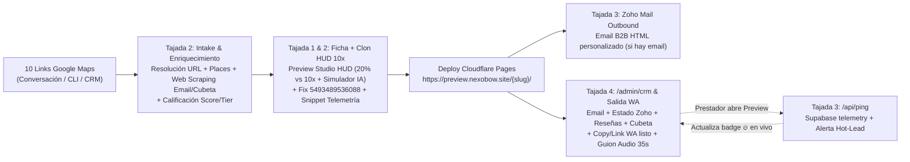

# ⚡ NexoBow — Especificación Técnica Formal: Sistema Final Gate 0 & Lotes de 10 Links Maps (`spec-gate0-validation.md`)

> **Fase del Main Flow:** `[FASE ACTUAL: 2. /to-spec]`  
> **Estado / Triage Label:** `ready-for-agent`  
> **Contratos Anclados:** [`AGENTS.md`](./AGENTS.md) · [`brain.md`](./brain.md) · [`memory.md`](./memory.md) · [`routemap.md`](./routemap.md) · [`GLOSSARY.md`](./GLOSSARY.md) · [`spec-admin-alignment.md`](./spec-admin-alignment.md)

---

## Problem Statement

Hoy NexoBow se encuentra en **Día 0 comercial** (`0` mensajes enviados, `0` **prestadores** pagos activos) aunque la fábrica de **templates** REA, el sitio institucional y el Cockpit administrativo conectado a Supabase ya están construidos. Para salir a validar la oferta **hoy mismo** con `$0` de gasto fijo adicional (**Gate 0**), la prospección asistida inicial operará bajo un flujo simple y repetible: Juanma envía lotes de **10 links de Google Maps**, y el sistema debe calificarlos, enriquecer sus datos reales (email, web actual, WhatsApp, calificación y reseñas), generar y publicar su **landing** personalizada, enviarles un correo profesional desde **Zoho Mail**, y entregar listo el mensaje de WhatsApp junto con el registro completo en el panel `/admin/crm`.

Hoy existen **4 brechas operativas y de conversión** que impiden ejecutar este ciclo sin fricción desde el primer lote:

1. **Sin ingesta por lotes de 10 links directos de Google Maps ni extracción de email/web:** El flujo actual de prospección busca por consultas abiertas y descarta automáticamente a todo **prestador** que tenga una web listada. No admite una lista curada de 10 URLs de Google Maps (links cortos o completos), no inspecciona la web/bio vinculada para extraer el **email** de contacto ni diagnostica si su sitio actual es obsoleto (**Cubeta B**) o inexistente (**Cubeta A**), ni calcula un puntaje de calificación y Tier recomendado.
2. **Riesgo de conversión en la preview y bug crítico de teléfono (`ERROR-006`):** En los 10 `templates`, el componente `ThemeSwitcher` mantiene hardcodeado el teléfono placeholder `"5491100000000"` en lugar del WhatsApp oficial de Juanma (`5493489536088`). Además, cuando un **prestador** abre su preview, no recibe el marco psicológico de **`NexoBow Preview Studio HUD`**: corre el riesgo de creer que ese prototipo rápido es la web definitiva en lugar de ver el salto hacia su **Sistema Final 10x** (dominio propio, fotos reales, **Recepcionista IA 24/7** que atiende audios y **Protocolo Anti-Silla Vacía**).
3. **Ausencia de outbound ejecutivo por Zoho Mail y sensor Hot-Lead en vivo (`/api/ping`):** No existe todavía un módulo de envío de correo profesional desde **Zoho Mail** para prospectos con email extraído, ni está inyectado el snippet pasivo de telemetría (< 1 KB, 0 cookies) conectado a un endpoint `/api/ping` que registre aperturas/cambios de paleta en Supabase y dispare alertas Hot-Lead instantáneas cuando un **prestador** mira su demo.
4. **Fricción en el panel `/admin/crm` para operar lotes de 10 leads:** El CRM muestra datos básicos del **clon**, pero no expone de un vistazo el **email** extraído, el estado del envío en **Zoho Mail**, la web original / enlace a Google Maps (`Cubeta A` vs. `Cubeta B`), el resumen de reseñas reales, la actividad de telemetría en vivo ni botones de 1 clic para copiar el mensaje de WhatsApp listo (ángulo **"Anti-Silla Vacía & Cero-Secretaria"**), leer el guion de audio de 35 segundos o ejecutar seguimiento Hot-Lead.

---

## Solution

Construir e integrar el **Sistema Final de Gate 0** dividido en **4 Tajadas Verticales** acopladas sobre las costuras existentes del repositorio, sin gastos fijos de servidores VPS ni bots automáticos de WhatsApp en frío:



### Tajada 1 — `NexoBow Preview Studio HUD 10x` & Fix WhatsApp `5493489536088` (Ticket #50)
- **Corrección transversal de contacto (`5493489536088`):** Reemplazar el placeholder `"5491100000000"` en los 10 `templates` (`abogado`, `clinica`, `construccion`, `corporativo`, `deportes`, `dermatologia`, `nutricionista`, `producto`, `propiedades`, `tech`) por una referencia única al número oficial de Juanma (`5493489536088`), garantizando que tanto el HTML renderizado como el script de cliente apunten al canal real de cierre.
- **Evolución de `ThemeSwitcher` a `NexoBow Preview Studio HUD`:**
  - Barra/dock discreta de prototipo con badge **`PROTOTIPO CONCEPTUAL · 20%`** e indicador real de expiración **`Reservado 7 días (TTL)`**.
  - Aviso contextual para recursos visuales referenciales: **`"📸 Foto ilustrativa de prototipo — Se reemplaza por fotos reales de tu consultorio y equipo"`**.
  - Modal o drawer comparativo **`"✨ Preview (20%) vs. Tu Sistema Final (10x)"`** que contrapone el prototipo rápido (subdominio temporal, datos públicos de Maps, fotos ilustrativas) contra el sistema productivo (dominio `.com.ar`/`.com` con SSL, curaduría de fotos reales, copy afinado, **Recepcionista IA 24/7 en WhatsApp** que transcribe audios, **Protocolo Anti-Silla Vacía** 24h/2h con lista de espera y **Posicionamiento AEO** en ChatGPT y Google Maps).
  - Mini-simulador interactivo **`"🤖 Probar cómo atiende tu Recepcionista IA"`** con una secuencia demostrativa en voseo argentino (audio/consulta de un **paciente** → respuesta inmediata → **turno automatizado** confirmado).
  - Selector de 4 paletas con persistencia en `localStorage`, actualización dinámica del botón de WhatsApp y despacho del `CustomEvent("theme-switched", { detail: { theme } })` para alimentar la telemetría pasiva.

### Tajada 2 — Pipeline "10 Links de Google Maps → Calificación, Scraping Email/Web & Preview Live" (Ticket #51)
- **Orquestador de Lotes por Links Directos + Skill Operativa:** Nuevo flujo ejecutable que recibe de **1 a 10 links de Google Maps** (URLs cortas tipo `maps.app.goo.gl`, URLs completas `/maps/place/...` o consultas puntuales por línea), resuelve redirecciones públicas sin evadir controles ni CAPTCHAs, y consulta Places API / Serper para extraer: nombre limpio, rubro inferido, dirección y ciudad, teléfono normalizado en formato WhatsApp argentino (`+549...`), rating, cantidad de reseñas, textos de reseñas reales y sitio web o red social declarada.
- **Extractor de Email & Clasificador Cubeta A / B:** Cuando el perfil de Google Maps expone una URL externa (web propia, Linktree, bio pública), el extractor inspecciona el HTML público (página principal y ruta de contacto si existe) para capturar direcciones de **email** válidas (filtrando falsos positivos de activos estáticos o placeholders), links sociales (Instagram, Facebook, WhatsApp) y diagnosticar el estado digital del **prestador**:
  - **Cubeta A (Sin Web / Solo Redes o Directorio):** Máxima prioridad para Tier 1 / Tier 2.
  - **Cubeta B (Web Existente Obsoleta o Lenta):** Evaluada por falta de HTTPS, viewport móvil ausente, generador legado lento o ausencia de embudo directo a WhatsApp/agenda.
- **Motor de Calificación Gate 0 (`qualifyLeadForGate0`):** Puntúa cada **prestador** (`0–100`) combinando: validez de celular WhatsApp, presencia de email, rating y volumen de reseñas en Google Maps, alto margen del nicho (Odontología, Estética/Dermatología, Cirugía, Abogacía, Kinesiología, Nutrición, Psicología) y Cubeta A/B. Asigna automáticamente `tier_recomendado` (`tier_1_starter` `$189.999 ARS` o `tier_2_autonomous` `$549.999 ARS`), `modalidad`, `tipo_consulta`, `canal_agenda` y el ángulo de dolor Hormozi (**"Anti-Silla Vacía & Cero-Secretaria"**).
- **Cadena End-to-End del Lote:** Genera la **ficha de cliente** correlativa (incluyendo `email`, `website_url`, `website_bucket`, `maps_url`, `qualification` y reseñas), compila el **clon** con el HUD 10x y telemetría, despliega a `https://preview.nexobow.site/{slug}/` (desactivable con flag de simulación/no-deploy), sincroniza en Supabase `public.leads`, dispara Zoho Mail (Tajada 3) y devuelve en consola/JSON la lista lista para copiar con Preview URL, estado de Zoho, mensaje de WhatsApp y guion de audio de 35 segundos.

### Tajada 3 — Outbound Profesional con Zoho Mail + Telemetría Hot-Lead `/api/ping` (Ticket #52)
- **Módulo de Outbound Ejecutivo vía Zoho Mail:**
  - Construcción de correo B2B HTML + texto plano en español argentino profesional (voseo respetuoso), evitando palabras gatillo de spam.
  - Contenido personalizado con datos reales del **prestador**: diagnóstico específico de su ficha en Google Maps (`★ rating`, cantidad de reseñas, hallazgo de Cubeta A/B), enlace destacado a su **landing** temporal en `https://preview.nexobow.site/{slug}/`, anclaje de valor concreto (*"evitar apenas 2 sillas vacías por semana cubre el sistema completo"*), aviso de reserva activa por 7 días y contacto directo por respuesta al correo o WhatsApp (`5493489536088`).
  - Transporte SMTP TLS inyectable configurado mediante variables de entorno (`ZOHO_SMTP_HOST`, `ZOHO_SMTP_PORT`, `ZOHO_SMTP_USER`, `ZOHO_SMTP_PASS`, `ZOHO_FROM_NAME`) con soporte de `--dry-run`, tasa controlada para lotes de 10 correos y registro automático del resultado (`sent`, `skipped_no_email`, `dry_run`, `error`, `sent_at`, `message_id`) en `lead.metadata.email_outreach` de Supabase.
- **Telemetría Pasiva (< 1 KB, 0 Cookies) & Endpoint `/api/ping`:**
  - Integración en el proceso de compilación del **clon** del snippet pasivo de `preview-telemetry` apuntando al endpoint unificado `/api/ping`, manteniendo intacta la regla estricta de **0 JS** en la home pública de NexoBow.
  - Nuevo handler Edge/Pages Function en `/api/ping` que valida cumplimiento estricto de la Ley 25.326 (rechaza IPs, cookies o PII en el payload), localiza al **prestador** por `slug` en Supabase, actualiza `metadata.telemetry` (`views_count`, `last_viewed_at`, `last_event`, `selected_theme`, `cta_clicks`, `is_hot_lead: true`) y dispara una **alerta inmediata Hot-Lead** al correo de Juanma (vía Resend API si está configurada o relay configurado) indicando qué profesional está viendo su preview y qué paleta eligió.

### Tajada 4 — Workstation de Prospección en `/admin/crm` & Mensajes Listos para WhatsApp (Ticket #53)
- **Visibilidad Integral del Lote en `/admin/crm` (`CrmView`) y `/admin` (`CockpitView`):**
  - Extensión no destructiva del contrato `LeadMetadata` en JSONB (sin migrar ni romper filas existentes): exposición directa en tarjetas Kanban, tabla de alta densidad y `LeadDrawer` de **Email extraído**, badge de **Zoho Mail** (`✉️ Zoho Enviado` / `⏳ Pendiente` / `Sin Email`), **Web Original / Google Maps** con etiqueta **`Cubeta A`** o **`Cubeta B`**, calificación de **Google Maps** (`★ Rating · N reseñas`) + texto de reseñas en el drawer, score de calificación y badge **`🔥 Hot-Lead`** alimentado en tiempo real por `/api/ping` (mostrando vista previa vista + paleta preferida).
  - Nuevos filtros rápidos en `/admin/crm`: `Con Email`, `Hot-Leads (Vistos)` y `Cubeta A / B`.
  - Modal **`⚡ Lote 10 Links Maps`** en `/admin/crm` para pegar hasta 10 URLs de Google Maps, pre-calificar o disparar el flujo de ingesta/registro directo al CRM.
- **Generador Táctico de WhatsApp Listo (`buildVoseoWhatsAppMessage` & `buildVoseoWhatsAppUrl`):**
  - Botones de 1 clic en tarjeta y drawer: **`📋 Copiar Mensaje WA`** (copia texto al portapapeles con confirmación visual) y **`💬 Abrir WhatsApp`**.
  - Nuevos modos de guion orientados a la oferta irresistible **"Anti-Silla Vacía & Cero-Secretaria"**:
    1. `initial`: Mensaje de apertura personalizado con su zona, rating/Maps, link a la preview 10x y referencia sutil al mail enviado vía Zoho si corresponde.
    2. `audio_script`: Guion cronometrado de **35 segundos** visible en el drawer para que Juanma grabe su nota de voz natural en WhatsApp.
    3. `followup_hot`: Mensaje quirúrgico para enviar dentro de los 5 minutos posteriores a la alerta de `/api/ping` (*"Vi que estuviste chusmeando la demo y probaste la paleta..."*).
    4. Conservación de los modos tácticos `objecion_presencial` y `objecion_arancelada`.

---

## Seams de Prueba y Verificación (Test Seams)

Se definen **4 costuras (seams) de alto nivel** verificables con `node:test` sin depender de red real ni llamadas pagas en CI:

1. **Seam 1 (`Preview HUD 10x & Telemetry Build Seam`):**
   - Verifica que los 10 `templates` contengan el teléfono oficial `5493489536088` y **0 ocurrencias** de `5491100000000`, incluyan los elementos del `Preview Studio HUD` (badge 20%, aviso de fotos ilustrativas, comparador 20% vs 10x, simulador IA y evento `theme-switched`), y que el compilador de sitios inyecte el snippet `< 1 KB` hacia `/api/ping` mientras la landing principal de la agencia mantiene **0 etiquetas `<script>` ejecutables**.
2. **Seam 2 (`Maps 10-Links Intake, Scraping & Qualification Seam`):**
   - Verifica funciones puras y orquestación con proveedores inyectables: parseo/normalización de hasta 10 links de Google Maps (`parseGoogleMapsUrlInput`), extracción sanitizada de emails y redes desde HTML (`extractEmailsFromHtml`, `extractContactFromWebsite`), clasificación `Cubeta A` vs `Cubeta B` (`classifyWebsiteBucket`), calificación y asignación de Tier (`qualifyLeadForGate0`) y salida consolidada de lote sin duplicados.
3. **Seam 3 (`Zoho Outreach & /api/ping Telemetry Seam`):**
   - Verifica `buildZohoOutreachEmail` (asunto, cuerpo HTML/texto con preview URL y diagnóstico Maps en voseo argentino) y `sendZohoOutreachEmail` con transporte mock/dry-run retornando trazabilidad limpia, más el handler `POST /api/ping` rechazando payloads con datos prohibidos por Ley 25.326, actualizando `metadata.telemetry` en Supabase mock y disparando alerta Hot-Lead.
4. **Seam 4 (`Admin CRM Gate 0 Workstation Seam`):**
   - Verifica `resolveLeadMetadata` extendido (retrocompatible con los leads actuales sin `metadata` completo), generación de mensajes para todos los modos (`initial`, `audio_script`, `followup_hot`, `objecion_presencial`, `objecion_arancelada`), visibilidad en el CRM de email/Zoho/Cubeta/reviews/Hot-Lead, preservación de verdad única en Supabase y compilación de la web + admin sin errores.

---

## User Stories

1. As the NexoBow operator at Day 0, I want to submit a batch of up to 10 Google Maps links in a single command or CRM action, so that I can process a full daily prospecting batch without searching one by one.
2. As the NexoBow operator, I want short Google Maps links and full `/maps/place/...` URLs to resolve automatically to the exact business profile, so that I can paste links directly from my phone or browser.
3. As the NexoBow operator, I want the intake pipeline to extract the prestador's name, specialty, formatted address, Argentine WhatsApp number (`+549...`), rating, review count, and real review texts, so that every preview uses authentic social proof compliant with Ley 25.326.
4. As the NexoBow operator, I want the scraper to inspect any website or social link listed on Google Maps to extract valid email addresses and contact links, so that I can reach the prestador by both Zoho Mail and WhatsApp.
5. As the NexoBow operator, I want leads with websites to be classified into Cubeta A (no website / social-only) or Cubeta B (slow, insecure, or outdated website) rather than discarded, so that I never miss high-ticket clinics or law firms that have an ugly WordPress site.
6. As the NexoBow operator, I want each prospect to receive an automatic qualification score (0–100), recommended Tier, modality (`presencial`/`mixto`/`online`), and Hormozi pain angle ("Anti-Silla Vacía & Cero-Secretaria"), so that I prioritize the highest-converting prospects first.
7. As a prestador opening my preview link, I want the floating HUD to show my real advisor's WhatsApp (`5493489536088`) instead of a broken placeholder number, so that when I click "Pedir esta versión" I reach Juanma immediately.
8. As a prestador opening my preview link, I want to see a clear "Prototipo Conceptual · 20%" framing badge and labels on placeholder photos, so that I do not mistake a quick mockup for the final custom product.
9. As a prestador evaluating the preview, I want to open a "Preview (20%) vs. Tu Sistema Final (10x)" comparison modal inside the HUD, so that I understand I am getting custom domain, real photos, AEO, and 24/7 AI reception rather than just a static page.
10. As a prestador evaluating the preview, I want to test an interactive live mini-simulator of the AI Receptionist on WhatsApp inside the HUD, so that I can experience how it answers patient voice notes and prevents empty chairs ("silla vacía") before paying anything.
11. As a prestador who has an email listed on their website or Google profile, I want to receive a concise, non-spam B2B email sent from NexoBow's Zoho Mail containing my Google Maps audit and direct link to my 7-day preview, so that I perceive high executive credibility.
12. As the NexoBow operator, I want Zoho Mail sending to run with configurable SMTP credentials, support dry-run verification, and log delivery status back to Supabase, so that I never double-email a prospect or lose track of bounces.
13. As the NexoBow operator, I want every compiled preview to include a zero-cookie, < 1 KB telemetry ping sent to `/api/ping` whenever a prestador views the landing, switches palettes, or clicks a CTA, so that I know who is interested in real time.
14. As the NexoBow operator, I want `/api/ping` to update the lead's Hot-Lead status in Supabase and notify me immediately via email alert when a prospect opens their preview, so that I can follow up while they are actively looking at it.
15. As the NexoBow operator, I want the home landing page of NexoBow (`nexobow.site`) to remain strictly 0 KB client JavaScript even after adding `/api/ping` and updating `/admin`, so that our agency benchmark stays intact.
16. As the NexoBow operator inside `/admin/crm`, I want every lead card, table row, and drawer to display their extracted email, Zoho Mail status, original website/Maps URL, Cubeta A/B tag, rating/reviews, and live Hot-Lead telemetry badge, so that I have full context on one screen.
17. As the NexoBow operator inside `/admin/crm`, I want 1-click buttons to copy the tailored WhatsApp outreach message, open `wa.me` directly, or view the 35-second voice-note script, so that I can send 10–20 personalized messages and audios in under 30 minutes per day.
18. As the NexoBow operator inside `/admin/crm`, I want a "Follow-up Hot-Lead" message template ready whenever telemetry detects a preview view or palette switch, so that my follow-up feels natural and timely instead of pushy.
19. As the NexoBow operator, I want the batch intake output in the terminal and in `/admin/crm` to list every processed lead with its Preview URL, Zoho status, and ready-to-paste WhatsApp text right after processing the 10 Google Maps links, so that I can start contacting prospects immediately on Day 0.
20. As the NexoBow operator inside `/admin` Cockpit, I want to see recent Hot-Lead views alongside TTL <48h alerts without phantom mock data when online, so that my daily dashboard guides my highest-leverage sales actions first.

---

## Implementation Decisions

### 1. Contrato de Metadatos en `public.leads.metadata` (JSONB No Destructivo)
Se extiende la interfaz `LeadMetadata` definida en [`spec-admin-alignment.md`](./spec-admin-alignment.md) sobre la columna `metadata JSONB` existente, evitando migraciones SQL destructivas y manteniendo retrocompatibilidad con leads anteriores mediante `resolveLeadMetadata(lead)`:

```ts
export interface LeadMetadata {
  // Campos existentes (Ticket #47)
  source?: "inbound_web" | "scout_maps" | "intake_batch" | "manual_crm" | string;
  email?: string | null;
  maps_url?: string | null;
  modalidad?: "presencial" | "mixto" | "online";
  tipo_consulta?: "gratuita" | "arancelada" | "consultar";
  canal_agenda?: "whatsapp_secretaria" | "google_calendar" | "turnero_externo";
  arancel_consulta_ars?: number | null;
  tier_interes?: "tier_1_starter" | "tier_2_autonomous" | "tier_3_growth";

  // Extensiones Gate 0 (Enriquecimiento, Calificación, Zoho & Telemetría)
  website_url?: string | null;
  website_bucket?: "cubeta_a" | "cubeta_b";
  website_audit?: {
    has_https?: boolean;
    has_mobile_viewport?: boolean;
    signals?: string[];
  };
  rating?: number | null;
  reviews_count?: number;
  reviews_summary?: Array<{ author: string; rating?: number; text: string }>;
  qualification?: {
    score: number; // 0..100
    grade: "A" | "B" | "C";
    recommended_tier: "tier_1_starter" | "tier_2_autonomous" | "tier_3_growth";
    reasons: string[];
  };
  email_outreach?: {
    status: "sent" | "skipped_no_email" | "dry_run" | "error";
    provider: "zoho_mail";
    sent_at?: string | null;
    message_id?: string | null;
    subject?: string | null;
    error?: string | null;
  };
  telemetry?: {
    views_count: number;
    last_event?: "preview_view" | "theme_switch" | "cta_click";
    last_viewed_at?: string | null;
    selected_theme?: string | null;
    cta_clicks?: number;
    is_hot_lead?: boolean;
  };
  audio_script_35s?: string | null;
  [key: string]: any;
}
```
*(Nota: Este tipo amplía el contrato `LeadMetadata` establecido en el prototipo operativo de CRM del Frente F).*

### 2. Reglas de Resolución y Enriquecimiento de 10 Links de Google Maps
- **Límite duro por lote:** Se procesan entre 1 y 10 links por ejecución para proteger cuotas de API, calidad de copywriting y ventana de contexto.
- **Resolución de URLs:**
  - Si la entrada es `maps.app.goo.gl/...` o `goo.gl/maps/...`, se sigue la redirección HTTP estándar (`redirect: 'follow'` o lectura de cabecera `location`) para obtener la URL canónica `/maps/place/...`.
  - De la URL canónica se extrae el nombre del lugar, coordenadas (`@lat,lng`) o parámetro `q`/`cid` para consultar la ficha exacta en Serper Places o Google Places API (New).
- **Extracción de Email desde Web/Bio:**
  - Si existe `websiteUri` no excluida o URL pública de bio, se descarga el HTML público (con timeout estricto de `<= 6s` y límite de tamaño) y se escanean enlaces `mailto:` y texto visible, aplicando filtros estrictos contra falsos positivos (`@2x`, `.png`, `.jpg`, `.svg`, `.webp`, `sentry.io`, `wixpress.com`, `example.com`). Si la home no expone correo y hay un enlace interno `/contacto` o `/contact`, se realiza como máximo 1 salto adicional.
  - Se extraen además links públicos de Instagram, Facebook o `wa.me` detectados en la página.
- **Clasificación Cubeta A vs. Cubeta B & Score:**
  - **Cubeta A (`cubeta_a`):** Sin sitio web propio o únicamente link a Instagram, Facebook, Linktree, Doctoralia o `wa.me`.
  - **Cubeta B (`cubeta_b`):** Posee dominio propio. Se diagnostican señales objetivas rápidas (sin HTTPS, ausencia de `<meta name="viewport">`, stack pesado tipo WordPress/Wix/Elementor o ausencia de CTA directo a WhatsApp/turno) para usarlas como argumento real en el correo de Zoho y en el WhatsApp.
  - **Score (`0–100`):** Celular móvil argentino válido (`+35`), Rating `>= 4.3` y reseñas `>= 5` (`+20`), Nicho High-Ticket (`+20`), Cubeta A o Cubeta B con fallas claras (`+15`), Email válido extraído (`+10`).

### 3. Contrato de Zoho Mail Outbound & Variables de Entorno
- El módulo de envío utiliza transporte SMTP TLS estándar sobre Zoho Mail (`smtp.zoho.com`, puerto `465` SSL/TLS o `587` STARTTLS) configurado exclusivamente por variables de entorno (`.env` local y documentación en `.env.example`):
  - `ZOHO_SMTP_HOST` (default `smtp.zoho.com`)
  - `ZOHO_SMTP_PORT` (default `465`)
  - `ZOHO_SMTP_USER` (ej. `juanma@nexobow.site` o dirección configurada en Zoho)
  - `ZOHO_SMTP_PASS` (App Password de Zoho Mail, nunca hardcodeado en código)
  - `ZOHO_FROM_NAME` (default `Juanma Merodio · NexoBow`)
- **Protección contra envíos duplicados y rebotes:** Antes de enviar, verifica si `email_outreach.status === "sent"` para ese prospecto (salvo flag explícito `--force`) y soporta `--dry-run` imprimiendo asunto, destinatario y preview del cuerpo sin conectar al servidor SMTP.

### 4. Contrato del Endpoint de Telemetría `/api/ping` y Snippet en Previews
- **Payload aceptado (`POST /api/ping`):**
  ```json
  {
    "event": "preview_view" | "theme_switch" | "cta_click",
    "slug": "24-centro-odontologico-odonto",
    "timestamp": 1763390000000,
    "meta": { "theme": "Obsidian Gold", "ctaLabel": "Solicitar Turno" },
    "compliance": "Ley 25.326 - 0 Cookies"
  }
  ```
- **Privacidad Ley 25.326:** El endpoint valida que no ingresen claves sensibles (`ip`, `email`, `phone`, `dni`, `cookie`) y nunca lee ni setea cookies HTTP ni persiste la IP del visitante.
- **Efectos al recibir un evento válido:**
  1. Busca el registro en Supabase `public.leads` por `slug` (usando `SUPABASE_SERVICE_ROLE_KEY` en el environment de Cloudflare Pages).
  2. Actualiza `metadata.telemetry` incrementando `views_count` o `cta_clicks`, guardando `selected_theme` si el evento es `theme_switch`, y marcando `is_hot_lead: true`.
  3. Si es la primera vista de sesión o un evento `theme_switch` / `cta_click`, dispara una alerta email instantánea a Juanma usando `RESEND_API_KEY` (si existe) o webhook configurado, con link directo a `/admin/crm` y enlace `wa.me` del prospecto.
  4. Responde HTTP `200` / `204` silencioso con cabeceras CORS controladas para no bloquear `navigator.sendBeacon` ni `fetch(..., { keepalive: true })`.

### 5. Contrato del `Preview Studio HUD` y Preservación de Cero-JS en `web/`
- En los 10 templates de **prestadores**, `ThemeSwitcher` pasa a renderizar el dock `NexoBow Preview Studio HUD` manteniendo la compatibilidad de props y las 4 variables CSS (`--color-primary`, `--color-accent`, `--color-paper`/`--color-bg`, `--color-ink`) y el almacenamiento en `localStorage("nexobow_theme")`.
- El teléfono oficial de contacto de la agencia (`5493489536088`) se mantiene como única verdad compartida en los 10 templates y nunca más se vuelve al fallback `"5491100000000"`.
- El snippet de telemetría inyectado durante el build de sitios de **prestadores** se limita estrictamente a `/sites/{slug}/` y `dist-previews/{slug}/`; la home de `web/` y `/solicitud-enviada/` permanecen **100% libre de `<script>` ejecutables en cliente**.

### 6. Ergonomía en `/admin/crm` y Mensajes Listos para WhatsApp
- Los 5 modos de mensaje (`initial`, `audio_script`, `followup_hot`, `objecion_presencial`, `objecion_arancelada`) se encapsulan como funciones puras exportables (`buildVoseoWhatsAppMessage` y `buildVoseoWhatsAppUrl`) para permitir pruebas unitarias rápidas sin montar React.
- El panel `/admin/crm` permite:
  1. Copiar con 1 clic el mensaje completo listo para pegar en WhatsApp Web / Desktop (en caso de querer editarlo o adjuntar audio antes de enviar) o abrir el enlace `wa.me` directo.
  2. Consultar en el `LeadDrawer` el **guion de audio de 35s**, los datos extraídos de Google Maps (web original, email, reseñas, rating) y el historial de envío de Zoho + aperturas de `/api/ping`.
  3. Pegar un lote de hasta 10 links de Google Maps desde un modal dedicado para registrar/preparar lotes sin salir del panel.

---

## Testing Decisions

- **Qué hace a un buen test aquí:** Validar exclusivamente comportamiento observable y contratos de entrada/salida (HTML renderizado de los templates, ausencia total de `5491100000000`, parseo de URLs de Maps, extracción de emails desde HTML de prueba, puntajes de calificación, generación de payload/HTML de Zoho Mail con transporte mock, validación Ley 25.326 y mutaciones de `/api/ping` sobre mock Supabase, salidas de `buildVoseoWhatsAppMessage`/`buildVoseoWhatsAppUrl`, y build 0-JS de `web/`). Nunca acoplarse a detalles internos de estilos CSS ni hacer peticiones reales a internet, Google Maps, Zoho SMTP o Supabase en tests automatizados.
- **Módulos bajo prueba:**
  1. Suite de templates & Preview Studio HUD + inyección de telemetría en builds de **clones**.
  2. Suite del pipeline de ingesta de 10 links de Google Maps, extractor web de email/Cubeta A-B y calificador Gate 0.
  3. Suite de Zoho Mail outbound (constructor de email + transporte inyectable + actualización de metadata) y endpoint `/api/ping`.
  4. Suite de `/admin/crm` y `/admin` Cockpit (metadatos Gate 0, modos de WhatsApp, filtros, retrocompatibilidad y 0-JS en `web/`).
- **Prior art en el repositorio:** `tests/flexible-booking-funnel.test.mjs`, `tests/theme-switcher.test.mjs`, `tests/preview-telemetry.test.mjs`, `tests/supabase-lead-store.test.mjs`, `tests/admin-cockpit-e2e.test.mjs` y `tests/web-redesign.test.mjs`.

---

## Out of Scope

Quedan **estrictamente congelados** hasta superar **Gate 0** (cobrar los primeros 1 a 3 **Setups** pagos de Tier 1 `$189.999 ARS`):
- Contratación o aprovisionamiento de VPS Hetzner, Docker Compose Zero-Trust, n8n 2.0, PostgreSQL 16 y Redis 7.
- Onboarding productivo de Meta Cloud API (WABA) y Chatwoot satélite.
- Envío masivo automatizado en frío por WhatsApp no oficial (prohibido por riesgo de baneo; WhatsApp permanece semi-asistido desde `/admin/crm`).
- Despliegue de Hermes Agent 24/7, Obsidian Sync por Syncthing, Treg.to gateway y Jev System-1.
- Creación de nuevos **templates** REA congelados (`propiedades`, `farmaceutica`, `profesional`, `turismo`, `musica`) más allá de actualizar el `ThemeSwitcher` de los 10 **templates** actuales a `Preview Studio HUD`.

---

## Further Notes

- **Cumplimiento Legal (Ley 25.326 Argentina):** Tanto el snippet pasivo de telemetría como `/api/ping` operan con **0 cookies** y sin almacenar direcciones IP ni datos sensibles en logs de analítica. Las reseñas de Google Maps se atribuyen explícitamente a `"Google Maps"` con `consentimiento_testimonios: false` hasta contar con autorización expresa del **prestador**.
- **Higiene de Credenciales:** Ninguna credencial (`ZOHO_SMTP_PASS`, `RESEND_API_KEY`, `SUPABASE_SERVICE_ROLE_KEY`, `SERPER_API_KEY`, `GOOGLE_MAPS_API_KEY`) se commitea en archivos del repositorio; todas se documentan en `.env.example` y se inyectan vía `.env` local o Secrets de Cloudflare Pages.
- **Velocidad de Salida Hoy:** El criterio operativo de éxito del Gate 0 es que, con 10 links reales de Google Maps pegados por Juanma, en una sola pasada queden generadas y publicadas las 10 previews con HUD 10x, despachados los correos válidos por Zoho Mail, actualizadas las tarjetas en `/admin/crm` y listos los 10 mensajes/audios de WhatsApp para empezar a conversar hoy mismo.
